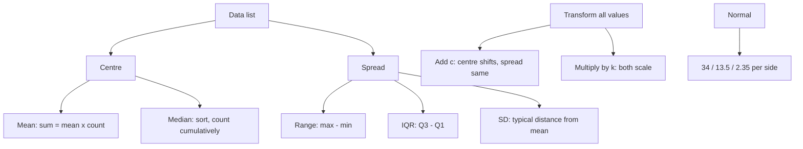

# Q-7: Statistics and Distributions

**Why this matters:** 40 questions here, and the same ideas (median from a table, box plots, weighted means) carry many Q-9 data questions. The GRE asks you to compare spreads far more than to calculate them.

## Mean

- Mean = sum ÷ count, so always work with **sum = mean × count** (ETS 4.2).
- Adding or removing a value: new sum − old sum = the value added (or removed).
- **Deviation method:** pick a guess, add up each value's difference from it. A total of 0 means the guess is the mean; a positive total means the mean is higher.
- **Weighted mean:** (n₁x̄₁ + n₂x̄₂) ÷ (n₁ + n₂). The combined mean sits closer to the larger group. The distances to the combined mean are in the inverse ratio of the group sizes.

## Median, mode, range

- Sort first. With n odd, the median is the middle value; with n even, the mean of the middle two (ETS 4.2).
- In a frequency table count cumulatively; don't take the median of the distinct values.
- For evenly spaced values, median = mean = (first + last) ÷ 2.
- The median ignores extreme values; the mean does not. Large high values pull the mean above the median.
- Mode: the most frequent value; a list can have several or none. Range: greatest − least (ETS 4.2).

## Quartiles and box plots

- ETS rule: Q2 is the median; Q1 is the median of the lower half and Q3 of the upper half of the ordered list (ETS 4.2).
- **IQR = Q3 − Q1**, the spread of the middle half, and not much affected by outliers (ETS 4.2).
- A box plot shows five numbers: least, Q1, median, Q3, greatest. Each part holds about 25% of the data. **It does not show the mean.**
- The p-th percentile is roughly the value with p% of the data below it. Q1 ≈ 25th, median = 50th, Q3 ≈ 75th.

## Standard deviation

- The typical distance of the values from the mean: more spread out, larger SD; clustered near the mean, smaller SD; all equal, SD = 0 (ETS 4.2).
- A value k SDs above the mean is mean + k·SD; the number of SDs from the mean is (value − mean) ÷ SD (ETS 4.2).

| Change to every value | Mean, median, quartiles, min, max | Range, IQR, SD |
|---|---|---|
| add c | + c | no change |
| multiply by k | × k | × \|k\| |

## Normal distribution

- Bell-shaped and symmetric; mean = median = mode (ETS 4.5).
- About two-thirds of the data lie within 1 SD of the mean and almost all within 2 SD (ETS 4.5).
- Finer rule: about 34% between the mean and 1 SD on each side, 13.5% between 1 and 2 SD, 2.35% between 2 and 3 SD, about 2.5% beyond 2 SD in one tail.

## Traps the bank keeps setting

- Taking the median without sorting.
- Averaging two group means without weighting.
- Giving the whole 5% outside ±2 SD to one tail (it is about 2.5% each side).
- "Must be true" against "could be true": a box plot cannot prove anything about the mean or exact counts.
- "Indicate all" can have a single right answer.
- Missing the units on a graph (hundreds of dollars).

## Practise on

- [GRE-k001-main-k-1](/practice/question/GRE-k001-main-k-1) mean against median (QC)
- [GRE-k001-main-k-10](/practice/question/GRE-k001-main-k-10) quartiles and IQR
- [GRE-k001-main-k-14](/practice/question/GRE-k001-main-k-14) mean, median, range (select all)
- [GRE-k001-main-k-6](/practice/question/GRE-k001-main-k-6) greatest value with a fixed median and mean (numeric)
- [GRE-k002-main-h-2](/practice/question/GRE-k002-main-h-2) greatest median with different integers (QC)
- [GRE-t008-s1-s1-7](/practice/question/GRE-t008-s1-s1-7) median of an even count

## Concept map

## Flashcards
Q: Every value in a list is increased by 5. What happens to the mean and the SD?
A: The mean rises by 5; the SD does not change.

Q: Every value is doubled. What happens to the SD?
A: It doubles.

Q: 20 students average 70 and 30 average 80. Combined mean?
A: (1,400 + 2,400)/50 = 76.

Q: How do you find Q1 and Q3 (ETS rule)?
A: Q1 is the median of the lower half, Q3 the median of the upper half of the ordered list.

Q: Does a box plot show the mean?
A: No. Only least, Q1, median, Q3 and greatest.

Q: In a normal distribution, roughly what share lies more than 2 SD above the mean?
A: About 2.5%.

Q: Mean 50, SD 8. How many SDs above the mean is 70?
A: 20/8 = 2.5.

Q: Median of 2, 4, 6, …, 40?
A: Evenly spaced: (2 + 40)/2 = 21.

Q: Mean of 6 numbers is 15; a seventh makes it 17. What was added?
A: 7·17 − 6·15 = 119 − 90 = 29.

Q: Which is less affected by one huge value: the mean or the median?
A: The median.

## Sources
- ETS, *GRE Math Review*, 4.2 Numerical Methods for Describing Data, 4.5 Distributions of Data (normal distribution): https://www.ets.org/pdfs/gre/gre-math-review.pdf
- GRE Quant Lab, statistics formula card in data/k001/main.json (Turkish, translated here), pekalkan/gre-quant-lab @ 9bdc26e
- GRE Quant Lab question bank solutions (traps), translated in this repo
