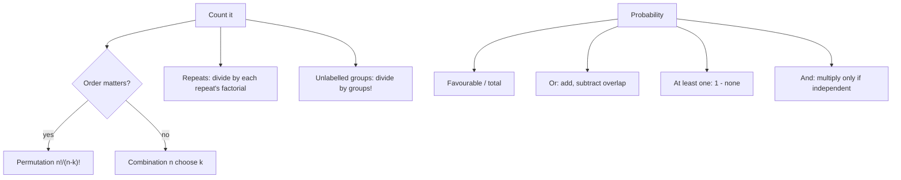

# Q-8: Counting and Probability

**Why this matters:** 47 questions, mostly hard in this bank. The skill is choosing the right count: ordered or not, repeated or not, labelled groups or not.

## Sets

- A ∪ B is everything in A or B or both; A ∩ B is what is in both (ETS 4.3).
- **Inclusion-exclusion:** |A ∪ B| = |A| + |B| − |A ∩ B| (ETS 4.3). For "divisible by 6 or 15", subtract the multiples of the LCM (30), not of the product.
- Without full information, an overlap has a range: from max(0, |A| + |B| − total) up to the smaller set.

## Counting

- **Multiplication principle:** k choices then m choices give km outcomes (ETS 4.3). Fill a restricted position first.
- n! orderings of n different objects (ETS 4.3). Around a circle: (n − 1)!.
- **Permutations:** ordered selections of k from n: n!/(n − k)! (ETS 4.3).
- **Combinations:** unordered selections, n choose k = n!/(k!(n − k)!); C(n, k) = C(n, n − k) (ETS 4.3).
- Repeated letters: divide by a factorial for each repeat. LEVEL: 5!/(2!·2!) = 30.
- "Must be next to each other": glue them into one block, then multiply by the orders inside the block.
- **Unlabelled groups:** split 9 people into 3 teams of 3: C(9,3)·C(6,3)·C(3,3) = 1,680, then divide by 3! = 280.

## Probability

- P(E) = favourable outcomes ÷ total outcomes, when outcomes are equally likely (ETS 4.4).
- **P(E or F) = P(E) + P(F) − P(E and F)** (ETS 4.4).
- Independent events: P(E and F) = P(E)·P(F) (ETS 4.4). Do not assume independence unless it is stated.
- **At least one:** 1 − P(none).
- **Exactly k as the largest:** P(all ≤ k) − P(all ≤ k − 1).
- Conditional ("given that"): shrink the sample space to the cases where the condition holds.
- Binomial: exactly k successes in n tries with chance p: C(n, k)·p^k·(1 − p)^(n−k).
- Symmetry often replaces counting: A is left of B in exactly half of all orders.

## Traps the bank keeps setting

- Counting with repetition when the question says "different" (that means C(n, k)).
- Forgetting to divide by the number of orders for unlabelled teams.
- Assuming independence and multiplying, when the answer is really a range (QC answer often A or B anyway, sometimes D).
- Adding probabilities for "at least one" instead of using the complement.
- Treating 1/2 as the default for "exactly half the coins".

## Practise on

- [GRE-t003-easy-e-9](/practice/question/GRE-t003-easy-e-9) probability of A or B
- [GRE-k002-main-h-4](/practice/question/GRE-k002-main-h-4) bounds on a union (QC)
- [GRE-k003-main-h-1](/practice/question/GRE-k003-main-h-1) bounds on an intersection (QC)
- [GRE-t002-medium-m-9](/practice/question/GRE-t002-medium-m-9) restricted arrangement
- [GRE-t006-hard-h-12](/practice/question/GRE-t006-hard-h-12) repeated letters (numeric)
- [GRE-t001-s1-s1-10](/practice/question/GRE-t001-s1-s1-10) probability (fraction entry)

## Concept map

## Flashcards
Q: Committees of 3 from 9 people. How many?
A: C(9,3) = 84.

Q: Arrangements of the letters of LEVEL?
A: 5!/(2!·2!) = 30.

Q: 5 people around a round table. How many seatings?
A: 4! = 24.

Q: P(E) = 0.6, P(F) = 0.5. What range can P(E and F) take?
A: 0.1 to 0.5.

Q: Probability of at least one rainy day in 3 if each day has a 30% chance (independent)?
A: 1 − 0.7³ = 0.657.

Q: Three fair dice. Probability the largest is exactly 5?
A: (125 − 64)/216 = 61/216.

Q: Two different integers from 1 to 10. Probability their product is even?
A: 1 − C(5,2)/C(10,2) = 1 − 10/45 = 7/9.

Q: Exactly 3 heads in 6 fair tosses?
A: C(6,3)/64 = 20/64 = 5/16.

Q: Numbers from 1 to 999 divisible by 6 or 15?
A: 166 + 66 − 33 = 199.

## Sources
- ETS, *GRE Math Review*, 4.3 Counting Methods, 4.4 Probability: https://www.ets.org/pdfs/gre/gre-math-review.pdf
- GRE Quant Lab question bank solutions (traps), pekalkan/gre-quant-lab @ 9bdc26e, translated in this repo
