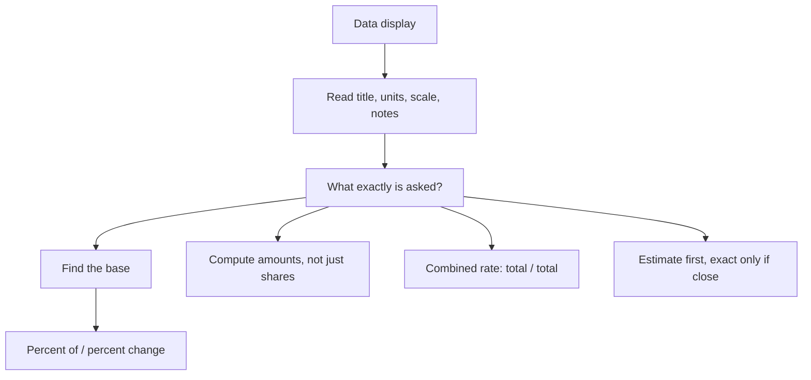

# Q-9: Data Interpretation

**Why this matters:** 10 of the 96 ETS questions. On the test, Data Interpretation sets share one table or graph across several questions. The maths is Q-2 and Q-7; the skill is reading the right number and the right base.

## Reading the display

- Read the title, the axis labels, the units and any note under the figure before the question (ETS 4.1, 4.6).
- Units and scale: "in hundreds of dollars", "in thousands", percent against count.
- Bar and line graphs: compare heights, but read the values off the axis; where lines cross can mislead.
- Circle graphs: each sector is a share of the whole; a share of 12% is 0.12 × 360° = 43.2° of the circle.
- Histograms and frequency tables: to find a median, count cumulatively to the middle position.
- Box plots give five numbers and nothing about the mean (see Q-7).
- Scatter plots: each point is one item; filter by both conditions separately.

## The base

- "What percent of A is B": B ÷ A. Find the base from the sentence, often the subject or the group after "of" (ETS 1.7, 4.6).
- Percent change uses the earlier value as the base.
- A share can fall while the amount rises, when the total grows. Always compute amounts, not just shares.
- If every part keeps its share, every part grows by the same percent as the total.
- Combined rates (people per km², revenue per employee): total ÷ total, never the average of the rates.

## Working fast

- Estimate first; the options are often far apart. Use exact values only when they are close.
- Use the total the table gives rather than adding it again.
- Multiply growth factors for several years: +10% then +20% is ×1.32.
- For "same percent increase next year", apply the ratio, not the amount.

## Numeric entry habits (ETS)

- Read the question again and give the kind of answer asked: units, millions, percent or decimal.
- Round only the final answer, and only if the question says to; otherwise enter the exact value.
- Any equivalent fraction counts in a fraction box; it need not be reduced.

## Concept map

## Flashcards
Q: A category is 12% of a circle graph. Its central angle?
A: 0.12 × 360 = 43.2°.

Q: Region populations differ. How do you find the combined density?
A: Total population ÷ total area, not the average of the densities.

Q: Sales of A fell from 25% to 22% of the total while the total rose 20%. Did A's sales fall?
A: No. 0.22 × 1.2 = 0.264 > 0.25, so they rose.

Q: 108 of the 280 transit users are aged 18 to 29. What percent is that?
A: 108/280 ≈ 38.6%.

Q: Revenue grew from 60 to 75. At the same rate, next year?
A: 75 × 1.25 = 93.75.

Q: When should you round in a numeric entry answer?
A: Only the final answer, and only if told to.

Q: Is 7/9 entered as 14/18 marked right?
A: Yes, equivalent fractions count.

Q: 5% of a group of 700 and 30% of a group of 500. Combined percent?
A: (35 + 150)/1,200 ≈ 15.4%, not the average 17.5%.

## Sources
- ETS, *GRE Math Review*, 4.1 Methods for Presenting Data, 4.6 Data Interpretation Examples, 1.7 Percent: https://www.ets.org/pdfs/gre/gre-math-review.pdf
- ETS, GRE Quantitative Reasoning overview (numeric entry: read carefully, watch units, round only the final answer): https://www.ets.org/gre/test-takers/general-test/prepare/content/quantitative-reasoning.html
