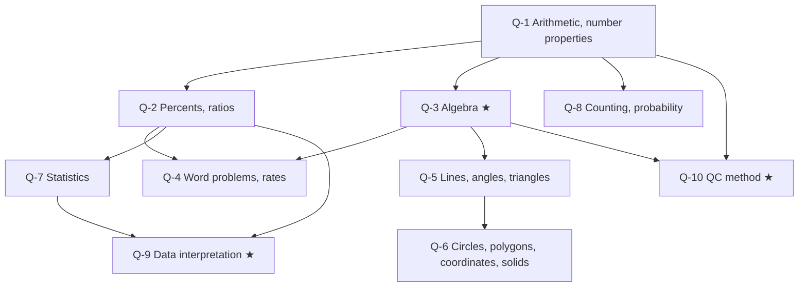

# GRE Quantitative Reasoning: node map

The GRE Quant section has two timed sections (12 questions in 21 minutes, then 15 in 26), with an on-screen calculator. Questions come in four formats: Quantitative Comparison (QC), multiple choice with one answer, multiple choice with every right answer ("select all"), and numeric entry (a number, or a fraction in two boxes). Content is arithmetic, algebra, geometry and data analysis.

The practice bank holds 96 official ETS questions: Practice General Test 1 (35), Practice General Test 3 (35, the same test as the paper-delivered Practice Book) and the 26 Quantitative Reasoning sample questions from the ETS sample questions file (with ETS's own explanations). Each question sits in one content node, chosen by hand from what it asks. Q-10 is a method node: it holds every QC question again, so its 33 questions also count in Q-1 to Q-9. Each node has a topic note built from the official ETS GRE Math Review.

## Nodes

| Node | Topic | Questions | QC | Single | Select all | Numeric | Fraction |
|---|---|---|---|---|---|---|---|
| Q-1 | Arithmetic and number properties | 16 | 5 | 6 | 4 | 1 | 0 |
| Q-2 | Percents and ratios | 12 | 5 | 4 | 1 | 2 | 0 |
| Q-3 | Algebra | 19 | 9 | 9 | 1 | 0 | 0 |
| Q-4 | Word problems and rates (speed, work, flow, mixtures) | 7 | 0 | 4 | 0 | 3 | 0 |
| Q-5 | Lines, angles, triangles | 7 | 4 | 1 | 2 | 0 | 0 |
| Q-6 | Circles, polygons, coordinates, solids | 11 | 6 | 2 | 1 | 0 | 2 |
| Q-7 | Statistics and distributions | 9 | 3 | 3 | 2 | 0 | 1 |
| Q-8 | Counting and probability | 5 | 1 | 3 | 1 | 0 | 0 |
| Q-9 | Data interpretation (tables, graphs) | 10 | 0 | 7 | 1 | 2 | 0 |
| Q-10 | Quantitative Comparison method | 33 | 33 | 0 | 0 | 0 | 0 |

Q-1 to Q-9 add up to 96. Every question that is read from a shared table or graph (the data sets) is in Q-9; a question about a normal distribution or a bar graph of frequencies is in Q-7 because it tests statistics.

By file: 35 in `ets-pt1.json`, 35 in `ets-pt3.json`, 26 in `ets-sample.json`. The 70 Practice General Test questions are answer-key only: ETS publishes no explanations for them, so none is shown. The sample questions carry the ETS explanation.

## Study order

★ marks the exam-focus nodes: Q-3 (the largest content node), Q-9 (data sets) and Q-10 (a third of the bank).

## How the nodes were assigned

By hand, from what each question asks, using the topic split of the ETS GRE Math Review:

- geometry: triangles, angles and lines go to Q-5; anything with a circle, polygon, solid or axes goes to Q-6.
- data: questions that read a shared table or graph go to Q-9; probability and counting to Q-8; mean, median, range, standard deviation and the normal distribution to Q-7.
- arithmetic and algebra: rates, work and cost set-ups go to Q-4; percents, ratios, interest and proportion to Q-2; everything else to Q-3 (algebra) or Q-1 (arithmetic and number properties).

## Source note

All 96 questions are official ETS material, free downloads fetched 2026-11-01 (see `content/sources/gre/ets/SOURCE.txt`). Question wording, figures and options are copied from the ETS files, and every answer is the one in the ETS answer key or sample question explanation. Maths that ETS gives as images or spoken text is typed as HTML. For private study only.
