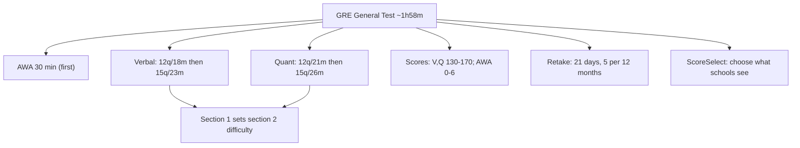

# S-1: Format and Scoring

**Why this matters:** every pacing and target decision rests on the exact format. The GRE changed on 22 September 2023, so older guides with 3 hour 45 minute timings are out of date.

## The test (ETS, since 22 September 2023)

About **1 hour 58 minutes**, five sections. Analytical Writing is always first. Verbal and Quant can come in any order after it.

| Section | Questions | Time |
|---|---|---|
| Analytical Writing | one Analyze an Issue task | 30 min |
| Verbal 1 | 12 | 18 min |
| Verbal 2 | 15 | 23 min |
| Quant 1 | 12 | 21 min |
| Quant 2 | 15 | 26 min |

An unscored section may appear after Analytical Writing, in any order. A research section, if present, comes at the end.

## Adaptivity

Verbal and Quant are **section-level adaptive** (ETS). The first section of each is average difficulty; the second section's difficulty depends on how you did in the first. The scaled score uses the total number correct across both sections and the difficulty of those sections. Raw scores are converted to scaled scores by equating, so a given scaled score means the same level of performance whichever second section you drew.

There is no question-by-question adaptivity, so you can skip around and change answers within a section. Section 1 therefore carries extra weight: a strong first section opens up the harder, higher-scoring second one.

## Score scales

- **Verbal and Quant:** 130 to 170 per section, in one-point steps (ETS, Interpreting GRE Scores).
- **Analytical Writing:** 0 to 6, in half-point steps (ETS). Reported as a single score.
- Scores arrive 8 to 10 days after the test in your ETS account.

## ScoreSelect

You decide which scores each school receives:

- **Most Recent:** the scores from your current test (on test day) or your latest test (after test day).
- **All:** scores from all General Tests in the last 5 years.
- **Any:** one or more tests from the last 5 years, available only after test day.
- Four score reports sent on test day are free. Additional reports ordered later cost US$35 each (checked on ETS's India site; confirm for your region).
- Some programmes require all scores, so check each school.

## Retakes

Once every **21 days**, up to **five times** in any rolling 12-month period (ETS). Cancelled scores still count toward the limit; missed or cancelled appointments do not.

## At-home testing rules to know

- **ID verification (ETS):** complete IDVaaS identity verification at least **72 hours** before your test. If you register inside 72 hours, verify immediately after scheduling. Late verification can delay check-in or stop you testing. ETS' ID page gives the rule as relative, with no calendar date.
- **Applies to tests booked from 31 March 2026** *(the date is from several test-prep sources; ETS's own pages state the 72-hour rule without a date)*.
- **Second camera required since 5 January 2026** *(reported consistently by several test-prep sources, not yet seen on an ETS page; check ETS's at-home page when booking)*. The usual setup described is a phone or tablet linked by QR code to give a side view of the workspace.
- Room rules (ETS): quiet, well lit, clear table, alone, door visible to the proctor, face and both ears visible, no headset, close other apps, check in up to 15 minutes early, and start within 12 minutes of the appointment or the test is cancelled without refund.
- Some business schools do not accept at-home scores. For GMAT, ISB requires a test-centre score (see [[GMAT Strategy - S-5 ISB Context Test Centre Attempts Timeline Target]]). The same goes for GRE: **ISB does not accept online or at-home GMAT or GRE scores** (ISB PGP FAQ, from the April 2025 intake; guides say this covers PGP YL too). For ISB, book a **test centre** GRE.

## Concept map

## Flashcards
Q: How long is the GRE and how many sections?
A: About 1 hour 58 minutes, five sections.

Q: Which section is always first?
A: Analytical Writing (30 minutes).

Q: Verbal sections?
A: 12 questions in 18 minutes, then 15 in 23.

Q: Quant sections?
A: 12 questions in 21 minutes, then 15 in 26.

Q: What does section-level adaptive mean?
A: Section 1 is average difficulty; its result sets the difficulty of section 2.

Q: Score ranges?
A: Verbal and Quant 130 to 170; AWA 0 to 6 in half-point steps.

Q: Retake limit?
A: Once every 21 days, up to five times in a rolling 12 months.

Q: IDVaaS timing for at-home?
A: At least 72 hours before the test.

Q: What does ScoreSelect do?
A: Lets you choose which test scores each school receives.

## Sources
- ETS, test structure (format since 22 September 2023, timings, adaptivity): https://www.ets.org/gre/test-takers/general-test/prepare/test-structure.html
- ETS, Analytical Writing scoring (0 to 6, half points): https://www.ets.org/gre/test-takers/general-test/prepare/content/analytical-writing/scoring.html
- ETS, schedule and retake policy (21 days, five per rolling 12 months): https://www.ets.org/gre/test-takers/general-test/schedule.html
- ETS, ID requirements (IDVaaS 72-hour rule): https://www.ets.org/gre/test-takers/general-test/register/id-requirements.html
- ETS, test at home: https://www.ets.org/gre/test-takers/general-test/test-day/at-home-test-day.html
- ETS, send scores (ScoreSelect): https://www.ets.org/gre/test-takers/general-test/scores/send-scores.html
- ETS, Interpreting GRE Scores (130 to 170 scale): https://www.ets.org/content/dam/ets-org/pdfs/gre/interpreting-gre-scores.pdf
- ISB PGP FAQ (no online or home-based GMAT/GRE scores): https://www.isb.edu/programmes/post-graduate-programmes/pgp-in-management/faqs
- Second camera date (5 January 2026) and the 31 March 2026 IDVaaS booking date: test-prep sources (e.g. Magoosh, Collegedunia), not yet on an ETS page.
