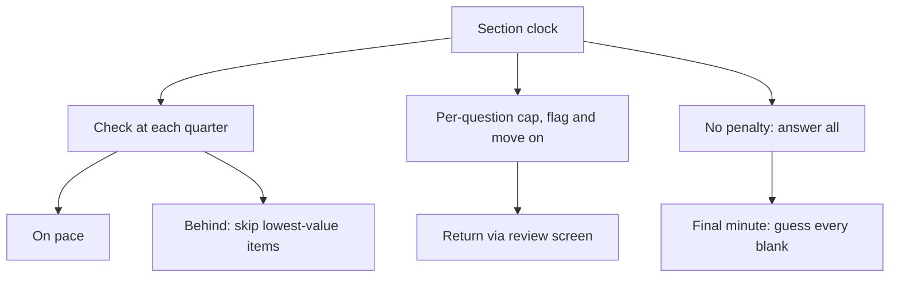

# S-2: Pacing

**Why this matters:** the GRE has short, separate timed sections. Because it is section-level adaptive, you can skip, flag and return inside a section, so pacing is about where you spend the minutes inside each block.

## Average time per question (arithmetic from ETS timings)

| Section | Questions | Time | Average |
|---|---|---|---|
| Verbal 1 | 12 | 18 min | 1 min 30 s |
| Verbal 2 | 15 | 23 min | about 1 min 32 s |
| Quant 1 | 12 | 21 min | 1 min 45 s |
| Quant 2 | 15 | 26 min | about 1 min 44 s |
| AWA | 1 task | 30 min | see [[GRE AWA - A-1 Issue Essay]] |

## Checkpoints (author's plan, proportional to the section clock)

Check the clock at about every quarter of the section.

| Section | Q3 or Q4 by | Halfway question by | Three-quarters by |
|---|---|---|---|
| Verbal 1 (12q, 18m) | Q3 at 13:30 left | Q6 at 9:00 left | Q9 at 4:30 left |
| Verbal 2 (15q, 23m) | Q4 at 17:00 left | Q8 at 11:00 left | Q12 at 5:00 left |
| Quant 1 (12q, 21m) | Q3 at 15:45 left | Q6 at 10:30 left | Q9 at 5:15 left |
| Quant 2 (15q, 26m) | Q4 at 19:00 left | Q8 at 12:00 left | Q12 at 5:00 left |

These are guides, not rules. Passage questions are lumpy: a Reading Comprehension passage of four questions can use six minutes up front.

## Rules that save points

- **Answer everything.** The GRE has no penalty for a wrong answer. Never leave a question blank; guess in the last minute if you must.
- **Cap a single question.** Pick a limit (about 2 minutes for Quant, 1.5 to 2 for Verbal sentence items) and flag and move on when you hit it.
- **Use the review screen.** You can mark questions, jump back and change answers within the current section. Flag fast, return with the time you saved.
- **Do the cheap points first.** Sentence Equivalence and short Text Completions are quick; bank them before long passages.
- **Section 1 matters most.** It sets the difficulty of section 2, so do not rush it, and do not burn so much time that you rush the end.
- **Use the on-screen calculator in Quant** for arithmetic, not for thinking; estimate first to catch slips.

## Between sections

Each section has its own clock; time you save does not carry over. Use the tiny pauses to reset: breathe, drink, look at nothing. The test is a little under two hours with no scheduled break, so take care of focus.

## Review: separate timing from ability

After each timed practice section, mark which questions took more than double the average and which you left to the last 30 seconds. A cluster of late errors points to timing, not knowledge; fix it with checkpoints, not more content.

## Concept map

## Flashcards
Q: Average time per question in Verbal 1?
A: 1 min 30 s (18 min for 12).

Q: Average time per question in Quant 2?
A: About 1 min 44 s (26 min for 15).

Q: Is there a penalty for wrong answers?
A: No. Never leave one blank.

Q: What can you do within a section that you cannot do across sections?
A: Mark, skip and change answers; sections cannot be revisited once finished.

Q: Which section's result sets the next section's difficulty?
A: Section 1 of each measure sets section 2.

Q: A cluster of late wrong answers signals what?
A: A timing problem more than an ability gap.

## Sources
- ETS, test structure (section counts and times): https://www.ets.org/gre/test-takers/general-test/prepare/test-structure.html
- Averages are arithmetic on those timings. Checkpoints, caps and the review routine are the author's own plan.
- "No penalty for wrong answers" and "mark and review within a section" are standard ETS GRE test-taking guidance (not re-verified on a fetched page for this note; confirm in ETS's test-day guidance).
