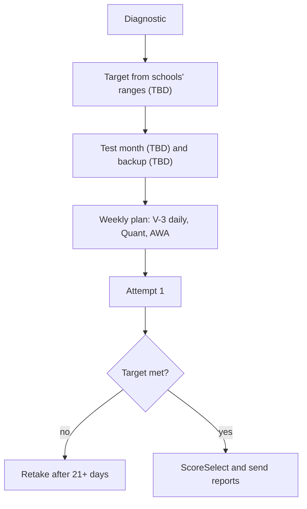

# S-3: Target, Schools and Dates

**Why this matters:** a target score and a date turn a long list of topics into a plan with a deadline. This note holds the frame; the student fills in the blanks.

## Student inputs (fill these in)

| Item | Value |
|---|---|
| Target score, Verbal | **TBD (student to fill in)** |
| Target score, Quant | **TBD (student to fill in)** |
| Target AWA | **TBD (student to fill in)** |
| Test month | **TBD (student to fill in)** |
| Backup test month | **TBD (student to fill in)** |
| School list | **TBD (student to fill in)** |
| Score-report deadline per school | **TBD (student to fill in)** |
| Does each school accept at-home scores? | **TBD (check each school)** |

Do not guess these. Set them after a diagnostic and a look at each programme's published score range.

## Context: the GMAT bar

The student's GMAT goal for ISB PGP YL is a **96th-percentile floor**, not a fixed score (see [[GMAT Strategy - S-5 ISB Context Test Centre Attempts Timeline Target]]). Whatever GRE target you set should be measured against that same bar, so anything you plan on the GRE side should still clear ISB's expectations and the other schools on the list. Whether ISB (or any school on the list) accepts the GRE, and in what form, is **TBD: check the school's current admissions page before relying on a GRE score.**

## How to set the target (method)

1. **Take an ETS PowerPrep test cold.** Note section scores and where time went.
2. **Check each school's published range** (class profile or admissions page) for the score they report, not hearsay.
3. **Pick a target at or above the middle of the range** for your most important school.
4. **Work back from the deadline:** latest test date = score-report deadline minus about 2 weeks. Reports take around 5 business days after you send them (ETS).
5. **Plan for a retake.** You may test once every 21 days, up to five times a year, so book the first attempt early enough to leave room for one more.
6. **Use ScoreSelect** to send only the scores you want, unless a school requires all scores.

## Timeline skeleton

| Stage | Window |
|---|---|
| Diagnostic and gap map | Week 0 |
| Content build (Verbal V-3 daily, Quant nodes, AWA once a week) | Weeks 1 to 8 |
| Timed sections and full mocks | Weeks 6 to 10 |
| Attempt 1 | **TBD (student to fill in)** |
| Review and retake window | 21+ days after attempt 1 |
| Score reports sent | at least 2 weeks before the earliest deadline |

## Concept map

## Flashcards
Q: What is the student's GMAT bar for ISB PGP YL?
A: A 96th-percentile floor, not a fixed score.

Q: Which three inputs are left as TBD in this note?
A: Target score, test month, and school list.

Q: How soon can you retake the GRE?
A: After 21 days, up to five times in a rolling 12 months.

Q: How do you pick a target score?
A: From each school's published range, at or above the middle for the main school.

Q: When should score reports go out?
A: At least about two weeks before the earliest deadline.

Q: What must you check before booking at-home?
A: Whether each school on the list accepts at-home scores.

## Sources
- ETS, schedule and retake policy: https://www.ets.org/gre/test-takers/general-test/schedule.html
- ETS, send scores (ScoreSelect, processing about 5 business days): https://www.ets.org/gre/test-takers/general-test/scores/send-scores.html
- In-repo note for the GMAT bar: [[GMAT Strategy - S-5 ISB Context Test Centre Attempts Timeline Target]]
- Target score, test month and school list: student inputs, not sourced.
