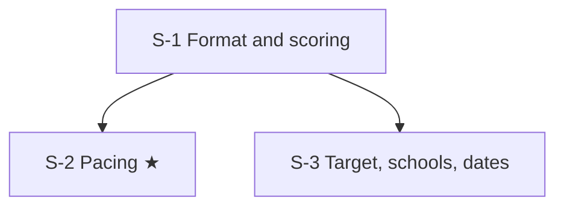

# GRE test strategy: node map

These nodes cover how the test is built, scored and booked, and how to manage the clock, rather than content. Pacing (S-2) is the starred node. The target score, test month and school list in S-3 are placeholders for the student to fill in.

## Nodes

| Node | Topic | Deps | Minutes | Exam focus |
|---|---|---|---|---|
| S-1 | Format and scoring | none | 30 | no |
| S-2 | Pacing | S-1 | 30 | yes |
| S-3 | Target, schools and dates | S-1 | 20 | no |

Total reading time: about 80 minutes.

## Dependency graph

## Headline numbers to know

- About 1 h 58 min: AWA 30 min, Verbal 12q/18 min and 15q/23 min, Quant 12q/21 min and 15q/26 min.
- Section-level adaptive for Verbal and Quant. Verbal and Quant 130 to 170, AWA 0 to 6 in half points.
- Retake every 21 days, up to five times in a rolling 12 months. ScoreSelect picks which scores schools see.
- At home: IDVaaS check at least 72 hours before. Second camera from 5 January 2026 and the 31 March 2026 booking date come from test-prep sources (see S-1). ISB takes test-centre scores only.
