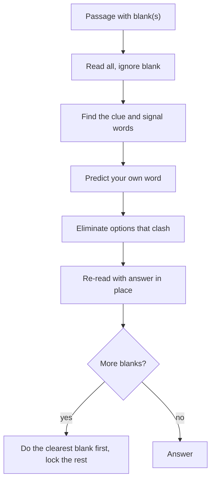

# V-1: Text Completion

**Why this matters:** Text Completion and Sentence Equivalence make up roughly half of Verbal Reasoning (ETS says about half the measure is passage-based and the other half is sentence completion work). Both reward the same habit: decide what the blank must do before you look at the choices.

## The format

ETS describes Text Completion as a short passage with crucial words left out. You pick words or phrases to fill the blanks so the passage becomes coherent. Each passage runs from one to five sentences and has one to three blanks.

- One blank: you choose one word or phrase from the options for it.
- Two or three blanks: each blank has its own set of options, and you answer every blank. A passage is only counted right when the whole set is right, so treat the blanks as a package.

## Method

1. **Read the whole passage once, ignoring the blank.** Find the main claim and any logic words around the blank.
2. **Find the clue.** The blank is almost always fixed by something else in the passage: a contrast, a cause, an example, a definition. Underline it mentally.
3. **Predict a word in your own language.** "Something negative and sudden" is a good prediction. Do not look at the options until you have one.
4. **Match, then eliminate.** Cross out options that clash with the prediction in meaning, in tone or in direction (positive against negative).
5. **Re-read with your answer in place.** The sentence should say something sensible and the passage should flow.
6. **For multi-blank passages, start with the blank that has the clearest clue**, then use it to lock the others.

## Signal words that fix the direction

| Signal | What it tells you about the blank |
|---|---|
| although, however, but, yet, despite, whereas | blank contrasts with the other half of the sentence |
| because, since, therefore, thus, hence | blank continues the same line of reasoning |
| and, moreover, in addition | blank is parallel to a nearby idea |
| not only ... but also | both halves push the same way, the second stronger |
| a colon or dash | what follows explains or defines what came before |
| "rather than", "instead of" | blank is the opposite of the named alternative |

## Traps

- **Picking the fancy word.** Test writers put difficult words in the choices as decoys. A plain word that fits the clue beats a rare word that nearly fits.
- **Half-right pairs.** In a two-blank passage, one option may fit blank 1 well and wreck blank 2.
- **Ignoring tone.** A word can have the right meaning and the wrong feeling (praise against criticism).
- **Reading the sentence in isolation.** The clue is sometimes in the sentence before.
- **Unknown words.** Use roots (see [[GRE Verbal - V-3 Vocabulary]]) and charge. If two choices are unknown and one is known and fits, take the known one.

## Practise on

ETS publishes free Verbal sample items with explanations on its prep pages and in the PowerPrep tests (cited below). Use those. Review each wrong answer by naming the clue you missed.

## Concept map

## Flashcards
Q: How many blanks and sentences can a Text Completion passage have?
A: One to three blanks in one to five sentences (per ETS).

Q: What should you do before reading the answer choices?
A: Find the clue and predict a word in your own language.

Q: When is a multi-blank item scored right?
A: When every blank is right, so check the blanks against each other.

Q: What does "although" tell you about the blank?
A: It contrasts with the other half of the sentence.

Q: A rare word and a plain word both nearly fit. Which first?
A: The one that matches the clue more exactly; rarity is not evidence.

Q: Where can the clue sit besides the same sentence?
A: In the sentence before or after.

Q: What does a colon usually do before a blank?
A: Introduces an explanation or definition of the idea before it.

## Sources
- ETS, Verbal Reasoning measure overview (three question types, about half passage-based, Text Completion format): https://www.ets.org/gre/test-takers/general-test/prepare/content/verbal-reasoning.html
- ETS, Text Completion question type page: https://www.ets.org/gre/test-takers/general-test/prepare/content/verbal-reasoning/text-completion.html
- ETS, PowerPrep practice tests (free): https://www.ets.org/gre/test-takers/general-test/prepare/powerprep.html
