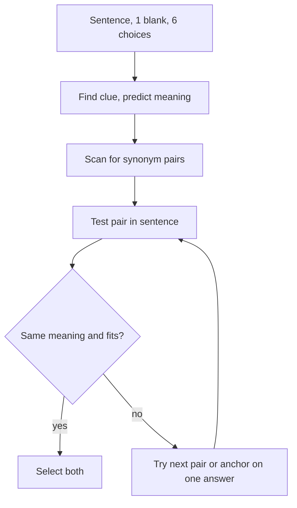

# V-2: Sentence Equivalence

**Why this matters:** it is the fastest Verbal question type to practise and it feeds directly on vocabulary, so it is where word-building pays off first.

## The format

ETS: a single sentence with one blank, six answer choices, and you select the **two** that complete the sentence coherently **and** give it the same meaning. You must pick both correct ones; one right and one wrong earns nothing.

## Method

1. **Treat it as a one-blank Text Completion.** Find the clue and predict a word.
2. **Look for the synonym pair.** The two right answers should mean nearly the same thing in this sentence. Scan the six choices for pairs of near-synonyms first.
3. **Test each candidate in the sentence.** If a pair fits grammatically and in tone, you are close.
4. **Beware pairs that are synonyms but do not fit.** Two words can mean the same and both be wrong for the blank. Always check the pair against the clue.
5. **Beware answers that fit but are not synonyms.** Two words may each make a sensible sentence yet change its meaning. The task asks for the same meaning, so these are decoys.
6. **If no pair is obvious, use the clue to find one answer, then look for its partner.**

## Traps

- A synonym pair that points the wrong way (both words are positive, the clue is negative).
- Two plausible words that give different meanings; only a synonym pair counts.
- Words with several senses: use the sense that suits the sentence, not the one you know best.
- Words with the same core meaning but a different strength or tone (a mild word and a harsh one are usually not a pair).
- Grammar: the blank's part of speech must match, and so must any following preposition.

## Practise on

ETS Verbal samples and PowerPrep (cited below). After each miss, write the pair you chose and why the real pair beat it.

## Concept map

## Flashcards
Q: How many answers do you select in Sentence Equivalence?
A: Two, out of six.

Q: What two conditions must the pair meet?
A: Both complete the sentence coherently and give it the same meaning.

Q: Two choices fit but give different meanings. Right pair?
A: No. They must produce the same meaning.

Q: Two synonyms, but neither fits the clue. Right pair?
A: No. Always test against the clue.

Q: Quick first move on a Sentence Equivalence item?
A: Predict the meaning, then scan the six choices for synonym pairs.

Q: Partial credit for one right word?
A: No.

**Practise on:** GRE Verbal, official ETS questions in `content/tests/gre-verbal/` (16 questions: 2 sample items in `ets-sample.json`, 7 in `ets-pt1.json`, 7 in `ets-pt3.json`).

## Sources
- ETS, Verbal Reasoning measure overview (Sentence Equivalence: one blank, choose two answers with the same meaning): https://www.ets.org/gre/test-takers/general-test/prepare/content/verbal-reasoning.html
- ETS, Sentence Equivalence question type page: https://www.ets.org/gre/test-takers/general-test/prepare/content/verbal-reasoning/sentence-equivalence.html
- ETS, PowerPrep practice tests (free): https://www.ets.org/gre/test-takers/general-test/prepare/powerprep.html
