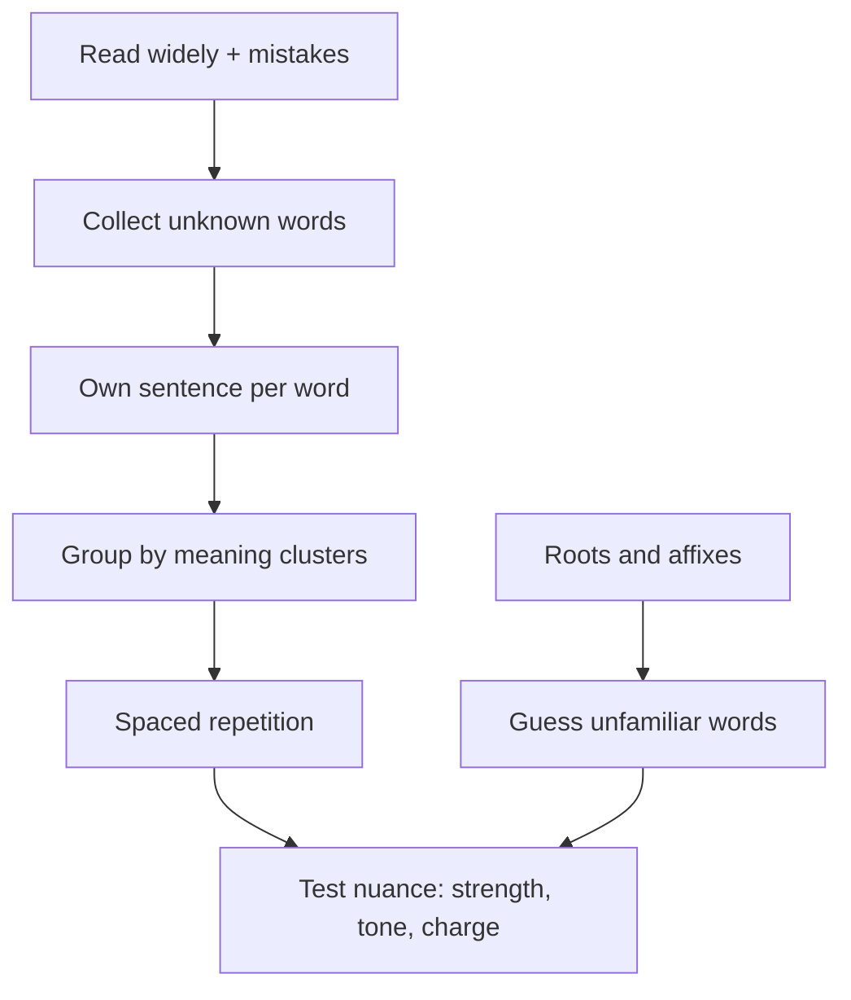

# V-3: Vocabulary

**Why this matters:** vocabulary is the one Verbal skill that cannot be improvised on test day. It drives Text Completion and Sentence Equivalence directly and helps Reading Comprehension indirectly. It is also the only part that rewards a daily routine over a one-off push.

This note is a method, not a word list. Build your own list from words you actually meet.

## How to build it

1. **Collect from real reading.** Read two or three dense pieces a week (long-form essays, science and economics journalism, book reviews). The GRE draws on books and periodicals across the sciences, social sciences, business and humanities (ETS). Note every word you could not define.
2. **Collect from your mistakes.** Every missed Text Completion or Sentence Equivalence item gives you at least one word for the list.
3. **Learn words with a sentence, not a gloss.** Write a short sentence of your own that shows the word's tone and use. A bare one-word definition does not survive a sentence with a twist.
4. **Group by meaning, not by alphabet.** Make buckets: praise, criticism, secrecy, change, stubbornness, brevity, excess. The test builds synonym pairs (see [[GRE Verbal - V-2 Sentence Equivalence]]), so clusters are exactly what you need.
5. **Space the reviews.** Use a spaced repetition app or flashcards: new cards daily, review the due ones first. A steady 15 to 20 new words a day beats cramming.
6. **Test the nuance.** For each cluster, ask which word is stronger, which is formal, which has a negative charge.
7. **Cap the list.** Stop adding words about two weeks before the test and shift to review and timed practice.

## Word roots that unlock many words

Learn the root, then guess unfamiliar words around it. A few illustrations per root only.

| Root or affix | Core idea | Example words |
|---|---|---|
| bene, bon | good | benevolent, benign |
| mal, male | bad | malice, malevolent |
| dict, dic | say | verdict, dictum |
| loqu, locut | speak | eloquent, loquacious |
| scrib, script | write | transcribe, inscription |
| spec, spic | look | inspect, perspicacious |
| vert, vers | turn | divert, aversion |
| ten, tain | hold | tenacious, retain |
| pel, puls | drive | repel, compulsion |
| chron | time | chronic, anachronism |
| anthrop | human | misanthrope, philanthropy |
| ambi, amphi | both, around | ambivalent, ambiguous |
| circum | around | circumvent, circumspect |
| un-, in-, im-, il-, ir- | not | unwavering, inexorable |
| ab-, dis- | away, apart | abstain, dispel |
| -ous, -ive | having the quality of | tenacious, reticent |

Use roots as a hint, not a proof. Many words drifted from their roots, so confirm with context.

## High-frequency word families (by meaning)

The test returns again and again to a handful of ideas. Make a cluster for each and fill it from your own reading.

- **Praise and flattery** versus **criticism and ridicule**.
- **Stubbornness**, **obstinacy**, **unwillingness to change** versus **flexibility**, **yielding**.
- **Brevity** versus **wordiness**.
- **Secrecy**, **concealment** versus **openness**.
- **Moderation**, **restraint** versus **excess**, **extravagance**.
- **Temporary**, **short-lived** versus **lasting**.
- **Skepticism**, **doubt** versus **credulity**.
- **Calm**, **soothe**, **ease** versus **provoke**, **aggravate**.
- **Obscure**, **vague** versus **clear**, **plain**.
- **Novel**, **original** versus **conventional**, **stale**.
- **Harmless** versus **harmful**.
- **Support**, **bolster** versus **undermine**, **weaken**.

## Handling an unknown word on test day

1. Use the clue in the sentence: a contrast or cause tells you the direction.
2. Use a root or affix to guess the charge (positive, negative, neutral).
3. Use a familiar relative word ("sounds like ...").
4. If still stuck, pick the answer you know fits the clue and move on. Do not pick a word only because it is unfamiliar.

## Concept map

## Flashcards
Q: Why group words by meaning instead of alphabetically?
A: Sentence Equivalence needs synonym pairs, and clusters train exactly that.

Q: What should each vocabulary card carry besides a definition?
A: A sentence of your own showing tone and use.

Q: What is the role of a root?
A: A hint for the word's core idea or charge, to be checked against context.

Q: What does the prefix "mal" signal?
A: Something bad.

Q: What does the prefix "bene" signal?
A: Something good.

Q: What do you do with an unknown word in the choices?
A: Use the clue and roots to guess its charge; do not choose it just because it is rare.

Q: Where do GRE passages come from?
A: Books and periodicals in sciences, social sciences, business, arts and humanities, and everyday topics (ETS).

Q: When should you stop adding new words?
A: About two weeks before the test, to focus on review and timed practice.

## Sources
- ETS, Verbal Reasoning measure overview (what the measure assesses; relationships among words and concepts): https://www.ets.org/gre/test-takers/general-test/prepare/content/verbal-reasoning.html
- ETS, Reading Comprehension question type page (passage source subjects): https://www.ets.org/gre/test-takers/general-test/prepare/content/verbal-reasoning/reading-comprehension.html
- Study method (spaced review, clustering, roots) is the author's synthesis, not an ETS claim.
