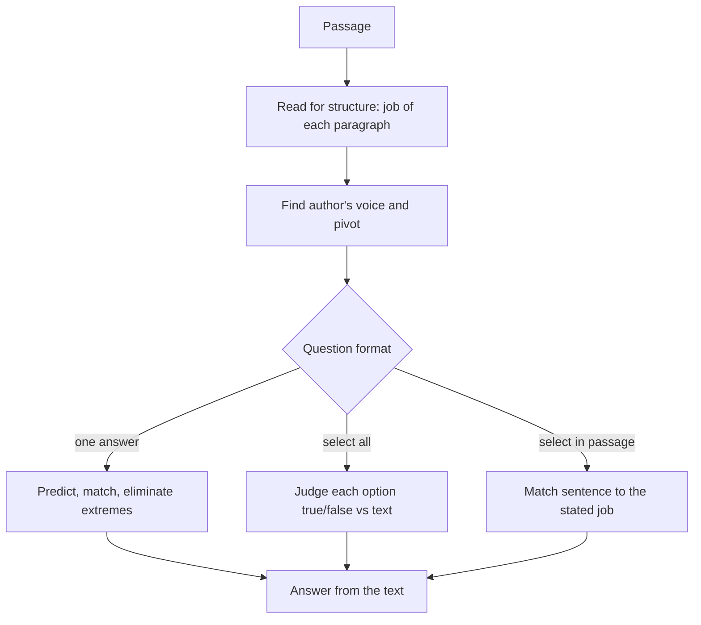

# V-4: Reading Comprehension

**Why this matters:** about half of the Verbal questions are passage-based (ETS). It is the largest block of the section and the one where pacing matters most.

## The format (ETS)

- Each passage has between one and six questions. Most passages are one paragraph; one or two are several paragraphs.
- Passages come from books and periodicals, academic and non-academic: physical sciences, biological sciences, social sciences, business, arts and humanities, everyday topics.
- Three question formats:
  1. **Select one answer** (multiple choice, one correct).
  2. **Select all that apply** (multiple correct answers, ETS says to select multiple; there is no partial credit, so treat each option as true or false against the passage).
  3. **Select in passage** (click the sentence in the passage that does a stated job).

## What the questions test

ETS lists the skills: the meaning of words and sentences, the meaning of paragraphs, major versus minor points, summarising, drawing conclusions, inferring missing information, structure of the text, the author's assumptions and perspective, strengths and weaknesses of a position, and alternative explanations.

## Method

1. **Read for the structure, not the detail.** After each paragraph, say its job in four words (states claim, gives example, raises objection, proposes fix). Keep these notes light.
2. **Find the author's voice.** Is the author describing, defending, criticising, or weighing? Words like "however", "surprisingly" and "critics" mark the pivot.
3. **Read the question stem before hunting.** Decide: main idea, detail, inference, function, or evaluation.
4. **Go back to the text for every answer.** The correct option must be supported by the passage, not by outside knowledge.
5. **Eliminate with the usual suspects.** Too extreme (always, never, only), outside scope, reverses the claim, true but not asked.

## Handling each format

| Format | Approach |
|---|---|
| Select one | Predict from the text, then match. Kill extreme and out-of-scope options. |
| Select all | Judge each option alone: supported, contradicted, or not stated. Pick only the supported ones. Do not stop at the first right one. At least one is correct. |
| Select in passage | Know the job the sentence must do (states the conclusion, gives the evidence, shows a contrast). Re-read candidate sentences with that job in mind. Often the answer is the sentence that does exactly that and nothing else. |

## Question types and what they ask

- **Main idea / primary purpose:** the thread across the whole passage. Avoid options that cover only one paragraph.
- **Detail:** quote-level support exists. Find it.
- **Inference:** something that must be true given the passage, usually one small step beyond the words.
- **Function of a sentence or paragraph:** why does the author include it? Answer in terms of role, not content.
- **Author's attitude:** tone words in the passage. Moderate wording, not extreme.
- **Evaluate or weaken or strengthen:** treat it as an argument task (see [[GRE Verbal - V-5 Argument Passages]]).

## Traps

- Choosing a statement that is true in the real world but not in the passage.
- Reading "may" as "will" or "some" as "all".
- Picking the option that repeats passage words but twists the logic.
- Spending two minutes on the first passage and starving the last.
- On select-all, selecting an option that is only partly supported.

## Pace

Section 1 gives 12 questions in 18 minutes, section 2 gives 15 in 23 (ETS), so about a minute and a half per question on average. Reading a long passage is the cost; budget it as a bundle and move on when the bundle's budget is spent.

## Concept map

## Flashcards
Q: How many questions can one RC passage carry?
A: One to six (ETS).

Q: What are the three RC question formats?
A: Select one answer, select all that apply, select a sentence in the passage.

Q: On a select-all question, how many answers are correct?
A: One or more; judge each option on its own against the passage.

Q: What must every correct RC answer have?
A: Support in the passage itself, not outside knowledge.

Q: What is the first job when reading a paragraph?
A: Name what the paragraph does (claims, illustrates, objects, resolves).

Q: For a function question, what do you answer in terms of?
A: The role the sentence plays, not its content.

Q: Which wording often signals a wrong option?
A: Extreme words such as always, never, only, all.

Q: Average time per Verbal question?
A: About 1.5 minutes (18 min for 12, or 23 min for 15).

**Practise on:** GRE Verbal, official ETS questions in `content/tests/gre-verbal/` (32 questions, plus the 5 argument questions in V-5 that also count here: 3 sample items in `ets-sample.json` (single answer, select all, select-in-passage), 15 (+2) in `ets-pt1.json`, 14 (+3) in `ets-pt3.json`; includes single answer, select all, select-in-passage and indicated-portion function questions).

## Sources
- ETS, Verbal Reasoning measure overview: https://www.ets.org/gre/test-takers/general-test/prepare/content/verbal-reasoning.html
- ETS, Reading Comprehension question type page (formats, skills, passage sources, one to six questions per passage): https://www.ets.org/gre/test-takers/general-test/prepare/content/verbal-reasoning/reading-comprehension.html
- ETS, test structure (Verbal section sizes and timing): https://www.ets.org/gre/test-takers/general-test/prepare/test-structure.html
