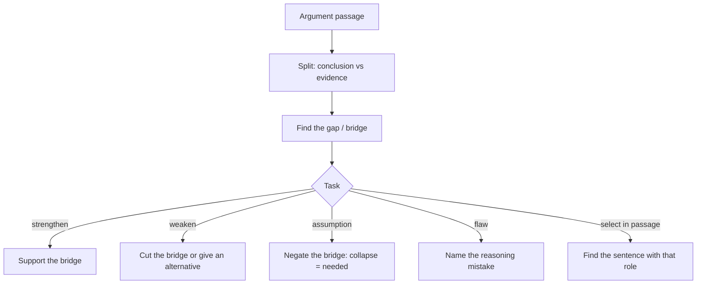

# V-5: Argument Passages

**Why this matters:** some short GRE passages are arguments rather than descriptions, and their questions ask you to judge the reasoning. ETS lists, among the skills tested, identifying the author's assumptions and perspective, finding strengths and weaknesses of a position, and developing alternative explanations. That is the same skill set the GMAT calls Critical Reasoning, so you can reuse that training.

## Spot an argument passage

A short block (often one paragraph) that states a conclusion and gives reasons or evidence, then the question asks what supports it, weakens it, what it assumes, or what the flaw is. Words to watch for: "therefore", "thus", "shows that", "proves", "because", "suggests".

## Method

1. **Split it.** Conclusion (what the author wants you to accept) and evidence (why). Everything else is background.
2. **Find the gap.** Arguments fail at the jump from evidence to conclusion: the evidence is about one thing, the conclusion about another.
3. **Name the assumption.** What must be true for the evidence to support the conclusion? A good one is usually the "bridge" between the two.
4. **Answer the task:**
   - **Strengthen:** the option that makes the bridge more likely.
   - **Weaken:** the option that cuts the bridge, offers an alternative cause, or shows the evidence is unrepresentative.
   - **Assumption:** the bridge itself. Test by negating it: if the argument collapses, it was needed.
   - **Flaw:** name the mistake (correlation as cause, a sample that is not representative, a shift of scope).
   - **Inference:** what must be true if the passage is true, one small step only.
5. **Select-all variants:** judge each option separately against the same test.

## Where it overlaps with the GMAT notes

Use these in the repo; the logic is the same, only the answer format changes (the GRE adds select-all and select-in-passage).

- Anatomy of an argument (conclusion, evidence, assumption): [[GMAT Verbal - V-1 Argument Anatomy]]
- Assumption, strengthen, weaken: [[GMAT Verbal - V-2 Assumption Strengthen Weaken]]
- Evaluate, boldface role and flaw: [[GMAT Verbal - V-3 Evaluate Boldface Role and Flaw]]
- Inference and explain-the-discrepancy: [[GMAT Verbal - V-4 Inference and Explain the Discrepancy]]

## Differences from GMAT CR to remember

- GRE argument questions sit inside Reading Comprehension, so the passage may be a little longer and more academic in tone.
- The GRE has **select-in-passage** formats: "select the sentence that states the conclusion" or "that provides the evidence". Use the split from step 1.
- GRE **select-all** can combine several roles (several weakeners, several assumptions). Test each option on its own.

## Traps

- Choosing an option that is relevant to the topic but not to the gap.
- Treating a strengthener as a necessary assumption (strengthening is weaker than needed).
- Bringing in outside knowledge to rescue the author.
- Reversing direction on weaken versus strengthen under time pressure; re-read the stem.

## Concept map

## Flashcards
Q: First step on an argument passage?
A: Separate conclusion from evidence.

Q: Where do arguments usually fail?
A: At the jump from evidence to conclusion (the unstated bridge).

Q: How do you test whether an option is a necessary assumption?
A: Negate it; if the argument falls apart, it was needed.

Q: What does a weakener do?
A: Cuts the bridge, offers an alternative explanation, or shows the evidence is unrepresentative.

Q: Which GMAT note covers conclusion, evidence and assumption?
A: [[GMAT Verbal - V-1 Argument Anatomy]].

Q: Which GRE format has no GMAT equivalent?
A: Select-in-passage (and select-all).

Q: Strengthener versus necessary assumption?
A: A strengthener helps; a necessary assumption must be true. Not the same.

## Sources
- ETS, Reading Comprehension question type page (skills tested include assumptions, strengths and weaknesses, alternative explanations; question formats): https://www.ets.org/gre/test-takers/general-test/prepare/content/verbal-reasoning/reading-comprehension.html
- ETS, Verbal Reasoning measure overview: https://www.ets.org/gre/test-takers/general-test/prepare/content/verbal-reasoning.html
- In-repo notes: the four GMAT Verbal V-1 to V-4 links above.
