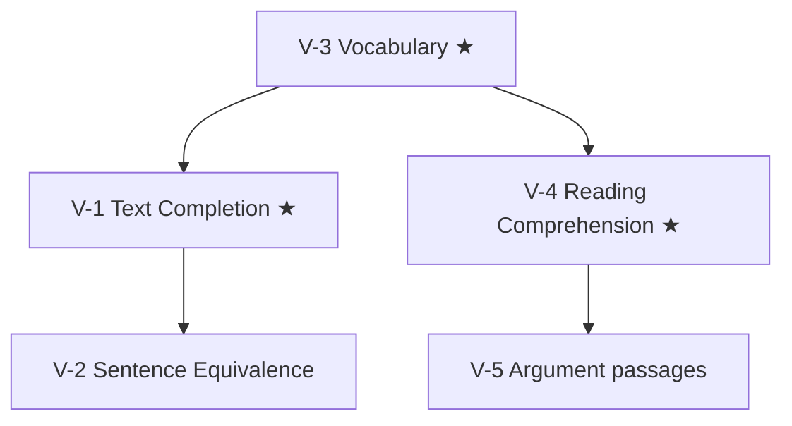

# GRE Verbal Reasoning: node map

The Verbal measure has two timed sections: 12 questions in 18 minutes, then 15 in 23 (ETS, format since 22 September 2023). It is section-level adaptive: the first section is average difficulty, and your result there sets the difficulty of the second. ETS names three question types: Reading Comprehension, Text Completion and Sentence Equivalence. About half the questions are passage-based.

These notes are method and study guides. There is no question bank for this section yet; practise from ETS's free samples and PowerPrep tests, and log mistakes in the Error book.

## Nodes

| Node | Topic | Deps | Minutes | Exam focus |
|---|---|---|---|---|
| V-1 | Text Completion | none | 45 | yes |
| V-2 | Sentence Equivalence | V-1 | 30 | no |
| V-3 | Vocabulary (build, roots, word families) | none | 60 | yes |
| V-4 | Reading Comprehension (incl. select-in-passage, select all) | V-3 | 60 | yes |
| V-5 | Argument passages | V-4 | 40 | no |

Total reading time: about 235 minutes. Vocabulary is a daily habit, not a one-sitting node.

## Study order

★ marks the exam-focus nodes. Start V-3 on day one and keep it running alongside the others.

## Reuse from GMAT

V-5 links to the GMAT Critical Reasoning notes ([[GMAT Verbal - V-1 Argument Anatomy]] to [[GMAT Verbal - V-4 Inference and Explain the Discrepancy]]). The reasoning is the same; the GRE adds select-all and select-in-passage formats.
