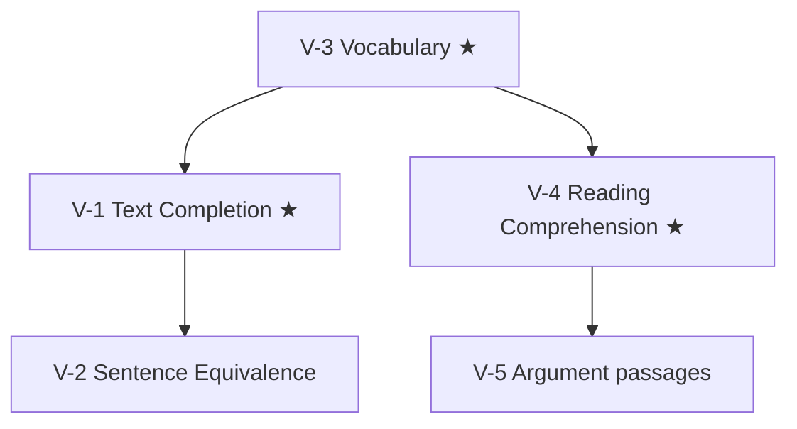

# GRE Verbal Reasoning: node map

The Verbal measure has two timed sections: 12 questions in 18 minutes, then 15 in 23 (ETS, format since 22 September 2023). It is section-level adaptive: the first section is average difficulty, and your result there sets the difficulty of the second. ETS names three question types: Reading Comprehension, Text Completion and Sentence Equivalence. About half the questions are passage-based.

These notes are method and study guides. The practice bank holds 77 official ETS Verbal questions (see Practice questions below); log mistakes in the Error book.

## Nodes

| Node | Topic | Deps | Minutes | Exam focus |
|---|---|---|---|---|
| V-1 | Text Completion | none | 45 | yes |
| V-2 | Sentence Equivalence | V-1 | 30 | no |
| V-3 | Vocabulary (build, roots, word families) | none | 60 | yes |
| V-4 | Reading Comprehension (incl. select-in-passage, select all) | V-3 | 60 | yes |
| V-5 | Argument passages | V-4 | 40 | no |

Total reading time: about 235 minutes. Vocabulary is a daily habit, not a one-sitting node.

## Study order

★ marks the exam-focus nodes. Start V-3 on day one and keep it running alongside the others.

## Reuse from GMAT

V-5 links to the GMAT Critical Reasoning notes ([[GMAT Verbal - V-1 Argument Anatomy]] to [[GMAT Verbal - V-4 Inference and Explain the Discrepancy]]). The reasoning is the same; the GRE adds select-all and select-in-passage formats.

## Practice questions

The practice bank holds 77 official ETS questions: Practice General Test 1 (35), Practice General Test 3 (35; the same test as the paper-delivered Practice Book) and the 7 Verbal sample questions from the ETS sample questions file (with ETS's own explanations). Each question sits in one node, chosen by hand from what it asks; ETS does not tag its questions. Questions that ask you to judge an argument (assumption, strengthen, weaken, what must be true) are in V-5 and also count in V-4. V-3 (Vocabulary) has no questions; it is a daily habit.

| Node | Topic | Questions | Single answer | Multi |
|---|---|---|---|---|
| V-1 | Text Completion | 24 | 9 | 15 |
| V-2 | Sentence Equivalence | 16 | 0 | 16 |
| V-4 | Reading Comprehension | 32 (37 with the 5 shared from V-5) | 23 (28 with V-5) | 9 |
| V-5 | Argument passages | 5 | 5 | 0 |

V-1, V-2, V-4 and V-5 add up to 77 (24 + 16 + 32 + 5). "Single answer" is one blank or one choice. "Multi" is a Text Completion with two or three blanks (one choice per blank), a Sentence Equivalence (exactly two) or a Reading Comprehension select-all (one or more of three). Select-in-passage questions (2: one in the sample, one in Practice Test 1) are in V-4 as single answer, with the passage's sentences given as the choices.

By file:

| File | Questions | V-1 | V-2 | V-4 | V-5 |
|---|---|---|---|---|---|
| `ets-pt1.json` | 35 | 11 | 7 | 15 | 2 |
| `ets-pt3.json` | 35 | 11 | 7 | 14 | 3 |
| `ets-sample.json` | 7 | 2 | 2 | 3 | 0 |

The 70 Practice General Test questions are answer-key only: ETS publishes no explanations, so none is shown, except that where the key gives "Answer in Context" for a Text Completion item, that sentence is shown. The sample questions carry the ETS explanation. All 77 are official ETS material (see `content/sources/gre/ets/SOURCE.txt`): wording, passages and options are copied from the ETS files and every answer is the one in the ETS answer key or sample explanation. For private study only.
