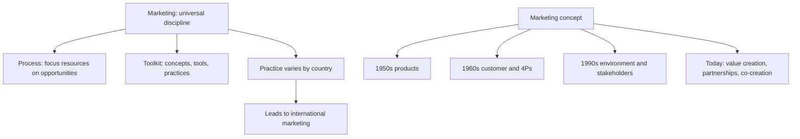

# GM-1: Marketing as a Universal Discipline and the Marketing Concept

Covers: the two faculty definitions of marketing, why practice still differs by country, and how the marketing concept moved from products (1950s) to co-creation (today). **(class)**

## Marketing as a universal discipline (class)
The slides give two ways to read the word marketing.
| Reading | Faculty wording |
|---|---|
| Marketing (1): a process | The process of focusing the resources and objectives of an organisation on environmental opportunities and needs. |
| Marketing (2): a toolkit | A set of concepts, tools, theories, practices, procedures and experiences. |
**Key line to write:** marketing is a universal discipline, but marketing practice varies from country to country. The concepts travel; the market, the customer and the rules do not. This one sentence is the bridge to international marketing (see GM-2 and GM-3).

## The marketing concept across time (class)
The concept "has changed dramatically". Learn it as a timeline.
| Period | Focus (slide) | Detail |
|---|---|---|
| 1950s | Products | Make a good product and it sells **(general)** |
| 1960s | Customer orientation | Marketing mix developed, the 4Ps; the four Ps are product, price, place, promotion **(general)** |
| 1990s | Customer in the broader external environment; stakeholder value | Competition, government policy and regulation; value for employees, customers, shareholders, society |
| Today | Two key tasks; strategic partnerships; co-creation | See below |

### Today (class)
- **Two key tasks:** (1) focus on the customer and his or her environment; (2) create value for consumers and stakeholders.
- **Shift towards** managing strategic partnerships, and positioning the firm in the value chain to optimise value creation.
- **Profit is a measure of success, not an end in itself.**
- **Customer co-creation:** the customer helps shape the offer, not just buy it **(general)**.

**(general)** Textbooks label the stages production, product, selling, marketing and societal orientation. The slides use decades instead; in the exam use the slide decades and mention the textbook labels in one line at most.

## Why the 1990s shift matters internationally
The 1990s version adds competition, government policy and regulation. These are exactly the things that change when a firm crosses a border, so international marketing needs the broader-environment version of the concept, not the 1950s product version.

## Worked example: classify the stage (illustrative)
Task: place each statement in the correct era of the marketing concept.
1. "We make the best steel pipe in the country; customers will come." Era: 1950s, product focus.
2. "We surveyed households and added a 4P plan for each segment." Era: 1960s, customer orientation and the 4Ps.
3. "We changed the pack size after a new import-duty rule and a competitor's price cut." Era: 1990s, customer in the external environment (policy, competition).
4. "Employees, farmers and the community share in our scorecard, not only shareholders." Era: 1990s stakeholder value.
5. "Customers design their own variants on our app and our supplier co-develops the part." Era: today, co-creation and strategic partnerships.

Decision line: the later the era, the wider the circle the firm is expected to serve. Interpretation: that wider circle is why a global firm must read each country's environment before it sells.

## 5-mark skeleton: "Explain the evolution of the marketing concept"
Two definitions of marketing (1); 1950s product and 1960s customer plus 4Ps (1); 1990s broader environment and stakeholders (1); today: two tasks, partnerships, profit as a measure, co-creation (1); close with universal discipline but local practice (1).

## What to remember
- Marketing (1) is a process of focusing resources on opportunities and needs; Marketing (2) is a set of concepts and tools.
- Universal discipline, but practice varies by country.
- 1950s products; 1960s customer and 4Ps; 1990s environment and stakeholders; today value creation and co-creation.
- Profit is a measure of success, not an end in itself.
- Stakeholders on the slide: employees, customers, shareholders, society.

## Concept map

## Flashcards
Q: What are the two faculty readings of marketing?
A: (1) The process of focusing an organisation's resources and objectives on environmental opportunities and needs. (2) A set of concepts, tools, theories, practices, procedures and experiences.

Q: Complete: marketing is a universal discipline, but ...
A: Marketing practice varies from country to country.

Q: What was the marketing focus in the 1950s?
A: Products.

Q: What developed in the 1960s?
A: Customer orientation and the marketing mix (4Ps; spelling them out as product, price, place, promotion is general).

Q: What did the 1990s add to the marketing concept?
A: Customer focus within the broader external environment (competition, government policy and regulation) and stakeholder value.

Q: Who are the stakeholders on the slide?
A: Employees, customers, shareholders and society.

Q: What are the two key tasks of marketing today?
A: Focus on the customer and his or her environment; create value for consumers and stakeholders.

Q: How does the slide treat profit?
A: As a measure of success, not an end in itself.

Q: What is customer co-creation?
A: The customer takes part in shaping the offer, a feature of today's marketing concept (the plain-words gloss is general).

## Sources
- Faculty deck Unit 1, slides 3-6. The textbook stage labels, the 1950s gloss, the four Ps spelled out and the co-creation gloss are **(general)**.
- Next node: [[International Marketing Unit 1 - GM-2 Definition of International Marketing and the Three Principles]]
- [[International Marketing Unit 1 - Global Marketing MOC (Node Map)]]
