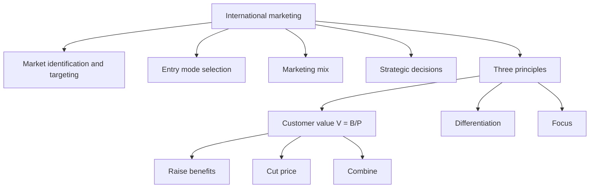

# GM-2: Definition of International Marketing and the Three Principles

Covers: the faculty and AMA definitions of international marketing, and the three principles of marketing (customer value with V = B/P, differentiation, focus). **(class)**

## Definitions (class)
| Source | Wording (slide, shortened) |
|---|---|
| Faculty definition 1 | International marketing (IM), or global marketing, is marketing carried out by companies overseas or across national borderlines. |
| Faculty definition 2 | Firm-level marketing practices across the border: market identification and targeting, entry mode selection, marketing mix and strategic decisions to compete in international markets. |
| AMA | "International Marketing is the multinational process of planning and executing the conception, pricing, promotion and distribution of ideas, goods, and services to create exchanges that satisfy individual and organizational objectives." |
| Simple words | The application of marketing principles across national boundaries. |

**How to write it:** quote the AMA line, then give the faculty four decision areas as the scope: (1) market identification and targeting, (2) entry mode selection, (3) marketing mix, (4) strategic decisions to compete.

## The three principles of marketing (class)
The slide shows three words: **customer focus (value), differentiation, focus**. The next three headings are the "key elements of marketing".

### 1. Customer value (class)
- **Goal:** create customer value greater than the value created by competitors.
- **Strategy:** expand or improve product and service benefits; reduce the price; or combine the two.
- **Formula on the slide:** V = B / P, where V = value, B = perceived benefits minus perceived costs, P = price.

**Reading the formula:** value rises if net benefits rise or price falls. **(general)** To avoid counting price twice, treat "perceived costs" as the non-price costs of buying and using (time, effort, risk, switching). Say this in one line only if the examiner asks about the formula; otherwise write it as the slide does.

### 2. Differentiation (class)
- **Goal:** create competitive advantage through differentiation.
- Advantage can exist in **any element** of the company's offer (product, price, place, promotion).
- One way to penetrate a new national market: offer a **superior product at a lower price**.

### 3. Focus (class)
- **Goal:** a concentration of attention and resources.
- It is a requirement to create customer value at a competitive advantage.
- A viable way for **small and medium-sized companies** to achieve a dominant position in the world market.
- A clear focus on customer needs and wants.

## Worked example: customer value, V = B / P (illustrative figures)
Question. A foreign supplier (A) and a local rival (B) sell the same type of industrial pump in a new market. Perceived benefits and costs are on a 100-point scale and prices are in ₹ thousand (all illustrative). Find who creates more value and what A should do.
1. Net benefit B = perceived benefits minus perceived costs.
2. V = B / P.

| Supplier | Perceived benefits | Perceived costs | B | Price P (₹ thousand) | V = B/P |
|---|---|---|---|---|---|
| A (entrant) | 90 | 20 | 70 | 50 | 1.400 |
| B (local) | 80 | 20 | 60 | 40 | 1.500 |

3. B delivers more value per rupee (1.500 against 1.400), even though A's product is better.
4. A's options (slide strategies):

| Option | Change | New B | New P | New V |
|---|---|---|---|---|
| Improve benefits | Benefits 90 to 100 | 80 | 50 | 1.600 |
| Reduce price | Price 50 to 40 | 70 | 40 | 1.750 |
| Combine | Benefits to 100 and price to 40 | 80 | 40 | 2.000 |

5. Decision line: the entrant should aim for V above 1.500, the local rival's value. Improving benefits alone (1.600) is enough to win; a price cut alone (1.750) wins by more but gives away margin; the combination (2.000) is strongest. Interpretation: the slide's route of a superior product at a lower price works because both moves raise V, and value is judged relative to the competitor, not in absolute terms.

## 5-mark skeleton: "Define international marketing and explain its three principles"
AMA definition (1); faculty scope: targeting, entry mode, mix, strategy (1); customer value with V = B/P and strategies (1); differentiation (1); focus, SMEs (1).

## What to remember
- IM = marketing across national borders; firm-level decisions: targeting, entry mode, mix, strategy.
- AMA: multinational process of planning and executing conception, pricing, promotion, distribution to create exchanges that satisfy individual and organisational objectives.
- Customer value: V = B/P, with B = perceived benefits minus perceived costs.
- Customer value must exceed competitors' value: raise benefits, cut price, or both.
- Differentiation can be in any element; focus suits small and medium firms.

## Concept map

## Flashcards
Q: Give the faculty definition of international marketing.
A: Marketing carried out by companies overseas or across national borderlines; firm-level practices including market identification and targeting, entry mode selection, marketing mix and strategic decisions.

Q: Complete the AMA definition: International Marketing is the multinational process of ...
A: Planning and executing the conception, pricing, promotion and distribution of ideas, goods and services to create exchanges that satisfy individual and organisational objectives.

Q: What are the three principles of marketing on the slides?
A: Customer value, differentiation and focus.

Q: Write the customer value formula.
A: V = B / P, where B = perceived benefits minus perceived costs and P = price.

Q: How can a firm raise customer value (three routes)?
A: Improve benefits, reduce price, or combine the two.

Q: Illustrative: B = 70 and P = 50. What is V?
A: 70 / 50 = 1.400.

Q: What is the goal of differentiation?
A: To create competitive advantage; it can sit in any element of the company's offer.

Q: How can a firm penetrate a new national market, per the slides?
A: Offer a superior product at a lower price.

Q: Why is focus useful to small and medium-sized companies?
A: Concentrating attention and resources is a viable way to achieve a dominant position in the world market.

## Sources
- Faculty deck Unit 1, slides 7-13. The note on counting price once in V = B/P is **(general)**; all figures in the worked example are illustrative.
- Back to: [[International Marketing Unit 1 - GM-1 Marketing as a Universal Discipline and the Marketing Concept]]
- Next node: [[International Marketing Unit 1 - GM-3 Global Marketing Knowledge Domains and Importance]]
- [[International Marketing Unit 1 - Global Marketing MOC (Node Map)]]
