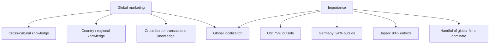

# GM-3: Global Marketing, Knowledge Domains and Importance

Covers: why global marketing is harder than home marketing (three knowledge domains), global localization, the market-potential figures that explain why firms go global, and the class assignment. **(class)**

## Global marketing: universal discipline, different markets (class)
Marketing discipline is universal, but **markets and customers are quite different**. A global marketer therefore needs three domains of knowledge.
| Domain | What it covers | Example question it answers (general) |
|---|---|---|
| **Cross-cultural knowledge** | Values, language, habits, buying behaviour across cultures | Will this ad and pack read the same in another culture? |
| **Country / regional knowledge** | Economy, politics, law, infrastructure, competition of a country or region | Is the market large enough and open to us? |
| **Cross-border transactions knowledge** | Trade documents, payments, currency, customs, logistics | How do we ship, invoice and get paid? |

The three domain names are the slide wording; the middle and right columns are **(general)** illustrations.

## Global localization (class)
- The need for **"global localization": adjustment of global marketing strategies to local requirements.**
- **(general)** The idea is often summed up as "think global, act local": keep the core brand and process common, adapt what customers, culture or law demand. Unit 4 (marketing mix) develops standardisation against adaptation.

## Importance of global marketing (class)
- The international arena is of great importance to companies **maximising growth potential**.
- Market potential outside the home country, as on the slide:

| Home country | Share of market potential outside it |
|---|---|
| United States | 75% |
| Germany (for German companies) | 94% |
| Japan (for Japanese companies) | 90% |

- A large number of industries will be dominated by a **handful of global companies** (the slide names Walmart, Toyota, Volkswagen).
- **Why firms go global (slide assignment):** the size of global markets for individual industries or product categories helps explain it. Company rankings by The Wall Street Journal, Fortune, the Financial Times and company websites show the importance of global marketing today.

## Worked example: what the 94% and 90% mean (illustrative arithmetic)
Question. If world market potential for a firm's product is ₹1,000 crore (illustrative round number), how much lies at home for a German, a Japanese and an American firm, and what follows for strategy?
1. Home share = 100 minus the share outside.
2. Germany: outside 94%, home 6%. Home = 1,000 × 0.06 = ₹60 crore; outside = ₹940 crore.
3. Japan: outside 90%, home 10%. Home = ₹100 crore; outside = ₹900 crore.
4. United States: outside 75%, home 25%. Home = ₹250 crore; outside = ₹750 crore.

| Home country | Home | Outside | Outside as multiple of home |
|---|---|---|---|
| Germany | ₹60 crore | ₹940 crore | 15.7 times |
| Japan | ₹100 crore | ₹900 crore | 9.0 times |
| United States | ₹250 crore | ₹750 crore | 3.0 times |

5. Decision line: a firm that stays at home reaches only 6% of its potential if German, 10% if Japanese, 25% if American. Interpretation: the smaller the home market relative to the world, the stronger the pull to go global. The ₹1,000 crore base is illustrative; only the percentages are from the slide.

## Class assignment: how to answer it (class)
The slide asks for global market size for companies such as Amazon, Nestle, Uber, GE, Siemens, Philips, Wipro and Infosys, then a brief summary for a company of your choice. Do not memorise figures. Use this frame and take the numbers from the latest annual report **[VERIFY]**:
| Block | Content |
|---|---|
| Company and industry | One line |
| Global footprint | Number of countries, share of revenue earned abroad (from the annual report) |
| Why it went global | Home market limits, scale economies, growth potential |
| Local adaptation | One example of global localization |
| Conclusion | One line linking size of the global market to the decision to go global |

Qualitative examples that need no numbers: Infosys and Wipro earn most of their business from clients abroad **[VERIFY with annual reports]**; Nestle adapts products to local tastes **(general)**.

## 5-mark skeleton: "Explain the importance of global marketing"
Growth potential beyond the home market (1); the 75%, 94% and 90% figures (2); industries dominated by a handful of global firms (1); global localization as the condition for success (1).

## What to remember
- Three knowledge domains: cross-cultural, country/regional, cross-border transactions.
- Global localization: adjust global strategies to local requirements.
- Market potential outside home: US 75%, Germany 94%, Japan 90%.
- A handful of global companies will dominate many industries (Walmart, Toyota, Volkswagen on the slide).
- Smaller home market share means a stronger reason to go global.

## Concept map

## Flashcards
Q: Name the three domains of knowledge in global marketing.
A: Cross-cultural knowledge, country/regional knowledge and cross-border transactions knowledge.

Q: What is global localization?
A: Adjustment of global marketing strategies to local requirements.

Q: What share of market potential lies outside the US?
A: 75%.

Q: What share of market potential for German companies lies outside Germany?
A: 94%.

Q: What share of world potential for Japanese companies lies outside Japan?
A: 90%.

Q: Illustrative: world potential ₹1,000 crore, 94% outside. How much is at home?
A: 1,000 × 0.06 = ₹60 crore; ₹940 crore is outside.

Q: Which companies does the slide name as likely global leaders?
A: Walmart, Toyota, Volkswagen.

Q: Why does the size of global markets matter to a firm?
A: It helps explain why companies go global: it shows growth potential beyond the home market.

Q: What does the class assignment ask for?
A: Global market size for companies such as Amazon, Nestle, Uber, GE, Siemens, Philips, Wipro and Infosys, and a brief summary for a company of your choice.

## Sources
- Faculty deck Unit 1, slides 14-15 and 18. The cross-border example questions and the "think global, act local" gloss are **(general)**. Worked-example base amount is illustrative.
- Back to: [[International Marketing Unit 1 - GM-2 Definition of International Marketing and the Three Principles]]
- Next node: [[International Marketing Unit 1 - GM-4 International Organisations]]
- [[International Marketing Unit 1 - Global Marketing MOC (Node Map)]]
