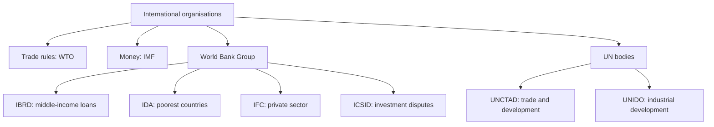

# GM-4: International Organisations (WTO, IBRD, IDA, IFC, ICSID, IMF, UNCTAD, UNIDO)

Covers: what each of the eight organisations does and why an international marketer cares. **Slide gap:** the faculty deck lists these eight names in the module overview but has no slide describing them. Everything below beyond the names is **(general)** and every date or count carries a **[VERIFY]** tag. Ask your faculty whether a class note exists and prefer it over this node.

## The eight at a glance (general)
| Organisation | Full name | Core job in one line | Why a marketer cares |
|---|---|---|---|
| **WTO** | World Trade Organization | Sets and polices the rules of trade between member countries; settles trade disputes; negotiates lower barriers | Tariffs, quotas, anti-dumping and dispute rules decide whether a market is open |
| **IMF** | International Monetary Fund | Promotes exchange-rate stability and international monetary cooperation; lends to members with balance-of-payments problems | Currency crises change prices, payments and repatriation of profit |
| **IBRD** | International Bank for Reconstruction and Development | World Bank's main arm: loans at near-market terms to middle-income governments for development | Funds roads, ports, power and telecom that make a market reachable |
| **IDA** | International Development Association | World Bank's soft-loan arm: interest-free or low-interest credit and grants to the poorest countries | Builds infrastructure in low-income markets that may later become customers |
| **IFC** | International Finance Corporation | World Bank Group's private-sector arm: loans, equity and advice to private firms in developing countries | A direct source of project finance and a partner for entry |
| **ICSID** | International Centre for Settlement of Investment Disputes | Offers conciliation and arbitration of disputes between foreign investors and host states | Protection for FDI and joint ventures when a host government acts against an investor |
| **UNCTAD** | United Nations Conference on Trade and Development | Helps developing countries integrate into the world economy through trade, investment and development policy; research and data | Reports on trade and FDI flows; a voice for developing-country interests |
| **UNIDO** | United Nations Industrial Development Organization | Promotes inclusive and sustainable industrial development, technology transfer and industrial capacity | Supports industrial upgrading and technology partnerships in emerging markets |

## Memory anchors (general)
- **Money and exchange rates:** IMF. **Trade rules:** WTO. **Development lending:** IBRD (middle income), IDA (poorest). **Private sector finance:** IFC. **Investor-state disputes:** ICSID. **Trade and development advocacy and data:** UNCTAD. **Industrial development:** UNIDO.
- **World Bank Group** is the family that includes IBRD, IDA, IFC and ICSID **(general)**. The IMF is a separate institution, though both were born at Bretton Woods.
- WTO is about **rules**, IMF about **money**, Bank about **projects**.

## Background facts for one-line answers (general) [VERIFY all dates and counts]
| Organisation | Founded (approx.) | Base |
|---|---|---|
| IMF and IBRD | Agreed at Bretton Woods, 1944 | Washington, D.C. |
| IFC | 1956 | Washington, D.C. |
| IDA | 1960 | Washington, D.C. |
| UNCTAD | 1964 | Geneva |
| ICSID | 1966 (convention in force) | Washington, D.C. |
| UNIDO | 1966 (UN specialised agency from the mid-1980s) | Vienna |
| WTO | 1 January 1995, successor to GATT (1947) | Geneva |
India is a WTO member **(general)**. Whether India is a party to the ICSID convention is a point to check before writing it **[VERIFY]**; leave it out of an exam answer if unsure.

## Worked example: which organisation fits the problem? (illustrative)
Question. For each situation below, name the organisation a firm or government would turn to, and justify in one line. All situations are fictional.
| # | Situation | Organisation | Reason |
|---|---|---|---|
| 1 | An Indian exporter finds a country has imposed a duty that breaks its trade commitments | WTO | Dispute settlement under trade rules |
| 2 | A country's currency falls sharply and it cannot pay for imports | IMF | Balance-of-payments support and exchange-rate stability |
| 3 | A middle-income state wants a loan for a port | IBRD | Development lending to middle-income governments |
| 4 | A very poor country wants a long, near-interest-free loan for rural roads | IDA | Soft credit for the poorest countries |
| 5 | A private manufacturer in an emerging market needs equity for a new plant | IFC | Finance and advice to private firms |
| 6 | A foreign investor says the host government cancelled its licence unfairly | ICSID | Arbitration of investor-state disputes |
| 7 | A researcher needs data on global trade and FDI trends for developing countries | UNCTAD | Research and data on trade, investment and development |
| 8 | A poor country wants help building industrial skills and technology | UNIDO | Industrial development and technology transfer |
Decision line: sort by what is at stake, which is money, rules, projects, private finance, disputes, data or industry. Interpretation: an international marketer reads these bodies as part of the environment (see Unit 2), because they shape market access, currency risk, infrastructure and investor protection.

## 5-mark skeleton: "Explain the role of any three international organisations in global marketing"
One line each for three bodies, for example WTO, IMF, IBRD (1 each = 3); link of each to a marketing decision such as market access, pricing and payments, infrastructure (1); a closing line that they form part of the global environment (1).

## What to remember
- The deck names eight: WTO, IDA, IFC, IBRD, ICSID, IMF, UNCTAD, UNIDO. Spell the full names.
- WTO = trade rules and disputes; IMF = monetary stability and balance-of-payments lending.
- IBRD = middle-income development loans; IDA = poorest countries; IFC = private sector; ICSID = investment disputes.
- UNCTAD = trade and development; UNIDO = industrial development.
- All descriptions here are general knowledge because the deck has no slide on them. Date and count tags are **[VERIFY]**.

## Concept map

## Flashcards
Q: Expand WTO and give its main job.
A: World Trade Organization; sets and polices trade rules and settles trade disputes (general).

Q: Expand IMF and give its main job.
A: International Monetary Fund; exchange-rate stability and balance-of-payments support (general).

Q: Expand IBRD and say who it lends to.
A: International Bank for Reconstruction and Development; development loans to middle-income governments (general).

Q: What is IDA and how does it differ from IBRD?
A: International Development Association; soft loans and grants to the poorest countries, while IBRD lends at near-market terms to middle-income countries (general).

Q: What does IFC do?
A: International Finance Corporation; loans, equity and advice to private-sector firms in developing countries (general).

Q: Expand ICSID and say what it handles.
A: International Centre for Settlement of Investment Disputes; conciliation and arbitration between foreign investors and host states (general).

Q: What is UNCTAD?
A: United Nations Conference on Trade and Development; helps developing countries integrate into world trade and investment, with research and policy work (general).

Q: What is UNIDO?
A: United Nations Industrial Development Organization; promotes inclusive and sustainable industrial development and technology transfer (general).

Q: Which of the eight bodies deals with disputes between a foreign investor and a host government?
A: ICSID.

Q: Which eight organisations does the faculty overview list?
A: WTO, IDA, IFC, IBRD, ICSID, IMF, UNCTAD, UNIDO.

## Sources
- Faculty deck Unit 1, overview slide 2 (names only). All descriptions, founding years and bases are **(general)**; verify them against your faculty's note or the organisations' own sites **[VERIFY]**.
- Back to: [[International Marketing Unit 1 - GM-3 Global Marketing Knowledge Domains and Importance]]
- Next node: [[International Marketing Unit 1 - GM-5 Driving and Restraining Forces]]
- [[International Marketing Unit 1 - Global Marketing MOC (Node Map)]]
