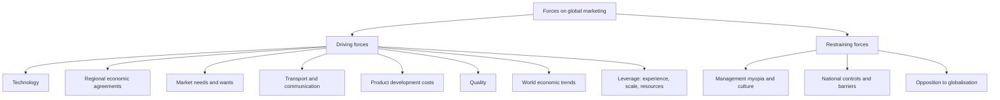

# GM-5: Driving and Restraining Forces Affecting Global Marketing

Covers: the eight driving forces and three restraining forces on the faculty slides, what each means, and a force-field way to weigh them in a case. **(class)** for the lists; the explanations are **(general)**.

## Driving forces (class)
The slide lists eight forces that push firms towards global marketing.
| # | Force (slide) | What it means (general) |
|---|---|---|
| 1 | **Technology** | Common technologies and digital tools make products and information the same everywhere |
| 2 | **Regional economic agreements** | Trade blocs and free-trade areas lower barriers and widen markets |
| 3 | **Market needs and wants** | Customers in different countries increasingly want similar products |
| 4 | **Transportation and communication improvements** | Cheaper, faster shipping, flights, telecom and internet link buyers and sellers |
| 5 | **Product development costs** | Heavy R&D cost must be spread over a larger volume, so sell worldwide |
| 6 | **Quality** | Global standards of quality are demanded; scale helps firms reach them |
| 7 | **World economic trends** | Growth, liberalisation and rising incomes in new markets open opportunities |
| 8 | **Leverage** | Experience transfers, scale economies and resource utilisation (the slide's own list) |

**Leverage in detail (class):** experience transfers (lessons learned in one market used in another), scale economies (lower unit cost at higher volume) and resources utilisation (spare capacity, brands and know-how used more fully). Treat these as the firm-side reasons that sit beside the five environment-side forces.

## Restraining forces (class)
Three forces hold firms back.
| # | Force (slide) | What it means (general) |
|---|---|---|
| 1 | **Management myopia and organisational culture** | Managers who see only the home market, or assume foreign customers are like home customers, or a culture that resists change |
| 2 | **National controls and barriers** | Tariffs, quotas, licensing, local-content rules, exchange controls, regulation |
| 3 | **Opposition to globalisation** | Public, political and activist resistance: job loss, cultural dilution, environmental and equity concerns |

## How to use them in an answer
- Name the force, state its effect on the firm, tie it to a decision (enter, adapt, delay, partner).
- Pair each restraint with a response **(general)**: myopia is answered by training and a global mindset in top management; barriers by joint ventures, local production or licensing; opposition by local jobs, local sourcing and visible social responsibility.
- Conclude with the net direction: if driving forces outweigh restraints for this firm, go global now; otherwise stage the entry.

## Worked example: force-field scorecard (fictional firm, illustrative scores)
Question. Deccan Auto Components Ltd (fictional) is deciding whether to enter export markets. Management scores each force for importance (weight 1 to 5) and strength for this firm (1 to 5). Weigh the forces and advise.
1. Score = weight × strength for each force.

| Side | Force | Weight | Strength | Score |
|---|---|---|---|---|
| Driving | Regional economic agreements | 3 | 4 | 12 |
| Driving | Product development costs | 5 | 4 | 20 |
| Driving | Market needs and wants | 4 | 3 | 12 |
| Driving | Transport and communication | 3 | 4 | 12 |
| Restraining | National controls and barriers | 4 | 4 | 16 |
| Restraining | Management myopia and culture | 3 | 2 | 6 |
| Restraining | Opposition to globalisation | 2 | 3 | 6 |

2. Driving total = 12 + 20 + 12 + 12 = **56**.
3. Restraining total = 16 + 6 + 6 = **28**.
4. Net = 56 - 28 = **+28**; ratio driving to restraining = 56 / 28 = **2.0**.
5. Decision line: driving forces are twice the restraints, so Deccan should go global, led by the pressure to spread product development cost. Interpretation: the largest restraint is national barriers (16), so enter through a route that works around them, for example a local assembly partner, and keep a plan for the myopia risk (6) through management training. The scale and scores are judgemental and illustrative; the ratio only shows direction.

## 5-mark skeleton: "Explain the driving and restraining forces affecting global marketing"
Driving forces listed with a line each (2); leverage explained (1); three restraining forces (1); net judgement or response (1).

## What to remember
- Eight driving forces: technology, regional economic agreements, market needs and wants, transport and communication, product development costs, quality, world economic trends, leverage.
- Leverage = experience transfers, scale economies, resource utilisation.
- Three restraints: management myopia and organisational culture; national controls and barriers; opposition to globalisation.
- Always give the effect and a response for each force you name.
- Close with a net decision: driving outweigh restraints, or stage the entry.

## Concept map

## Flashcards
Q: List the eight driving forces on the slide.
A: Technology; regional economic agreements; market needs and wants; transportation and communication improvements; product development costs; quality; world economic trends; leverage.

Q: What does leverage mean on the slide?
A: Experience transfers, scale economies and resource utilisation.

Q: Name the three restraining forces.
A: Management myopia and organisational culture; national controls and barriers; opposition to globalisation.

Q: How do product development costs drive globalisation?
A: High R&D cost is spread over a larger volume by selling in many markets (general).

Q: How do regional economic agreements drive globalisation?
A: They lower trade barriers and enlarge accessible markets (general).

Q: What is management myopia?
A: A short-sighted, home-market-only view that assumes foreign markets are like home (general).

Q: Give one response to national controls and barriers.
A: Enter through a joint venture, licensing or local production (general).

Q: Illustrative: driving score 56 and restraining score 28. What is the ratio and what does it say?
A: 56 / 28 = 2.0; driving forces are twice the restraints, so the case favours going global.

Q: What should every force in an answer be tied to?
A: A firm decision such as enter, adapt, delay or partner.

## Sources
- Faculty deck Unit 1, slides 16-17 (lists only; no elaboration on the slides). Explanations and responses are **(general)**; Deccan Auto Components Ltd and all scores are fictional.
- Back to: [[International Marketing Unit 1 - GM-4 International Organisations]]
- Next node: [[International Marketing Unit 1 - GM-6 Unit 1 Exam Answers]]
- [[International Marketing Unit 1 - Global Marketing MOC (Node Map)]]
