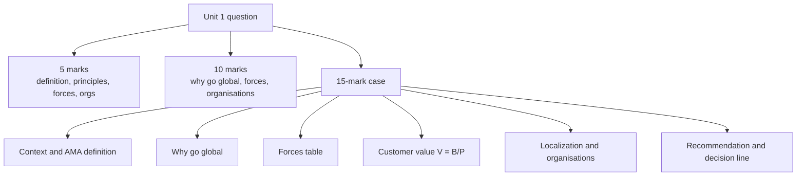

# GM-6: Unit 1 Exam Answers

Covers: likely 5-mark and 10-mark questions with answer skeletons, and the 15-mark case layout with a worked case. **(class)** content from the faculty deck, with **(general)** only for the organisations in GM-4.

## The paper (assumed)
No course plan is on file, so assume the standard Christ BBA ESE **[VERIFY with your course plan]**: 50 marks, 2 hours. **Section A:** 3 of 5 × 5. **Section B:** 2 of 3 × 10. **Section C:** one compulsory 15-mark case. Budget about 7 minutes per 5-mark answer, 15 per 10-mark, 30 for the case. Unit 1 is theory, so it feeds Sections A and B and the opening paragraph of the case.

## 5-mark answers (about 120-150 words, one table or list)
| Likely question | Skeleton (marks) |
|---|---|
| Define international marketing | AMA definition (2); faculty scope: targeting, entry mode, mix, strategy (2); one-line "marketing principles across borders" (1) |
| Marketing as a universal discipline | Two readings: process and toolkit (2); practice varies by country (1); why this makes IM different (2) |
| Evolution of the marketing concept | 1950s product, 1960s customer and 4Ps (2); 1990s environment and stakeholders (1); today: value creation, partnerships, co-creation, profit as a measure (2) |
| Three principles of marketing | Customer value (2); differentiation (1); focus (1); how they fit together (1) |
| Customer value formula | V = B/P with terms (2); three strategies (1); short numeric illustration (2) |
| Importance of international marketing | Growth potential (1); 75%, 94%, 90% (2); handful of global firms (1); global localization (1) |
| Three domains of knowledge | Name three (1); one line each (3); global localization link (1) |
| Driving forces | Eight forces with a line each (4); leverage detail (1) |
| Restraining forces | Three forces (3); one response each (2) |
| Short note: WTO / IMF / IBRD and IDA / IFC / ICSID / UNCTAD / UNIDO | Full name, founding, main function, relevance to marketers (general) |

## 10-mark answers (about 300-350 words)
**Layout:** introduction (1-2), body in headed points or a table (6), interpretation or conclusion (1-2).
| Likely question | Skeleton |
|---|---|
| Define international marketing and explain why companies go global | AMA and faculty definitions (2); three domains and global localization (2); 75/94/90 evidence (2); driving forces (2); conclusion (2) |
| Discuss the three principles of marketing with the customer value formula | Customer value with V = B/P and a worked sum (4); differentiation (2); focus and SMEs (2); link to entering a new national market (2) |
| Discuss the driving and restraining forces affecting global marketing | Table of eight driving forces (3); three restraints (2); responses (2); net judgement (2); intro (1) |
| Explain the role of international organisations in global trade | Eight organisations grouped by money, rules, projects, finance, disputes, development (6); link to marketing decisions (2); conclusion (2) |
| Trace the marketing concept from the 1950s to today and explain its relevance to global marketing | Timeline table (4); today's two tasks and co-creation (2); relevance: external environment and stakeholders matter when crossing borders (3); conclusion (1) |

## 15-mark case layout (Section C)
The case will describe a firm and ask for a go-global assessment and recommendations, probably also drawing on Units 2 to 5. Unit 1 supplies the **frame**: why go global, what forces apply, what value we offer. Spend about 30 minutes.
| Block | Marks | What to write |
|---|---|---|
| 1. Context and definition | 2 | Two lines on the firm; international marketing defined (AMA line, four decision areas) |
| 2. Why go global | 3 | Home-market ceiling, market potential outside, growth; cite the 75%, 94%, 90% pattern as general evidence |
| 3. Forces | 3 | Table of driving and restraining forces from the case, with a net judgement |
| 4. Customer value and differentiation | 3 | V = B/P versus the main rival; chosen strategy (benefits, price or both); focus on a segment if the firm is small |
| 5. Three knowledge domains and global localization | 2 | What the firm must learn: culture, country, cross-border transactions; what to adapt |
| 6. International organisations | 1 | Name the body that matters (WTO rules, IMF currency risk, ICSID investor protection, IFC finance) |
| 7. Recommendation and decision line | 1 | Go or stage the entry, first market, and the single reason; interpretation |

### Worked case (illustrative, fictional firm)
**Question.** Sahyadri Spices Ltd (fictional) sells packaged spice blends in India. Home revenue is ₹120 crore in a home market it estimates at ₹400 crore. A distributor in the Gulf offers to stock its product. Sahyadri's blend scores perceived benefits 85 and perceived costs 25 for Gulf buyers at ₹30 a pack; the leading rival scores benefits 80 and costs 25 at the same price. Home growth is slowing, Gulf import rules require label and halal compliance, and the founder doubts that Gulf customers differ from Indian ones. Assess and advise. (All figures are illustrative.)

**Answer layout.**
1. **Context.** International marketing is the multinational process of planning and executing the conception, pricing, promotion and distribution of ideas, goods and services to create exchanges that satisfy individual and organisational objectives (AMA). Sahyadri's decision covers targeting, entry mode, mix and competitive strategy.
2. **Why go global.** Home share = 120 / 400 = **30%**. The remaining ₹280 crore is contested, and growth is slowing, so the ceiling is near. The market outside home is large for most firms (75%, 94% and 90% of potential for US, German and Japanese firms respectively), so an export option has strong logic.
3. **Forces.**

| Side | Force from the case | Effect |
|---|---|---|
| Driving | Distributor offer; transport and communication links to the Gulf | Easy first step |
| Driving | Home growth slowing; need to spread fixed cost | Pushes volume abroad |
| Restraining | Label and halal rules (national controls and barriers) | Compliance cost and delay |
| Restraining | Founder's belief that markets are alike (management myopia) | Risk of copying the home offer |
Net: the drivers are stronger, but the two restraints must be managed.
4. **Customer value and differentiation.**

| Brand | Perceived benefits | Perceived costs | B | Price | V = B/P |
|---|---|---|---|---|---|
| Sahyadri | 85 | 25 | 60 | ₹30 | 2.000 |
| Rival | 80 | 25 | 55 | ₹30 | 1.833 |
Sahyadri leads by 2.000 - 1.833 = 0.167 at equal price. It need not cut price; it should protect and communicate the benefit lead (blend authenticity), which also keeps margin.
5. **Knowledge domains and localization.** Cross-cultural: taste, pack size, festival demand. Country: import rules, competitors, income. Cross-border transactions: documents, currency, payment terms. Adapt label, halal certification and pack size; keep the core brand (global localization).
6. **Organisations.** WTO rules limit arbitrary duties on trade in goods; watch currency risk (IMF context) and agree payment in a stable currency **(general)**.
7. **Recommendation and decision line.** Go, in stages: begin with the distributor, one Gulf country, a localised label and a compliance check before shipment. Interpretation: the 0.167 value lead is thin, so a failure on compliance or taste would erase it; the case for entry rests on execution of the local adaptation, not on the product alone.

## Interpretation phrases that earn marks
- "Marketing is universal, but practice varies by country, so the firm must adapt to local requirements: global localization."
- "Customer value is relative: the firm wins only if V = B/P exceeds the rival's."
- "Driving forces outweigh the restraints, so the firm should go global, but it must manage national barriers."
- "The smaller the home market's share of world potential, the stronger the pull to go global."

## Common slips to avoid
- Writing the AMA definition without "multinational process" or without "individual and organisational objectives".
- Putting price inside B and again in P without comment; write the slide formula and, if asked, note the non-price reading of costs.
- Forgetting leverage (experience, scale, resources) as the eighth driving force.
- Mixing IBRD and IDA, or IFC and ICSID; use the memory anchors in GM-4.
- Quoting founding dates of organisations with confidence; they are **[VERIFY]**.

## What to remember
- Section C is 15 marks: use the seven blocks and end with a decision line.
- Quote slide wording for definitions and lists; add (general) detail only to extend.
- Tables score: forces, customer value, organisation matching.
- Always tie a force or principle to a firm decision.
- Give an international organisation and a localization point in long answers.

## Concept map

## Flashcards
Q: What is the assumed ESE pattern?
A: 50 marks, 2 hours: 3 of 5 × 5, 2 of 3 × 10, one compulsory 15-mark case [VERIFY with the course plan].

Q: What are the seven blocks of the 15-mark case layout?
A: Context and definition; why go global; forces; customer value and differentiation; knowledge domains and localization; international organisations; recommendation and decision line.

Q: What earns the interpretation mark in the case?
A: A sentence that makes the go or stage decision and says what it depends on, such as a value lead or a barrier.

Q: What 5-mark skeleton fits "Define international marketing"?
A: AMA definition, faculty scope of four decision areas, and the one-line principles-across-borders summary.

Q: How would you structure a 10-mark answer?
A: Introduction, body in headed points or a table, interpretation or conclusion.

Q: Illustrative: home revenue ₹120 crore in a ₹400 crore home market. What is the share?
A: 120 / 400 = 30%.

Q: Illustrative: V for B = 60 and P = 30, and for B = 55 and P = 30?
A: 2.000 and 1.833; the first leads by 0.167.

Q: Which slips should you avoid with the organisations?
A: Mixing IBRD with IDA or IFC with ICSID, and stating founding dates with unverified confidence.

## Sources
- Faculty deck Unit 1; plan assessment pattern (assumed). Sahyadri Spices Ltd and all its numbers are fictional and illustrative.
- Back to: [[International Marketing Unit 1 - GM-5 Driving and Restraining Forces]]
- [[International Marketing Unit 1 - Global Marketing MOC (Node Map)]]
