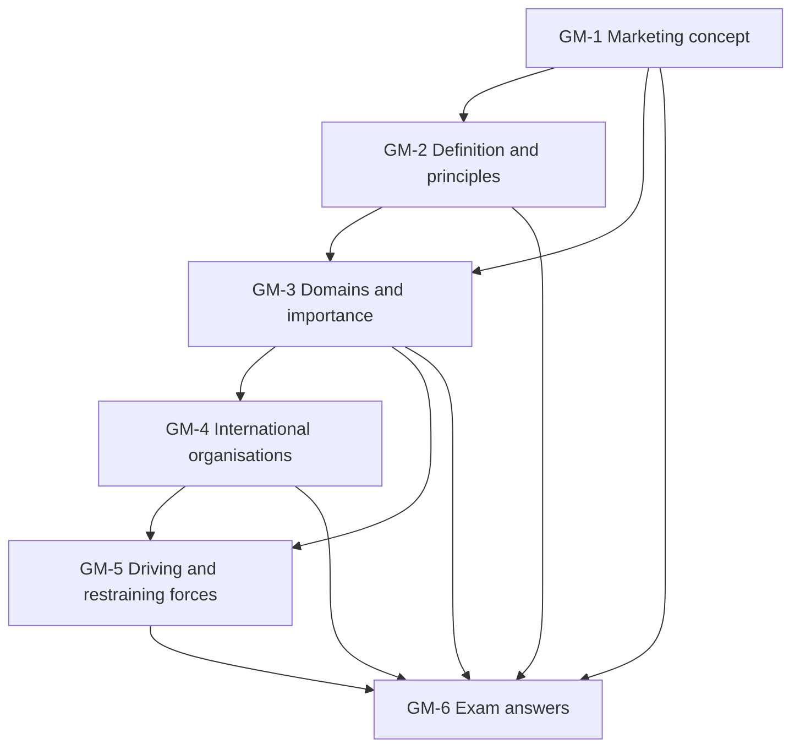

# International Marketing Unit 1: Introduction to Global Marketing, node map

ESE (assumed, no course plan on file): 50 marks, 2 hours. Section A 3 of 5 × 5, Section B 2 of 3 × 10, Section C one compulsory 15-mark case. Unit 1 is theory. The **faculty deck is the single source**; general knowledge fills gaps and is tagged **(general)**. The deck names eight international organisations (GM-4) but has no slide describing them, so that node is general knowledge with **[VERIFY]** tags.

## Nodes

| Node | Topic | Deps | Minutes | Exam focus |
|---|---|---|---|---|
| GM-1 | Marketing as a Universal Discipline and the Marketing Concept | none | 25 | yes |
| GM-2 | Definition of International Marketing and the Three Principles | GM-1 | 35 | yes |
| GM-3 | Global Marketing Knowledge Domains and Importance | GM-1, GM-2 | 30 | yes |
| GM-4 | International Organisations (WTO, IBRD, IDA, IFC, ICSID, IMF, UNCTAD, UNIDO) | GM-3 | 40 | yes |
| GM-5 | Driving and Restraining Forces | GM-3, GM-4 | 35 | yes |
| GM-6 | Unit 1 Exam Answers (5, 10 and 15-mark case layouts) | GM-1 to GM-5 | 30 | yes |

Total reading time: about 195 minutes.

## Dependency graph

## Headline facts to know

- Marketing concept: 1950s products; 1960s customer and 4Ps; 1990s environment and stakeholders; today value creation and co-creation.
- AMA definition: multinational process of planning and executing conception, pricing, promotion, distribution to create exchanges that satisfy individual and organisational objectives.
- Customer value V = B/P, B = perceived benefits minus perceived costs.
- Market potential outside home: US 75%, Germany 94%, Japan 90%.
- Eight driving forces, three restraining forces; leverage = experience, scale, resources.

## Links
- [[International Marketing MOC]]
- [[International Marketing Unit 1 - GM-1 Marketing as a Universal Discipline and the Marketing Concept]]
- [[International Marketing Unit 1 - GM-2 Definition of International Marketing and the Three Principles]]
- [[International Marketing Unit 1 - GM-3 Global Marketing Knowledge Domains and Importance]]
- [[International Marketing Unit 1 - GM-4 International Organisations]]
- [[International Marketing Unit 1 - GM-5 Driving and Restraining Forces]]
- [[International Marketing Unit 1 - GM-6 Unit 1 Exam Answers]]
