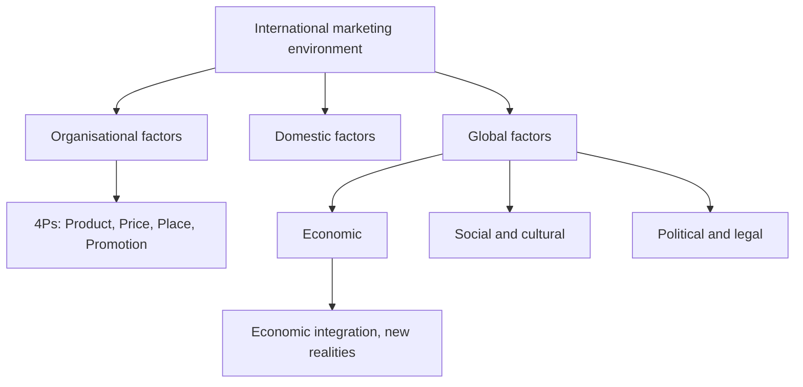

# EN-1 - Marketing Environment Framework and the World Economy

Covers: the Kotler definition, the three layers of the international marketing environment, the module map, economic integration and the "new realities" of the world economy. **(class)** unless tagged.

## Definition of the marketing environment (class)
- Kotler: "A company's marketing environment consists of the factors and forces **outside of marketing** that affect marketing management's ability to build and maintain successful relationships with target customers."
- **International marketing environment** = global forces (economic, social, cultural, legal, geographical and ecological) that affect international marketing decisions.
- For any marketer it has three parts: **internal, domestic and global** forces acting on the international marketing mix.

## The three layers (class, from the diagram)
| Layer | Slide label | What it holds |
|---|---|---|
| (a) Global factors | International uncontrollable environment | Economic, social, cultural, political, legal, geographical, ecological forces abroad |
| (b) Domestic factors | Domestic uncontrollable environment | Home-country laws, economy, politics, competition **(general: examples)** |
| (c) Organisational factors | Internal marketing environment | The firm's own resources, objectives, structure **(general: examples)** |
| Core | International marketing decisions | Product, Price, Place, Promotion, each linked to the others |

Exam hook: three nested boxes around the 4Ps. The firm **controls** only the core; it must adapt to the outer layers.

## Module II map (class)
1. Global economic environment (EN-1 to EN-3)
2. Social and cultural environment (EN-4, EN-5)
3. Cultural dynamics in the global market (EN-6)
4. Political environment (EN-7)
5. Legal and regulatory environments (EN-8)

## The world economy: an overview (class)
- Early 20th century economic integration was about **10%**; today the slide says **more than 50%** **[VERIFY]** the measure and source are not stated, so quote it as "per the class slide".
- **Economic integration** = unification of economic policies between countries through partial or full abolition of tariff and non-tariff restrictions on trade.
- The EU and NAFTA are very integrated (the slide uses NAFTA; the successor agreement is USMCA, 2020 **(general)**).
- Global competitors have displaced or absorbed local ones.

## The new realities (class)
| Reality on the slide | Meaning for a marketer |
|---|---|
| Capital movements have replaced trade as the driving force | Investment and finance flows decide where markets grow |
| Production is uncoupled from employment | Output can rise without local jobs; location decisions follow cost and skill |
| The world economy, not individual countries, dominates | Plan by global, not only national, conditions |
| The 75-year struggle between capitalism and socialism has almost ended | Formerly closed markets open (see EN-2) |
| E-commerce diminishes national barriers | Firms must re-evaluate business models |

## Worked example: classify forces for a market-entry brief (exam format)
**Question.** An Indian packaged-snack firm (fictional: Tarang Foods Ltd) plans to sell in a foreign market. Place these forces in the correct layer: (i) change in Indian export incentive, (ii) the firm's limited cold-chain capacity, (iii) the host country's import tariff, (iv) host-country religious food rules.

**Answer.**
1. State the frame: three layers around the 4Ps (class diagram).
2. Classify.
| Force | Layer | Controllable? |
|---|---|---|
| Indian export incentive | Domestic uncontrollable | No |
| Cold-chain capacity | Organisational (internal) | Yes, over time |
| Host import tariff | Global uncontrollable | No |
| Host religious food rules | Global uncontrollable (cultural) | No, adapt to it |
3. Decision line: the firm can only change the internal layer; for the other three it adapts the mix (for example halal-compliant recipe, tariff-aware pricing). Interpretation: environment analysis comes before the 4P decisions, because it sets the limits within which the mix is chosen.

## What to remember
- The environment is everything outside marketing's control; the 4Ps are the only controllable core.
- Three layers: global, domestic, organisational.
- Economic integration = removal of tariff and non-tariff barriers.
- Capital flows, not trade, now drive the world economy (slide).
- Quote the ">50%" integration figure as a class slide claim.

## Concept map

## Flashcards
Q: Give Kotler's definition of the marketing environment.
A: Factors and forces outside of marketing that affect management's ability to build and maintain successful relationships with target customers.

Q: What three kinds of forces make up the international marketing environment for a marketer?
A: Internal, domestic and global forces affecting the international marketing mix.

Q: Name the three layers around the international marketing decisions in the class diagram.
A: Global factors (international uncontrollable), domestic factors (domestic uncontrollable), organisational factors (internal marketing environment).

Q: Define economic integration.
A: Unification of economic policies between countries through partial or full abolition of tariff and non-tariff restrictions on trade.

Q: What did the slide say about integration then and now?
A: About 10% in the early 20th century; more than 50% today (class slide claim).

Q: List the five "new realities" of the world economy.
A: Capital movements over trade; production uncoupled from employment; world economy over countries; capitalism-socialism struggle almost over; e-commerce erodes national barriers.

Q: Which layer can the firm control?
A: Only the internal core, the 4Ps and its own organisation; outer layers must be adapted to.

Q: List the five topics of Module II.
A: Economic environment, social and cultural environment, cultural dynamics, political environment, legal and regulatory environment.

## Sources
- Faculty deck Unit 2 (definition, module overview, factors diagram, world economy slides). Tarang Foods Ltd is fictional.
- Back to: [[International Marketing Unit 2 - Global Environment MOC (Node Map)]]
