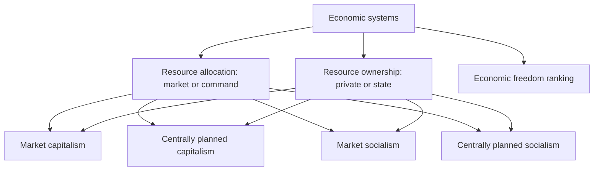

# EN-2 - Economic Systems and Economic Freedom

Covers: the 2 x 2 of resource allocation and ownership, the four systems with the faculty's examples, what market reforms mean for global firms, and the economic freedom index. **(class)** unless tagged. The slide question "explain how the four systems differ and give a country for each" is a ready-made 5 or 10-mark question.

## The framework (class)
Two questions classify any economy.
- **Resource allocation:** by the market or by command (state plan).
- **Resource ownership:** private or state.
| | Market allocation | Command allocation |
|---|---|---|
| **Private ownership** | Market capitalism | Centrally planned capitalism |
| **State ownership** | Market socialism | Centrally planned socialism |

Memory hook: the noun gives ownership (capitalism = private, socialism = state); the adjective gives allocation (market or centrally planned).

## The four systems (class)
| System | Features on the slide | Faculty example |
|---|---|---|
| **Market capitalism** | Individuals and firms allocate resources; production resources privately owned; consumer-driven; government promotes competition and protects consumers | North America, European Union |
| **Centrally planned socialism** | Opposite of market capitalism; state decides what and how much is produced; consumers spend only on what is available; government owns whole industries and distribution; demand typically exceeds supply; little product differentiation, advertising or pricing strategy | Former USSR; China and India "now moving towards some market allocation and private ownership" |
| **Centrally planned capitalism** | Command allocation used extensively with private ownership | Sweden: government controls about two-thirds of all spending; hybrid; plans to move towards privatisation |
| **Market socialism** | Means of production owned by the state or workers in each company; market allocation allowed within overall state ownership | China, Denmark, Finland, Netherlands (per slide) |

**Textbook note (one line):** most textbooks (Keegan, Cateora) treat Denmark, Finland and the Netherlands as market economies with large welfare states, not market socialism. Write the slide's examples in the exam, but you may add "welfare-state variants" in brackets. **(general)**

## What it means for marketers (class)
- Market reforms and nascent capitalism are opening large-scale investment opportunities for global firms.
- Socialists are embracing capitalism, governments are selling companies they had nationalised, and countries are inviting back the MNCs they expelled two decades earlier.
- Formerly closed countries open to trade and investment, **vastly enlarging the global market**.
- Marketing consequence: under command systems there is little need for branding, advertising or price strategy because supply is allocated; under market systems all four Ps matter.

## Economic freedom (class)
- Countries are ranked on economic freedom: "free", "mostly free", "mostly unfree", "repressed" (slide refers to the textbook page 68).
- Variables: trade policy, taxation policy, capital flows and foreign investment, banking policy, wage and price controls, property rights, black market.
- **(general)** The widely used ranking is the Heritage Foundation Index of Economic Freedom, which has a fifth band, "moderately free", between mostly free and mostly unfree. The slide lists four; use four in the exam and add the fifth only as a note. **[VERIFY]** the latest edition and country scores before quoting.
- Link: the freer the economy, the easier market entry, repatriation and pricing; weak property rights or a large black market raise risk (EN-7, EN-8).

## Worked example: classify and advise (exam format)
**Question.** Two fictional economies: Altoria (private firms own most industry; prices set by supply and demand; competition law enforced) and Zemland (state owns all heavy industry and distribution; plan fixes output; shops often empty). A consumer-goods firm considers both. Classify and advise.

**Answer.**
1. Apply the two tests.
| Test | Altoria | Zemland |
|---|---|---|
| Ownership | Private | State |
| Allocation | Market | Command |
| System | Market capitalism | Centrally planned socialism |
2. Marketing environment under each.
| Factor | Altoria | Zemland |
|---|---|---|
| Demand vs supply | Matched by price | Demand exceeds supply |
| Role of advertising, brand, price strategy | Central | Little |
| Government role | Promote competition, protect consumers | Decides production and distribution |
| Entry route | Open; compete | Needs state partner or reform window |
3. Decision line: enter Altoria with a full 4P mix; in Zemland, enter only if reforms are moving towards market allocation (as in China and India per the slide), and start by supplying scarce goods through the state channel. Interpretation: the system decides how much of the marketing mix is even usable.

## What to remember
- Two tests: who owns resources and who allocates them.
- Four systems: market capitalism, centrally planned socialism, centrally planned capitalism, market socialism.
- Slide examples: North America and EU; former USSR; Sweden; China, Denmark, Finland, Netherlands.
- Reforms and privatisation are widening the global market.
- Economic freedom variables: trade, tax, capital flows, banking, wage and price controls, property rights, black market.

## Concept map

## Flashcards
Q: What two dimensions classify economic systems in the class slide?
A: Resource allocation (market or command) and resource ownership (private or state).

Q: What is market capitalism, and which regions did the faculty give as examples?
A: Individuals and firms allocate privately owned resources, driven by consumers; North America and the European Union.

Q: What are the marketing features of centrally planned socialism?
A: State decides output, owns industries and distribution; demand exceeds supply; little product differentiation, advertising or pricing strategy.

Q: Which example did the slide give for centrally planned capitalism?
A: Sweden, where government controls about two-thirds of all spending.

Q: Define market socialism.
A: Means of production owned by the state or workers in each company, with market allocation permitted within overall state ownership.

Q: Which countries did the slide list for market socialism?
A: China, Denmark, Finland and the Netherlands (textbooks treat the last three as welfare-state market economies).

Q: Name the economic freedom bands on the slide.
A: Free, mostly free, mostly unfree, repressed.

Q: Name six variables used to rank economic freedom.
A: Trade policy, taxation policy, capital flows and foreign investment, banking policy, wage and price controls, property rights (and black market).

Q: Why do market reforms matter to global firms?
A: They open formerly closed countries to trade and investment and vastly increase the global market.

## Sources
- Faculty deck Unit 2 economic systems slides. Altoria and Zemland are fictional.
- Back to: [[International Marketing Unit 2 - EN-1 Marketing Environment Framework and the World Economy]]
- [[International Marketing Unit 2 - Global Environment MOC (Node Map)]]
