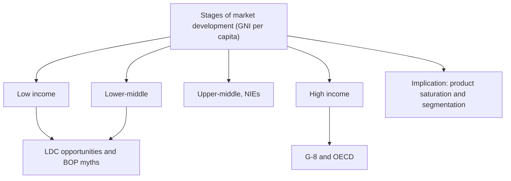

# EN-3 - Stages of Market Development and Developing Markets

Covers: the World Bank income groups with the slide's GNI bands, characteristics of each group, LDC opportunities, the five mistaken assumptions about BOP markets, high-income countries, G-8 and OECD, and product saturation. **(class)** unless tagged.

## Why stages matter (class)
- The World Bank defines **four categories** of development using **Gross National Income (GNI) per capita**.
- About ten years before the slide, the focus was on "big emerging markets" (BEMs) in Central Europe, Latin America and Asia. **Today the focus is BRICS: Brazil, Russia, India, China and South Africa.**
- Use: the stages give a basis for **global market segmentation and target marketing**.

## The four groups (class, slide figures)
| Group | GNI per capita (slide) | Characteristics on the slide | Examples on the slide |
|---|---|---|---|
| **Low income** | $1,045 or less | Limited industrialisation; high share of population in farming; high birth rates; low literacy; heavy reliance on foreign aid; political instability; concentrated in Sub-Saharan Africa | Uzbekistan, Turkmenistan (slide, dated) |
| **Lower-middle income** | $1,046 to $4,125 | Rapidly expanding consumer markets; cheap labour; mature, standardised, labour-intensive industries (footwear, textiles, toys) | India, China (the BRIC pair) (slide, dated) |
| **Upper-middle income** | $4,126 to $12,745 | Rapid industrialisation, less farm employment; urbanisation; rising wages; high literacy and advanced education; lower wage costs than advanced countries; also called **newly industrialising economies (NIEs)** | Brazil, Russia, Malaysia, Chile, Venezuela, Hungary, Mexico |
| **High income** | $12,476 or more (slide; a transposition of $12,746, the World Bank figure for the year these bands come from) | See below | US, Japan, Germany etc. (advanced, developed, industrialised, postindustrial) |

**Slide errors to know.** (1) The slide's top-of-band for upper-middle ($12,745) and bottom of high income ($12,476 or more (slide; a transposition of $12,746, the World Bank figure for the year these bands come from)) overlap between $12,476 and $12,745; the true high-income floor is $12,746, so the overlap is a typo and not a real band. (2) The low-income slide says "GNP per capita" while the heading says GNI. (3) The World Bank resets these cut-offs every year, and the slide mixes figures from different years. In the exam write the slide numbers, add "World Bank thresholds are revised annually" and mark them **[VERIFY]** against the latest release. Country groupings on the slide (Russia, Venezuela, India's grouping) also change by year **[VERIFY]**.

Slide saying: "if you are not manufactured in China or selling in India, you are as good as finished".

Slide examples are dated; the World Bank currently places Uzbekistan in lower-middle and Turkmenistan and China in upper-middle. Quote the slide examples but do not defend them as current.

## LDC marketing opportunities (class)
- LDCs are characterised by a **shortage of goods and services**.
- Long-term opportunities must be nurtured. Four rules: look **beyond per capita GNP**; consider LDCs **collectively** not individually; consider **first-mover advantage**; set **realistic deadlines**.
- Role of marketing: focus resources on creating and delivering products **suited to local needs and incomes**, use appropriate communication to speed acceptance, and link resources to opportunity on the consumer's terms.

## Five mistaken assumptions about LDC / BOP markets (class)
1. The poor have no money.
2. The poor will not "waste" money on non-essentials.
3. Entering developing markets is fruitless because goods there are too cheap to make a profit.
4. People in BOP (bottom of the pyramid) countries cannot use technology.
5. Global firms in BOP countries will be seen as exploiting the poor.
**(general)** The BOP idea is C. K. Prahalad's; the logic is that large numbers of low-income buyers, small unit packs and low margins with high volume can make money. Do not attach figures unless given.

## High-income countries (class)
- GNI per capita $12,476 or more (slide; a transposition of $12,746, the World Bank figure for the year these bands come from); also advanced, developed, industrialised or postindustrial.
- Sustained growth through disciplined innovation; **service sector above 70% of GNI**; households own most basic products.
- Information processing and exchange matter; **knowledge over capital, intellectual over machine technology, scientists and professionals over engineers and semi-skilled workers**; future-oriented; importance of interpersonal relationships.

## G-8 and OECD (class)
- **G-8**, goal of global economic stability and prosperity: US, Japan, Germany, France, Britain, Canada, Italy, Russia (joined 1998).
- **(general)** Russia was suspended in 2014, so the group is again the G7. Write "G-8 as per class" and add one line. **[VERIFY]**
- **OECD** (Organisation for Economic Cooperation and Development): promotes economic growth and social well-being; focuses on world trade, global issues and labour market deregulation.

## Marketing implications (class)
The stages guide marketers in judging **product saturation levels**, that is, the percentage of potential buyers or households that already own a product. Low saturation means room to grow; high saturation means replacement and upgrade selling.

## Worked example: classify and size (exam format)
**Question.** A fictional appliance maker looks at four fictional countries using the slide's bands. GNI per capita: Borania $900, Cendra $3,900, Altoria $6,800, Dolmar $14,200. In Altoria there are 8 crore households and 3.2 crore own a refrigerator. Classify each country and compute refrigerator saturation and room for growth in Altoria. (All figures illustrative.)

**Answer.**
1. Place each on the slide bands.
| Country | GNI per capita | Group | Marketing stance |
|---|---|---|---|
| Borania | $900 | Low income | Basic, low-price, sachet or small-unit goods; aid and instability risk |
| Cendra | $3,900 | Lower-middle | Fast-growing consumer market; affordable standardised models |
| Altoria | $6,800 | Upper-middle (NIE) | Rising wages, urban; mid-range and branded |
| Dolmar | $14,200 | High income | Saturated basics; premium, innovation, service |
2. Saturation in Altoria = households owning ÷ total households = 3.2 crore ÷ 8 crore = **40%**.
3. Room for growth = 8 − 3.2 = **4.8 crore households** not yet owning (60% unserved).
4. Decision line: Altoria is the best first target because it has real purchasing power and 60% unserved households; Cendra second as a follow-on; Dolmar only for premium models because basics are saturated. Interpretation: the income stage plus saturation tells the firm which product version and how much volume to plan, before any entry mode is chosen.

## What to remember
- Four World Bank groups on GNI per capita; slide cut-offs 1,045; 1,046-4,125; 4,126-12,745; $12,476 or more (slide; a transposition of $12,746, the World Bank figure for the year these bands come from) (note the overlap).
- Today's focus is BRICS, earlier it was BEMs.
- LDC rules: look beyond GNP, treat LDCs collectively, first-mover advantage, realistic deadlines.
- Learn all five mistaken assumptions about BOP markets.
- Saturation = owning households ÷ total households.

## Concept map

## Flashcards
Q: Which measure does the World Bank use to define the four categories of development?
A: Gross National Income (GNI) per capita.

Q: Give the slide's GNI bands for low, lower-middle and upper-middle income.
A: $1,045 or less; $1,046 to $4,125; $4,126 to $12,745 (high income $12,476 or more (slide; a transposition of $12,746, the World Bank figure for the year these bands come from), which overlaps; thresholds change yearly).

Q: What is the difference between BEMs and BRICS in the slide?
A: BEMs were the focus about ten years earlier (Central Europe, Latin America, Asia); today the focus is Brazil, Russia, India, China, South Africa.

Q: Name three characteristics of upper-middle-income countries.
A: Rapid industrialisation, rising wages, urbanisation and high literacy; also called NIEs.

Q: State the four rules for LDC marketing opportunities.
A: Look beyond per capita GNP, consider LDCs collectively, consider first-mover advantage, set realistic deadlines.

Q: List the five mistaken assumptions about BOP markets.
A: The poor have no money; will not waste money on non-essentials; markets too cheap to profit; cannot use technology; global firms will be seen as exploiting the poor.

Q: What are the main features of high-income countries on the slide?
A: Disciplined innovation, service sector above 70% of GNI, high ownership of basics, knowledge over capital, future orientation, interpersonal relationships.

Q: Name the members of the G-8 on the slide and the OECD's goals.
A: US, Japan, Germany, France, Britain, Canada, Italy, Russia (1998); OECD promotes growth and social well-being, trade, labour market deregulation.

Q: Illustrative: 3.2 crore of 8 crore households own a refrigerator. Saturation and unserved households?
A: 40% saturation; 4.8 crore unserved households.

## Sources
- Faculty deck Unit 2 stages-of-development slides; BOP idea (Prahalad) and G7 status **(general)**. Borania, Cendra, Altoria, Dolmar and all figures are fictional.
- Back to: [[International Marketing Unit 2 - EN-2 Economic Systems and Economic Freedom]]
- [[International Marketing Unit 2 - Global Environment MOC (Node Map)]]
