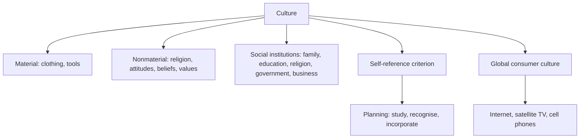

# EN-4 - Culture, Society and Global Consumer Culture

Covers: the task of global marketers, the self-reference criterion, definitions of culture, social institutions, material and nonmaterial culture, attitude, belief and value, and global consumer cultures. **(class)** unless tagged.

## The task of the global marketer (class)
1. Study and understand the cultures of the countries where the firm does business.
2. Understand how an unconscious reference to **one's own cultural values, the self-reference criterion (SRC)**, may colour perception of the market.
3. Build that understanding into the marketing planning process.

**(general)** Cateora's four steps to remove SRC bias: define the problem in home-culture terms; define it in host-culture terms; isolate the SRC influence and examine it; redefine the problem without the SRC bias and solve for the host market. Use as an optional extension.

## What culture is (class)
- Culture = **ways of living, built up by a group of human beings and transmitted from one generation to the next**.
- It has conscious and unconscious values, ideas, attitudes and symbols, and is acted out in social institutions.
- It is **physical** (clothing, tools) and **nonphysical** (religion, attitudes, beliefs, values).
- Second definition (slide): "**the collective programming of the mind** that distinguishes the members of one category of people from those of another". A category can be a nation, ethnic group, gender group, organisation or family. **(general)** This is Geert Hofstede's wording.

## Social institutions (class)
Family, education, religion, government, business. They **reinforce cultural norms**.

## Material and nonmaterial culture (class)
The slide shows "abstract culture" (the nonmaterial side): religion, perceptions, attitudes, beliefs, values. Material culture is the visible side: tools, clothing, products. Marketing exam point: a firm sells material culture (products) into a nonmaterial culture it cannot see.

## Attitude, belief, value (class definitions, keep the wording)
| Term | Definition on the slide | Example **(general)** |
|---|---|---|
| **Attitude** | Learned tendency to respond in a consistent way to a given object or entity | Liking or disliking a foreign brand |
| **Belief** | An organised pattern of knowledge that an individual holds to be true about the world | "Packaged food is less fresh" |
| **Value** | Enduring belief or feeling that a specific mode of conduct is personally or socially preferable to another | Respect for elders, thrift |

Order of depth: values are the deepest and most enduring; beliefs sit between; attitudes are the most changeable. **(general)**

## Global consumer culture (class)
- Emerging **global consumer cultures**: people who share meaningful sets of consumption-related symbols. Slide examples: pub culture, coffee culture, fast-food culture, credit-card culture.
- Primarily the product of a technologically interconnected world: **internet, satellite TV, cell phones**.
- Marketing consequence: shared symbols let a firm standardise parts of the mix for global segments (see EN-5 on marketing's impact on culture).

## Optional depth: dimensions to compare cultures (general)
Use only if a question asks "how do cultures differ".
- **Hofstede:** power distance, individualism vs collectivism, masculinity vs femininity, uncertainty avoidance, long-term vs short-term orientation (a sixth, indulgence vs restraint, was added later). **[VERIFY]** scores before quoting.
- **Hall:** high-context cultures rely on setting and relationships; low-context cultures rely on explicit words. Affects advertising copy and negotiation.

## Worked example: apply SRC to a market brief (exam format)
**Question.** A fictional Indian ready-meal firm, Tarang Foods Ltd, assumes that a host market eats a heavy main meal at 8 pm and wants lunch-box packs. Explain the SRC risk and how to correct it.

**Answer.**
1. Define SRC: unconscious reference to one's own cultural values when judging a market.
2. Identify the bias: the firm assumes the host market shares the Indian meal pattern, lunch-box habit and attitude to packaged food.
3. Check against the culture levels.
| Level | Home assumption | What to verify in the host market |
|---|---|---|
| Value | Home-cooked food is superior | How the host society sees convenience food |
| Belief | Packaged means stale | Beliefs about freshness and preservatives |
| Attitude | Brand loyalty to a trusted name | Openness to a foreign brand |
| Material | Steel lunch box, spice level | Preferred pack, taste and meal times |
4. Correct: do local consumer research; use local partners; test a prototype before scaling.
5. Decision line: launch a pilot in one city with the recipe and pack adjusted from research, and scale only if trial and repeat targets are met. Interpretation: removing SRC converts a home-market guess into a host-market fact and lowers the cost of a failed launch.

## What to remember
- Three tasks: study cultures, recognise SRC, build into planning.
- Culture = ways of living passed across generations, and collective programming of the mind.
- Five institutions: family, education, religion, government, business.
- Attitude learned tendency; belief organised knowledge held true; value enduring preference of conduct.
- Global consumer cultures come from internet, satellite TV, cell phones.

## Concept map

## Flashcards
Q: What is the self-reference criterion?
A: An unconscious reference to one's own cultural values that may influence perception of a foreign market.

Q: What are the three tasks of global marketers regarding culture?
A: Study the cultures; understand SRC; incorporate this into marketing planning.

Q: Define culture in the class slide.
A: Ways of living built up by a group and transmitted from one generation to another; also the collective programming of the mind distinguishing one category of people from another.

Q: Name the five social institutions.
A: Family, education, religion, government, business.

Q: Distinguish physical and nonphysical culture.
A: Physical: clothing and tools; nonphysical: religion, attitudes, beliefs and values.

Q: Define attitude, belief and value as on the slide.
A: Attitude: learned tendency to respond consistently to an object; belief: organised pattern of knowledge held true; value: enduring belief that a mode of conduct is preferable.

Q: Give four examples of global consumer cultures from the slide.
A: Pub culture, coffee culture, fast-food culture, credit-card culture.

Q: What technologies create global consumer culture?
A: Internet, satellite TV and cell phones.

Q: Whose wording is "collective programming of the mind"?
A: Geert Hofstede (general knowledge; the slide does not name him).

## Sources
- Faculty deck Unit 2 culture slides; SRC steps (Cateora), Hofstede and Hall **(general)**. Tarang Foods Ltd is fictional.
- Back to: [[International Marketing Unit 2 - EN-1 Marketing Environment Framework and the World Economy]]
- [[International Marketing Unit 2 - Global Environment MOC (Node Map)]]
