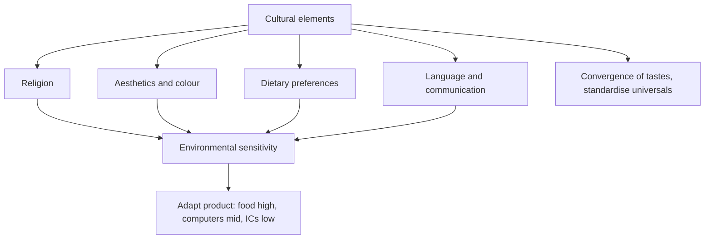

# EN-5 - Religion, Aesthetics, Diet and Environmental Sensitivity

Covers: how religion, aesthetics (including colour), dietary preferences and language shape marketing, marketing's impact on culture (respond or change), convergence of tastes, and the environmental sensitivity chart. **(class)** unless tagged.

## Religion (class)
- Major religions on the slide: **Buddhism, Christianity, Hinduism, Islam, Judaism**. They are a source of beliefs, attitudes and values.
- Religious tenets, practices, holidays and history affect marketing activity. **(general)** Examples: food rules (halal, vegetarian, beef or pork restrictions), festival-linked demand peaks, and limits on advertising content. Only qualitative examples; check each market **[VERIFY]**.

## Aesthetics (class)
- The sense of what is beautiful and what is not; good taste versus tastelessness or even obscenity.
- **Visual:** colour or shape of a product, label or package.
- **Styles:** degrees of complexity are perceived differently around the world.

## Aesthetics and colour (class)
| Colour | Meaning on the slide |
|---|---|
| Red | Blood, wine-making, activity, heat, vibrancy in many countries; poorly received in some African countries |
| White | Purity and cleanliness in the West; death in parts of Asia |
| Gray | Inexpensive in Japan and China; high quality and expensive in the US |
Rule: test colour, name and packaging in each market before standardising.

## Dietary preferences (class)
- **Domino's Pizza** pulled out of Italy because its products were seen as "too American", with bold tomato sauce and heavy toppings. **[VERIFY]** the exit date from a news source before giving details.
- **Subway** had to educate Indians about the benefits of sandwiches because they do not normally eat bread (slide claim).
- Lesson: food tastes are tied to identity, so adaptation or education is required.

## Language and communication (general, a gap on the slides)
The slide text lists "language and communication" as a cultural difference but gives no slide on it. Add: literal translation errors in names and slogans, multiple languages within one country, and non-verbal communication (gestures, silence, eye contact). Keep to qualitative points.

## Marketing's impact on culture (class)
- **Universal aspects** of culture are opportunities to **standardise** parts of a marketing programme.
- Culture, the "programming of the mind", has a **pervasive and changing** influence on each national market. Global marketers must recognise it and **either respond to it or change it**.
- Attitudes, values and beliefs vary by country. Differences in religion, aesthetics, dietary customs, language and communication affect local reaction to brands and products, and the ability of company staff to work across cultures.
- Increased travel and better communications cause a **convergence of tastes and preferences** in some product categories.

## Marketing implications and environmental sensitivity (class)
- Cultural factors must be considered for **both consumer and industrial products**.
- **Environmental sensitivity** = the extent to which products must be adapted to the culture-specific needs of different national markets.
- Chart on the slide (product adaptation against environmental sensitivity): **integrated circuits** sit low on both, **computers** in the middle, **food** high on both.
- Culture influences consumption **independent of social class and income**. **Food is the most culturally sensitive category of consumer goods.**
- Slide examples: dehydrated **Knorr soups** did not catch on in the US, which preferred canned soups; **Starbucks** overcame cultural barriers in Great Britain.
- Case study listed: **Kellogg's in India.** The deck gives only the title. **Gap:** for the exam, use the general theme without numbers: a Western breakfast cereal faced Indian habits of hot, home-cooked breakfast, milk served warm, and taste preferences, so the firm needed product and communication adaptation. Cite it as "per class case discussion" and add specifics only if your own class notes have them. **(general, qualitative)**

## Worked example: standardise or adapt (exam format)
**Question.** A fictional global brand wants to sell (a) industrial sensors, (b) a laptop, (c) a packaged breakfast cereal in a new Asian market. Using environmental sensitivity, decide the degree of adaptation.

**Answer.**
1. Define: environmental sensitivity is the degree to which a product must be adapted to culture-specific needs.
2. Place each on the slide chart.
| Product | Sensitivity | Adaptation | Reason |
|---|---|---|---|
| Industrial sensors | Low (like integrated circuits) | Low | Technical specs are universal |
| Laptop | Medium (like computers) | Medium | Keyboard language, power plug, price tiers, bundled software |
| Breakfast cereal | High (like food) | High | Taste, meal habits, religious or dietary rules, pack size |
3. Decision line: standardise the sensors, localise the laptop's interface and service, and fully adapt the cereal's recipe and communication after local testing. Interpretation: adapt where culture bites hardest, standardise where it does not, so that cost is spent only where it earns demand.

## What to remember
- Religion, aesthetics, diet and language drive local reaction to brands.
- Colour: red, white and gray carry different meanings across countries.
- Respond to culture or change it; universal elements allow standardisation.
- Food is the most culturally sensitive category; ICs the least, computers in between.
- Examples: Domino's in Italy, Subway in India, Knorr in the US, Starbucks in Britain.

## Concept map

## Flashcards
Q: Which five religions does the slide list?
A: Buddhism, Christianity, Hinduism, Islam and Judaism.

Q: What does aesthetics cover in marketing?
A: The sense of beautiful and not beautiful, good taste; visual (colour, shape, package) and styles of complexity.

Q: Give the colour examples on the slide.
A: Red poorly received in some African countries; white means purity in the West and death in parts of Asia; gray is cheap in Japan and China but high quality in the US.

Q: What happened to Domino's in Italy per the slide?
A: It pulled out because its products were seen as too American, with bold tomato sauce and heavy toppings.

Q: What did Subway have to do in India per the slide?
A: Educate Indians on the benefits of sandwiches because they do not normally eat bread.

Q: What choices does culture give a global marketer?
A: Respond to it or change it; universal elements can be standardised.

Q: Define environmental sensitivity.
A: The extent to which products must be adapted to the culture-specific needs of different national markets.

Q: Rank food, computers and integrated circuits by environmental sensitivity.
A: Food highest, computers medium, integrated circuits lowest.

Q: Which examples show food's cultural sensitivity on the slide?
A: Dehydrated Knorr soups failing in the US (canned preferred); Starbucks overcoming barriers in Great Britain.

Q: What causes convergence of tastes?
A: Increasing travel and improved communications.

## Sources
- Faculty deck Unit 2 religion, aesthetics, diet, marketing's impact and environmental sensitivity slides. Language and the Kellogg's theme are **(general)**; the deck gives the case title only.
- Back to: [[International Marketing Unit 2 - EN-4 Culture Society and Global Consumer Culture]]
- [[International Marketing Unit 2 - Global Environment MOC (Node Map)]]
