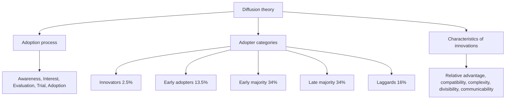

# EN-6 - Cultural Dynamics and Diffusion Theory

Covers: the five-stage adoption process and the role of information sources, the five adopter categories with their shares, the five characteristics of innovations (relative advantage, compatibility, complexity, divisibility, communicability), and a scoring method. **(class)** unless tagged. In the module map "cultural dynamics in the global market" is covered on the slides only through diffusion theory and the convergence points in EN-5.

## The adoption process (class)
Mental stages from first knowledge of an innovation to adoption or purchase:
**Awareness, Interest, Evaluation, Trial, Adoption** (hook: A-I-E-T-A).
- At **awareness**, impersonal sources such as mass-media advertising matter most.
- At **evaluation, trial and adoption**, **personal sources matter more**: salespeople and **word of mouth** become the major forces on the decision to buy.
- Marketing consequence: advertise to create awareness; use demonstrations, samples, dealers and referrals to convert.

## Adopter categories (class, from the curve)
| Category | Share of adopters | Life-cycle position on the slide |
|---|---|---|
| Innovators | 2.5% | Introduction |
| Early adopters | 13.5% | Growth |
| Early majority | 34% | Rising into maturity |
| Late majority | 34% | Maturity |
| Laggards | 16% | Decline |
Check: 2.5 + 13.5 + 34 + 34 + 16 = 100%. Cumulative: 2.5%, 16%, 50%, 84%, 100%. The curve is bell-shaped, with the early and late majority at the peak. **(general)** The categories and shares are Everett Rogers'.

## Five characteristics of innovations (class)
An innovation is something new. Five factors affect the **rate of adoption**.
| Factor | Meaning on the slide | Higher is better for adoption? |
|---|---|---|
| **Relative advantage** | How the new product compares with existing products or methods in customers' eyes; a major influence on adoption rate | Yes |
| **Compatibility** | Extent to which it fits existing values and past experiences of adopters | Yes |
| **Complexity** | Degree to which it is difficult to understand and use | **No**, lower is better |
| **Divisibility** | Wide income gaps across the globe cause large differences in preferred purchase quantities and sizes | Yes (smaller units help in low-income markets) |
| **Communicability** | Degree to which benefits or value can be communicated to the market | Yes |
Memory hook: **R-C-C-D-C** (Relative advantage, Compatibility, Complexity, Divisibility, Communicability). **(general)** The textbook list uses "trialability" and "observability" in place of divisibility and communicability; give the class list in the exam.

## Link to culture
Compatibility is the cultural filter: a product that clashes with local values, religion or habits adopts slowly (EN-5). Divisibility links to income stages (EN-3): small packs for low-income markets.

## Worked example: score an innovation across two markets (exam format)
**Question.** A fictional firm launches a solar lantern in two markets. Using the five characteristics, score each from 1 (poor for adoption) to 5 (very good); for complexity score ease of use. Judge which market to enter first. (Scores illustrative.)

**Answer.**
1. State the five factors and the scoring rule (complexity scored as ease of use).
2. Score.
| Factor | Market P (rural, no grid) | Market Q (urban, grid power) |
|---|---|---|
| Relative advantage | 4 | 2 |
| Compatibility | 3 | 4 |
| Complexity (ease) | 5 | 3 |
| Divisibility (pack or price flexibility) | 2 | 5 |
| Communicability | 4 | 2 |
| **Total (max 25)** | **18** | **16** |
3. Arithmetic check: P = 4 + 3 + 5 + 2 + 4 = 18; Q = 2 + 4 + 3 + 5 + 2 = 16.
4. Fix weakness: Market P has low divisibility, so introduce pay-as-you-go or instalment pricing.
5. Decision line: enter Market P first; its advantage is the lack of grid power, but it needs a smaller price unit. Interpretation: the score predicts the speed of adoption, and each low score points to a specific marketing fix.

## Worked example: how many buyers at each stage (illustrative)
Market potential 20,00,000 buyers. Using the slide shares:
| Category | Share | Buyers |
|---|---|---|
| Innovators | 2.5% | 50,000 |
| Early adopters | 13.5% | 2,70,000 |
| Early majority | 34% | 6,80,000 |
| Late majority | 34% | 6,80,000 |
| Laggards | 16% | 3,20,000 |
| Total | 100% | 20,00,000 |
Interpretation: innovators and early adopters together are 16%, or 3,20,000 buyers, so the campaign must reach about 3.2 lakh opinion leaders to trigger the 6.8 lakh early majority.

## What to remember
- Adoption stages: awareness, interest, evaluation, trial, adoption.
- Mass media dominates at awareness; personal sources and word of mouth dominate the later stages.
- Adopter shares: 2.5, 13.5, 34, 34, 16.
- Five factors: relative advantage, compatibility, complexity, divisibility, communicability.
- Low complexity speeds adoption; compatibility is the cultural test.

## Concept map

## Flashcards
Q: Name the five stages of the adoption process.
A: Awareness, interest, evaluation, trial, adoption.

Q: Which information sources matter at which stage?
A: Impersonal sources like mass media at awareness; personal sources, salespeople and word of mouth at evaluation, trial and adoption.

Q: State the five adopter categories and their shares.
A: Innovators 2.5%, early adopters 13.5%, early majority 34%, late majority 34%, laggards 16%.

Q: List the five characteristics of innovations in the class slides.
A: Relative advantage, compatibility, complexity, divisibility, communicability.

Q: Define compatibility.
A: The extent to which a product is consistent with existing values and past experiences of adopters.

Q: Why does divisibility matter globally?
A: Wide income gaps produce big differences in preferred purchase quantities and sizes.

Q: Which characteristic works against adoption when high?
A: Complexity, the difficulty of understanding and using the innovation.

Q: Illustrative: how many innovators and early adopters in a 20,00,000-buyer market?
A: 16% of 20,00,000 = 3,20,000 (50,000 innovators plus 2,70,000 early adopters).

Q: How does compatibility connect to culture?
A: Products that clash with local values, beliefs or habits are adopted slowly.

## Sources
- Faculty deck Unit 2 diffusion theory slides. Rogers attribution and textbook alternatives **(general)**. Markets P and Q and all numbers are illustrative.
- Back to: [[International Marketing Unit 2 - EN-5 Religion Aesthetics Diet and Environmental Sensitivity]]
- [[International Marketing Unit 2 - Global Environment MOC (Node Map)]]
