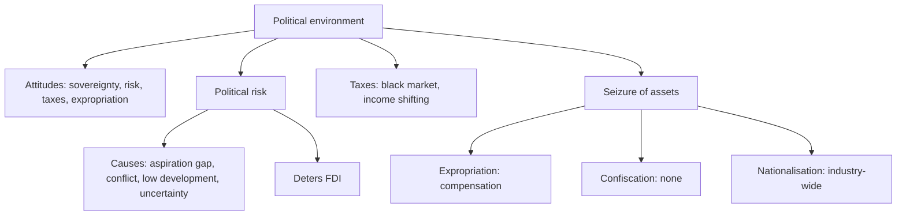

# EN-7 - Political Environment and Political Risk

Covers: what the political environment is, the governing party's attitudes, political risk and its causes, taxes, and the three seizure terms (expropriation, confiscation, nationalisation). **(class)** unless tagged.

## The political environment (class)
- It refers to the **political or government actions that impact business operations**.
- Political cultures provide context. Look at the governing party's attitude toward:
  1. **Sovereignty** (a state's supreme authority within its territory)
  2. **Political risk**
  3. **Taxes**
  4. **Expropriation** (governmental action to dispossess a foreign company or investor)

## Political risk (class)
- **Definition:** risk of a change in the political environment or government policy that would **adversely affect a company's ability to operate effectively and profitably**.
- When perceived political risk is high, a country has a **difficult time attracting foreign direct investment**.
- **Causes:**
  - Tension between aspirations and reality; mainly in **lower and lower-middle income** countries (slide example: Indonesia and its economic crisis).
  - In high-income countries it is generally due to a **long-standing conflict** (slide example: Northern Ireland).
  - **The less developed a country, the greater the risk.**
  - **Increased economic uncertainty increases risk.**
- Link to EN-3: the income group is a first screen for political risk.
- **(general)** Risk management steps: assess (country risk ratings, local advisers), reduce exposure (joint venture, local sourcing, local debt), insure (political risk insurance, for example MIGA of the World Bank Group **[VERIFY]**), and monitor.

## Taxes (class)
- Government taxation policy matters; **high taxation can lead to growth of a black market**.
- **Corporate taxation:** companies try to limit tax liability by **shifting the location of income**. **(general)** Transfer pricing is the usual technique, and tax authorities police it.

## Seizure of assets (class)
| Term | Meaning on the slide | Compensation |
|---|---|---|
| **Expropriation** | Governmental action to dispossess a foreign company or investor | Should be "**prompt, effective and adequate**" |
| **Confiscation** | Expropriation with **no compensation** | None |
| **Nationalisation** | Government takes control of some or all enterprises in an **entire industry** | Acceptable under international law if it **satisfies a public purpose** and **includes compensation** |
**(general)** Textbooks add a third test: non-discrimination, that is, the foreign firm is not singled out. The slide text for this list is cut off after "includes compensation"; write the two class conditions and mention the third as an addition. **[VERIFY]**

Memory line: expropriation = one firm seized, with pay; confiscation = seized with no pay; nationalisation = a whole industry taken over, lawful only with public purpose and compensation.

## Worked example: classify government actions and decide entry (exam format)
**Question.** A fictional power-equipment firm, Vindhya Turbines Ltd, plans a plant in a lower-middle-income country. In the past decade that government (a) seized one foreign power plant and paid fair market value within six months, (b) took over all private sugar mills and paid nothing, (c) raised corporate tax sharply. Classify (a) and (b), comment on (c), and advise.

**Answer.**
1. Classify.
| Action | Term | Reason |
|---|---|---|
| (a) One foreign plant seized, paid on time at fair value | Expropriation with prompt, effective, adequate compensation | Compensation given |
| (b) All sugar mills, no pay | Nationalisation of an entire industry; and since no compensation, confiscation | Whole industry; fails the compensation test, so not acceptable under international law as per slide |
| (c) Corporate tax raised | Taxation risk | Firms may shift income; high tax can grow the black market |
2. Political risk reading: history of seizure in a lower-middle-income country means high risk, which also deters FDI.
3. Risk response: joint venture with a local partner, local borrowing, political risk insurance, phased investment.
4. Decision line: enter by a minority-stake joint venture or licensing first, not a wholly owned plant, and invest the large capital only after two years of stable policy. Interpretation: because the host's behaviour already shows both lawful and unlawful seizure, the firm trades some control for lower exposure.

## What to remember
- Political environment = government actions affecting business; four attitudes: sovereignty, political risk, taxes, expropriation.
- Political risk is any adverse policy change; it deters FDI.
- Causes: aspiration-reality tension (poorer countries), long-standing conflict (richer), low development, economic uncertainty.
- High tax feeds a black market; firms shift income to limit tax.
- Expropriation (pay), confiscation (no pay), nationalisation (whole industry; public purpose plus compensation).

## Concept map

## Flashcards
Q: What is the political environment?
A: The political or government actions that impact business operations.

Q: List the governing party's attitudes the slide says to examine.
A: Sovereignty, political risk, taxes and expropriation.

Q: Define political risk.
A: Risk of a change in the political environment or government policy that adversely affects a company's ability to operate effectively and profitably.

Q: Which income groups mainly face political risk from tension between aspirations and reality, and what example is given?
A: Lower and lower-middle income countries; Indonesia and its economic crisis.

Q: What causes political risk in high-income countries, per the slide?
A: Generally a long-standing conflict, for example Northern Ireland.

Q: What happens to a country's FDI when political risk is high?
A: It has a difficult time attracting foreign direct investment.

Q: Define expropriation and the compensation standard.
A: Governmental action to dispossess a foreign company or investor; compensation should be prompt, effective and adequate.

Q: Distinguish confiscation from expropriation.
A: Confiscation is expropriation with no compensation.

Q: When is nationalisation acceptable under international law (slide)?
A: When it satisfies a public purpose and includes compensation.

Q: Why do companies shift the location of income?
A: To limit corporate tax liability; high taxation can also cause a black market.

## Sources
- Faculty deck Unit 2 political environment slides; risk-response steps, MIGA, transfer pricing, non-discrimination test **(general)**. Vindhya Turbines Ltd is fictional.
- Back to: [[International Marketing Unit 2 - EN-3 Stages of Market Development and Developing Markets]]
- [[International Marketing Unit 2 - Global Environment MOC (Node Map)]]
