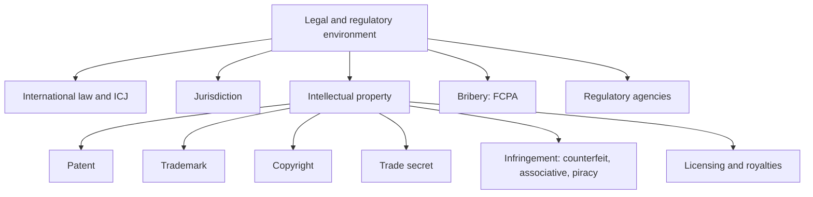

# EN-8 - Legal and Regulatory Environment

Covers: international law and the ICJ, jurisdiction, the four intellectual property forms, infringement (counterfeiting, associative counterfeit, piracy), licensing and trade secrets, the Foreign Corrupt Practices Act, and the regulatory environment. **(class)** unless tagged.

## International law (class)
- The **rules and principles that nation-states consider binding among themselves**.
- Disputes between nations are issues of **public international law**; the judicial arm of the United Nations is the **World Court or International Court of Justice (ICJ)**.
- **(general)** The ICJ hears disputes between states, not between a private firm and a state. Firm-level disputes go to host courts or arbitration (for example under a contract clause or a bilateral investment treaty).

## Jurisdiction (class)
- A court's **authority to rule on controversies arising outside a nation's borders**, or to exercise power over individuals or entities from different countries.
- Employees of foreign companies should know how far they are subject to **host-country court jurisdiction**.
- Courts have jurisdiction if it can be shown that the company is **doing business in the state where the court sits**.
- **(general)** Reduce risk with contract clauses fixing the governing law, the court and arbitration.

## Intellectual property (class)
- **WIPO definition:** "creations of the mind: inventions, literary and artistic works, and symbols, names, images, and designs used in commerce".
- Individuals and firms are free to own and control IP rights.
- **IP must be registered in each country** where business is conducted. **(general)** Rights are national (territorial); registration at home does not protect abroad. Treaties such as TRIPS, the Paris Convention and the Madrid system ease this **[VERIFY]**.
| Form | Meaning on the slide |
|---|---|
| **Patent** | Gives an inventor the exclusive right to make, use and sell an invention for a specified period |
| **Trademark** | Distinctive symbol, word or object identifying a product made or marketed by a firm; becomes a **registered trademark** once accepted by the Trademark Office |
| **Copyright** | Establishes ownership of a written, recorded, performed or filmed creative work |
| **Trade secret** | Know-how (manufacturing methods, formulas, plans) kept secret within a business |

## Infringement of IP (class)
| Term | Meaning |
|---|---|
| **Counterfeiting** | Unauthorised copying and production of a product |
| **Associative counterfeit / imitation** | Product name differs slightly from a well-known brand |
| **Piracy** | Unauthorised publication or reproduction of copyrighted work |

## Licensing and trade secrets (class)
- **Licensing:** a contract in which a **licensor** lets a **licensee** use patents, trademarks, trade secrets, technology and other intangibles in return for **royalties** or other compensation.
- Three considerations: **what assets may be licensed, how to price them, the rights granted**.
- **Trade secrets** = confidential information with commercial value, not in the public domain, and kept secret by steps the owner has taken. To prevent disclosure use **confidentiality contracts**. **(general)** Add access limits and non-compete clauses.
- Link: licensing as an entry mode is Unit 3.

## Bribery and corruption (class)
**Foreign Corrupt Practices Act (FCPA):**
- Requires publicly held companies to keep **internal accounting controls that record all transactions**.
- Makes it a **crime for a US corporation to bribe an official of a foreign government or political party** to obtain or retain business.
- **Prohibits payments to third parties** when there is reason to believe they may be passed to foreign officials.
- **(general)** The US Act reaches US firms and their agents abroad. India has no direct FCPA equivalent for bribing foreign officials. The nearest domestic law, which covers Indian public servants, is the Prevention of Corruption Act, 1988 (amended 2018). An Indian firm's controls are its compliance policy, host-country law, and any US or UK nexus (FCPA, UK Bribery Act 2010). **[VERIFY]** details before quoting in an answer beyond naming them.

## The regulatory environment (class)
- **Agencies, governmental and non-governmental, that enforce laws or set guidelines** for doing business.
- Issues they address: **price control; valuation of imports and exports; trade practices; labelling; food and drug regulations; employment conditions; advertising content; competitive practices**.
Memory hook: P-V-T-L-F-E-A-C (Price, Valuation, Trade practices, Labelling, Food and drug, Employment, Advertising, Competition).

## Worked example: legal checklist for entry (exam format)
**Question.** A fictional Indian herbal-cosmetics firm, Nilgiri Botanicals Ltd, plans to sell in a foreign market and license its brand to a local maker. A local firm already sells a product with a near-identical name. Identify the legal issues and advise.

**Answer.**
1. Intellectual property: register the trademark and any patent in the host country; home registration does not cover abroad.
2. Infringement: the near-identical name is an **associative counterfeit**; it needs an objection or opposition before the Trademark Office. If outright copies appear, that is counterfeiting.
3. Licensing decision.
| Licensing consideration | Application |
|---|---|
| What assets | Trademark and recipe know-how; keep the core formula as a trade secret |
| How to price | Royalty on sales plus a minimum fee |
| Rights granted | Territory, duration, quality control, no sub-licensing |
4. Trade secrets: confidentiality contracts with the licensee and staff.
5. Jurisdiction: name governing law and arbitration in the licence contract.
6. Regulatory: check labelling, cosmetics and ingredient rules and advertising content rules in the host market. **(general)**
7. Bribery: forbid payments through agents to officials; keep records.
8. Decision line: register first, then license in stages with confidentiality and quality clauses, because a licence granted before registration may let the licensee register the mark locally. Interpretation: IP protection is a precondition for any entry mode that shares the brand or know-how.

## What to remember
- Public international law governs states; the ICJ is the UN's judicial arm.
- Jurisdiction follows where the firm does business; use contract clauses.
- IP forms: patent, trademark, copyright, trade secret; register in each country.
- Infringement: counterfeiting, associative counterfeit, piracy.
- Licensing: licensor, licensee, royalty; price, assets, rights.
- FCPA: accounting controls, no bribes to officials, no payments via third parties.

## Concept map

## Flashcards
Q: What is international law?
A: The rules and principles that nation-states consider binding among themselves.

Q: Which body is the judicial arm of the United Nations for disputes between nations?
A: The International Court of Justice (World Court).

Q: Define jurisdiction in the class slide.
A: A court's authority to rule on controversies arising outside a nation's borders or to exercise power over individuals or entities from different countries.

Q: When do courts have jurisdiction over a foreign company?
A: When the company is shown to be doing business in the state where the court sits.

Q: What is IP according to WIPO?
A: Creations of the mind: inventions, literary and artistic works, and symbols, names, images and designs used in commerce.

Q: Name the four forms of IP and define patent.
A: Trademark, copyright, patent, trade secret; a patent gives an inventor the exclusive right to make, use and sell an invention for a specified period.

Q: Distinguish counterfeiting, associative counterfeit and piracy.
A: Counterfeiting: unauthorised copying of a product; associative counterfeit: name slightly differs from a famous brand; piracy: unauthorised reproduction of copyrighted work.

Q: What three points must a licence consider?
A: Which assets may be licensed, how to price them, and the rights granted.

Q: How are trade secrets protected?
A: Through confidentiality contracts and steps taken to keep the information secret.

Q: What are the three requirements of the FCPA on the slide?
A: Internal accounting controls recording all transactions; no bribes by US corporations to foreign officials or parties; no payments to third parties likely to reach officials.

Q: List the areas regulators cover.
A: Price control, valuation of imports and exports, trade practices, labelling, food and drug rules, employment conditions, advertising content, competitive practices.

## Sources
- Faculty deck Unit 2 legal and regulatory slides; Indian and UK anti-bribery laws, treaties, ICJ scope **(general)**. Nilgiri Botanicals Ltd is fictional.
- Back to: [[International Marketing Unit 2 - EN-7 Political Environment and Political Risk]]
- [[International Marketing Unit 2 - Global Environment MOC (Node Map)]]
