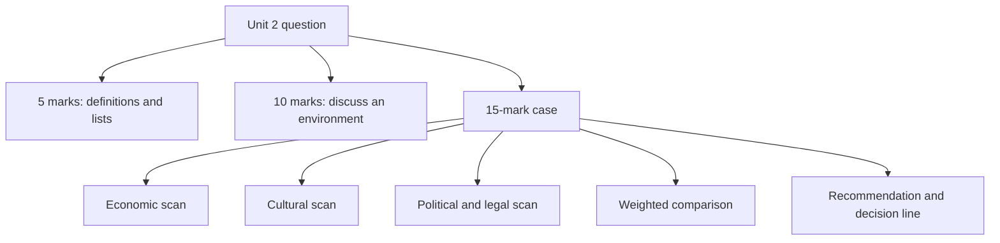

# EN-9 - Unit 2 Exam Answers

Covers: likely 5-mark and 10-mark questions with skeletons, and a 15-mark case layout with a worked case on environment analysis for market entry. **(class)** content from the faculty slides.

## The paper (assumed)
No course plan is on file, so assume the standard Christ BBA ESE: **50 marks, 2 hours.** Section A: 3 of 5 x 5. Section B: 2 of 3 x 10. Section C: one compulsory 15-mark case. Budget about 7 minutes per 5-mark answer, 15 per 10-mark and 30 for the case. **[VERIFY]** against the real paper pattern when the course plan arrives. Unit 2 is theory plus environment analysis, so it feeds Sections A and B and gives the frame for the case.

## 5-mark answers (about 120-150 words, one table or list)
| Likely question | Skeleton (marks) |
|---|---|
| Explain the international marketing environment | Kotler definition (1); global forces list (1); three layers: global, domestic, organisational around 4Ps (2); uncontrollable vs controllable (1) |
| Differentiate the four economic systems with an example each | 2 x 2 of allocation and ownership (1); one line each for four systems (3); examples: North America/EU, former USSR, Sweden, China (1) |
| Stages of market development | World Bank, GNI per capita (1); four groups with slide bands (2); one characteristic each (1); use for segmentation (1) |
| Marketing opportunities and myths in LDCs / BOP | Four opportunity rules (2); five mistaken assumptions, name at least four (2); role of marketing (1) |
| Self-reference criterion | Define (1); three tasks of global marketers (1); example (1); correction steps (2) |
| Attitude, belief, value | Three definitions (3); example each (2) |
| Role of religion and aesthetics in marketing | Religion list and effect (2); aesthetics visual and styles (1); colour examples (2) |
| Environmental sensitivity | Definition (1); chart: food high, computers mid, ICs low (2); Knorr, Starbucks (1); implication (1) |
| Diffusion theory: adoption process and adopter categories | Five stages (2); information sources (1); five categories with shares (2) |
| Characteristics of innovations | Five factors with a line each (4); link to adoption rate (1) |
| Political risk and its causes | Definition (1); causes (2); effect on FDI (1); example Indonesia or Northern Ireland (1) |
| Expropriation, confiscation, nationalisation | Three definitions (3); compensation standard (1); public purpose test (1) |
| Forms of intellectual property and infringement | Four forms (2); registration in each country (1); counterfeiting, associative counterfeit, piracy (2) |
| FCPA | Accounting controls (1); bribery crime (2); third-party payments (1); effect on US firms (1) |
| Short notes: G-8 and OECD, BOP, global consumer culture | Definition, members or features, one example |

## 10-mark answers (about 300-350 words)
**Layout:** introduction (1-2), body in headed points or a table (6), interpretation or conclusion (1-2).
| Likely question | Skeleton |
|---|---|
| Discuss the global economic environment and its implications for marketers | World economy new realities (2); four systems table (3); four income stages table and BRICS (3); implication: saturation and segmentation (2) |
| Explain how economic development stages shape marketing in LDCs and high-income countries | Bands and traits table (3); LDC rules and BOP myths (3); high-income traits (2); product saturation (1); conclusion (1) |
| Discuss the role of culture in international marketing | Definitions and institutions (2); attitude, belief, value (1); religion, aesthetics, diet, language (3); respond or change, convergence (2); environmental sensitivity (2) |
| Explain diffusion theory and its marketing implications | Adoption process (2); adopter categories with shares (2); five factors (3); implications for global launch sequence and pricing (2); example (1) |
| Discuss the political environment and political risk | Definition and attitudes (2); causes and FDI effect (2); taxes (1); seizure terms table (3); managing risk (2) |
| Discuss the legal and regulatory environment of international marketing | International law and jurisdiction (2); IP forms and infringement (3); licensing and trade secrets (2); FCPA (1); regulatory areas (2) |

## 15-mark case layout (Section C)
The case will describe a firm and one or two markets and ask for an assessment and recommendation. Unit 2 supplies the **environment scan**. Spend about 30 minutes.
| Block | Marks | What to write |
|---|---|---|
| 1. Frame | 1 | One line: environment = global, domestic and organisational forces (Kotler); the firm adapts to what it cannot control |
| 2. Economic scan | 3 | System type (allocation and ownership); World Bank stage and GNI band; saturation and income; BOP or LDC points |
| 3. Social and cultural scan | 3 | Religion, diet, aesthetics and colour, language; SRC check; environmental sensitivity of the product; adoption factors (compatibility, divisibility) |
| 4. Political and legal scan | 3 | Political risk level and cause; tax; seizure history; IP registration; licensing and trade secrets; FCPA; labelling and advertising rules |
| 5. Weighted comparison | 2 | Score and weight the four environments for each market; show the arithmetic |
| 6. Recommendations | 2 | Two or three actions with owners: adaptation, entry sequence, risk reduction |
| 7. Decision line | 1 | Which market first, what changes, and the interpretation |

### Worked case (illustrative, fictional)
**Question.** Tarang Foods Ltd, an Indian packaged-snack maker (fictional), is choosing between Altoria and Borania for its first export market. Altoria: GNI per capita $6,800, market economy, rising urban incomes, mixed religions with a large vegetarian minority, stable government, strong trademark registry, but strict labelling rules. Borania: GNI per capita $900, mostly farming, state controls distribution, heavy dependence on foreign aid, past nationalisation of two industries without compensation, weak IP enforcement, but strong demand for low-cost food and few competitors. Recommend. (All data illustrative.)

**Answer layout.**
1. **Frame.** The environment sits around the 4Ps; Tarang controls only the mix and must adapt the rest.
2. **Economic scan.**
| Factor | Altoria | Borania |
|---|---|---|
| System | Market capitalism | Closer to centrally planned (state controls distribution) |
| Stage (slide bands) | $6,800 falls in $4,126 to $12,745: upper-middle (NIE) | $900 is at most $1,045: low income |
| Implication | Rising wages, urbanisation; branded and mid-range snacks | Small unit packs, low price, aid dependence; BOP lesson: the poor do spend and can be served |
3. **Social and cultural scan.** Altoria: a vegetarian minority and mixed religions mean a vegetarian recipe and clear labelling; food is the most culturally sensitive category, so high adaptation and local testing; check SRC. Borania: tastes untested; adoption turns on divisibility (small pack), compatibility and communicability through word of mouth.
4. **Political and legal scan.**
| Factor | Altoria | Borania |
|---|---|---|
| Political risk | Low | High: nationalisation without compensation is confiscation of an entire industry; the less developed, the greater the risk |
| IP | Register the trademark; strong registry | Weak enforcement; counterfeit risk |
| Regulation | Labelling rules to meet | Unclear; state distribution channel |
5. **Weighted comparison** (illustrative judgement scores, 1 to 5; weights economic 30%, cultural 30%, political 25%, legal 15%).
| Environment | Weight | Altoria score | Weighted | Borania score | Weighted |
|---|---|---|---|---|---|
| Economic | 0.30 | 4 | 1.20 | 2 | 0.60 |
| Cultural | 0.30 | 3 | 0.90 | 4 | 1.20 |
| Political | 0.25 | 3 | 0.75 | 2 | 0.50 |
| Legal | 0.15 | 4 | 0.60 | 2 | 0.30 |
| **Total** | 1.00 | | **3.45** | | **2.60** |
Arithmetic: Altoria = 1.20 + 0.90 + 0.75 + 0.60 = 3.45; Borania = 0.60 + 1.20 + 0.50 + 0.30 = 2.60.
6. **Recommendations.** (a) Enter Altoria with a vegetarian-recipe range and compliant labels after a city pilot; (b) register the trademark in both countries before shipping; (c) keep Borania as a later option through a local partner and a small-pack range, with political risk insurance or a licensing structure rather than a plant. **(general)**
7. **Decision line.** Enter Altoria first (3.45 against 2.60). Interpretation: Borania's lower score comes from political and legal weakness, not from demand; revisit it when policy stabilises, because first-mover advantage in LDCs is real but only worth taking at limited exposure. The weights are judgement, so state that a different weighting (for example cultural 40%) should be tested before final approval.

## Interpretation phrases that earn marks
- "The firm controls only the 4Ps; the outer layers are adapted to, not changed."
- "Income stage tells us what product version and volume to plan, and saturation tells us how much room is left."
- "Where culture bites hardest, as with food, we adapt; where it does not, we standardise."
- "Higher political risk means lower FDI appetite, so I would choose a lighter-capital entry mode."
- "IP is territorial, so registration comes before licensing or shipping."

## Common slips to avoid
- Mixing up "capitalism" (ownership) and "market" (allocation) in the four systems.
- Quoting GNI bands without noting that the slide's upper-middle and high-income figures overlap and that the World Bank revises them yearly **[VERIFY]**.
- Calling confiscation "nationalisation"; nationalisation is industry-wide and acceptable with public purpose and compensation.
- Listing "trialability" and "observability" instead of divisibility and communicability in the class answer.
- Saying the ICJ settles company disputes; it handles disputes between states.
- Writing GNP and GNI as if they were different in the exam; use GNI per capita, the World Bank measure.

## What to remember
- Section C is 15 marks: use the seven blocks and always end with a decision line.
- Use slide wording for definitions; add (general) detail only to extend.
- Tables score: four systems, income groups, seizure terms, weighted comparison.
- Link every scan to a marketing action: adapt, standardise, partner, register.
- Show arithmetic in the weighted comparison.

## Concept map

## Flashcards
Q: What is the assumed ESE pattern?
A: 50 marks, 2 hours: 3 of 5 x 5, 2 of 3 x 10, one compulsory 15-mark case (verify against the real plan).

Q: What are the seven blocks of the 15-mark case layout?
A: Frame; economic scan; social and cultural scan; political and legal scan; weighted comparison; recommendations; decision line.

Q: How do you structure a 10-mark answer?
A: Introduction, body in headed points or a table, interpretation or conclusion.

Q: In the worked case, what is Altoria's weighted score and Borania's?
A: Altoria 3.45 and Borania 2.60 (illustrative weights 30, 30, 25, 15).

Q: Which stage band does a country with GNI per capita of $6,800 fall in?
A: Upper-middle income ($4,126 to $12,745 on the slide), a newly industrialising economy.

Q: Which stage band does $900 fall in?
A: Low income ($1,045 or less).

Q: What earns the interpretation mark in the case?
A: A sentence that picks the market, links the scan to the entry choice, and states the risk or adaptation consequence.

Q: Which slides' errors should you mention in an answer?
A: The GNI band overlap and yearly revision (flag as verify), and G-8 now being the G7.

Q: Which five-mark question can you answer straight from a slide question?
A: Explain how the four economic systems differ and give an example country for each.

## Sources
- Faculty deck Unit 2; plan assessment pattern. Tarang Foods Ltd, Altoria and Borania and all scores are fictional and illustrative.
- Back to: [[International Marketing Unit 2 - EN-8 Legal and Regulatory Environment]]
- [[International Marketing Unit 2 - Global Environment MOC (Node Map)]]
