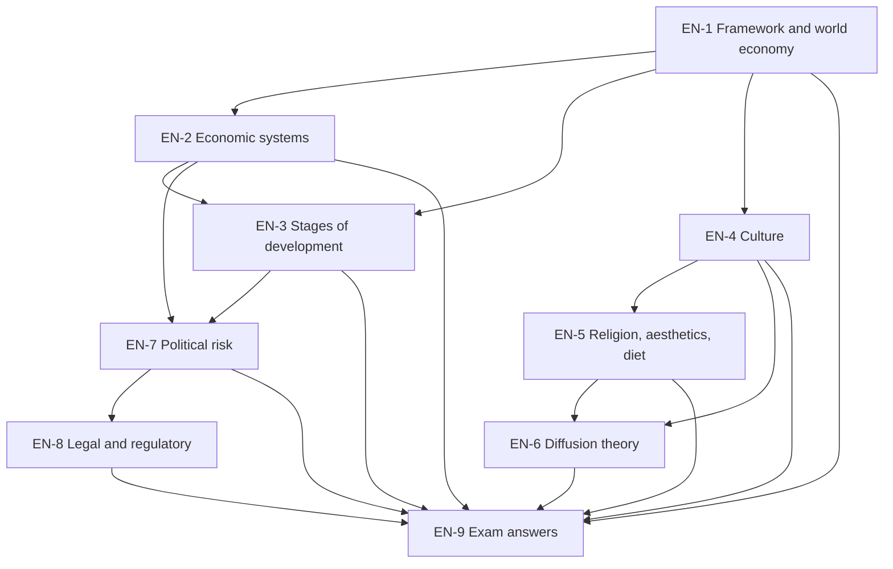

# International Marketing Unit 2: Global Marketing Environment, node map

Assumed ESE: 50 marks, 2 hours. Section A 3 of 5 x 5, Section B 2 of 3 x 10, Section C one compulsory 15-mark case. The **faculty slides are the single source**; general knowledge fills gaps and is tagged. Company and country examples in worked sums are **illustrative**.

## Nodes

| Node | Topic | Deps | Minutes | Exam focus |
|---|---|---|---|---|
| EN-1 | Marketing Environment Framework and the World Economy | none | 25 | yes |
| EN-2 | Economic Systems and Economic Freedom | EN-1 | 30 | yes |
| EN-3 | Stages of Market Development and Developing Markets | EN-1, EN-2 | 40 | yes |
| EN-4 | Culture, Society and Global Consumer Culture | EN-1 | 30 | yes |
| EN-5 | Religion, Aesthetics, Diet and Environmental Sensitivity | EN-4 | 30 | yes |
| EN-6 | Cultural Dynamics and Diffusion Theory | EN-4, EN-5 | 30 | yes |
| EN-7 | Political Environment and Political Risk | EN-2, EN-3 | 30 | yes |
| EN-8 | Legal and Regulatory Environment | EN-7 | 35 | yes |
| EN-9 | Unit 2 Exam Answers (5, 10 and 15-mark case layouts) | EN-1 to EN-8 | 35 | yes |

Total reading time: about 285 minutes.

## Notes

- [[International Marketing Unit 2 - EN-1 Marketing Environment Framework and the World Economy]]
- [[International Marketing Unit 2 - EN-2 Economic Systems and Economic Freedom]]
- [[International Marketing Unit 2 - EN-3 Stages of Market Development and Developing Markets]]
- [[International Marketing Unit 2 - EN-4 Culture Society and Global Consumer Culture]]
- [[International Marketing Unit 2 - EN-5 Religion Aesthetics Diet and Environmental Sensitivity]]
- [[International Marketing Unit 2 - EN-6 Cultural Dynamics and Diffusion Theory]]
- [[International Marketing Unit 2 - EN-7 Political Environment and Political Risk]]
- [[International Marketing Unit 2 - EN-8 Legal and Regulatory Environment]]
- [[International Marketing Unit 2 - EN-9 Unit 2 Exam Answers]]

## Dependency graph

## Headline facts to know

- Four systems: market capitalism, centrally planned socialism, centrally planned capitalism, market socialism.
- GNI bands (slide): 1,045 or less; 1,046 to 4,125; 4,126 to 12,745; $12,476 or more (slide; a transposition of $12,746, the World Bank figure for the year these bands come from) (overlap, verify).
- BRICS: Brazil, Russia, India, China, South Africa.
- Adopter shares: 2.5, 13.5, 34, 34, 16 percent.
- Environmental sensitivity: food high, computers medium, ICs low.
- Seizure: expropriation (compensation), confiscation (none), nationalisation (industry-wide).
- IP: patent, trademark, copyright, trade secret; FCPA bans bribes to foreign officials.

## Links
- [[International Marketing MOC]]
