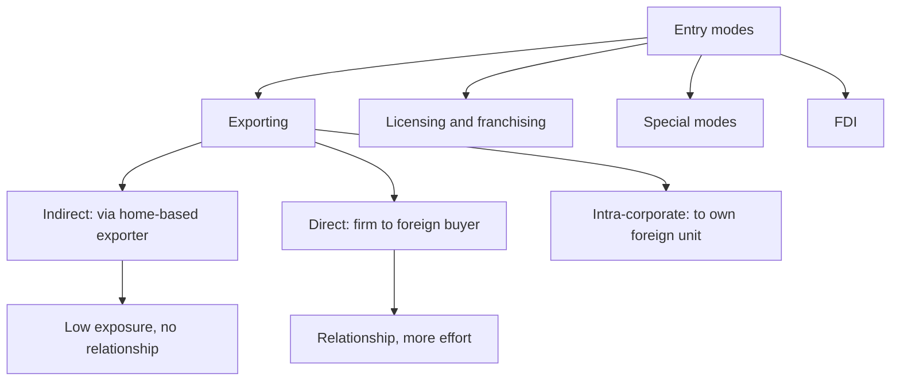

# ME-1 - Entry Modes Overview and Exporting

Covers: the faculty map of entry modes (ten items on slide 1), indirect vs direct involvement, the three forms of exporting, and their advantages and disadvantages. **(class)**

## The faculty map of entry modes (class)
Slide 1 lists ten items: indirect exporting, direct exporting, intra-corporate transfers, licensing, franchising, contract manufacturing, management contracts, turnkey projects, FDI without alliances and FDI with alliances. It becomes eleven once M&A and JV are split under FDI with alliances. The table below groups them for revision.

| Block | Modes |
|---|---|
| Exporting | Indirect exporting, direct exporting, intra-corporate transfers |
| Contractual | Licensing, franchising |
| Special modes | Contract manufacturing, management contracts, turnkey projects |
| FDI | FDI without alliances (greenfield), FDI with alliances (mergers and acquisitions, joint ventures) |

Slides run exporting, contractual, special, FDI. **(general)** Commitment rises in that order. Say this in one line in any entry-mode answer.

## Indirect vs direct involvement (class)
- **Indirect involvement:** the firm takes part in international business through an intermediary and does **not** deal with foreign customers or markets.
- **Direct involvement:** the firm works with foreign customers or markets, with the opportunity to **develop a relationship**.

Memory hook: indirect means someone stands between you and the foreign buyer; direct means you face the buyer.

## Forms of exporting (class)
Slides show three diagrams. Reproduce them as examples.

| Form | Diagram on the slide | Meaning |
|---|---|---|
| Indirect exporting | Company A (USA) transfers to Company B (home-based), Company C sells to the Malaysian market | The goods are exported through **home-based exporters**. Intermediaries (four on the slide): manufacturers' export agents, export commission agents, export merchants, international firms. |
| Direct exporting | Company A (China) sells straight to Company C (Malaysia) | The firm itself finds, ships to and deals with the foreign buyer. |
| Intra-corporate transfer | Company A (UK) to Company A (Malaysia) | Sale to the firm's **own** subsidiary, affiliate or branch abroad. |

**(general)** Direct exporting needs an export department, documentation, and a foreign agent or distributor. Intra-corporate transfer prices are watched by tax authorities, so say "arm's length" if asked about pricing.

## Advantages and disadvantages of exporting (class)
| Advantages | Disadvantages |
|---|---|
| Relatively low financial exposure | Vulnerability to tariffs and non-tariff barriers (NTBs) |
| Permits gradual market entry | Logistical complexities |
| Acquires knowledge about the local market | Potential conflicts with distributors |
| Avoids restrictions on foreign investment | |

Link the two columns: low exposure and gradual entry are why exporting is the first step; tariffs and distributor conflict are why firms later move to licensing or FDI.

## Worked example: classify the route (exam layout)
**Q.** Anand Spices (illustrative firm, Kerala) sells cardamom in three ways: (i) to a Mumbai export merchant who ships to Dubai; (ii) by its own export team to a Malaysian supermarket chain; (iii) to its own Singapore warehouse company. Classify each.

1. Identify who deals with the foreign buyer.
2. (i) The merchant is a home-based exporter and Anand never meets the Dubai buyer. **Indirect exporting.**
3. (ii) Anand negotiates and ships to the Malaysian buyer itself. **Direct exporting.**
4. (iii) The sale is within the same group. **Intra-corporate transfer.**

| Route | Foreign customer contact | Relationship building | Financial exposure |
|---|---|---|---|
| (i) Indirect | No | None | Lowest |
| (ii) Direct | Yes | Yes | Moderate (export staff, documents) |
| (iii) Intra-corporate | Via own subsidiary | Yes, through the group | Moderate to high (subsidiary is owned) |

**Decision line:** Anand should move (i) to (ii) in markets where volumes justify its own team, because direct contact builds the relationship and market knowledge the slides list as an advantage; it keeps (i) where volumes are small, since indirect carries the least exposure.

## What to remember
- Ten items on slide 1 (eleven once M&A and JV are split); exporting is the lowest-commitment entry.
- Indirect: through an intermediary, no foreign customer contact. Direct: you face the foreign buyer and can build a relationship.
- Four indirect intermediaries: manufacturers' export agents, export commission agents, export merchants, international firms.
- Intra-corporate transfer: shipments to your own foreign unit.
- Exporting pros: low exposure, gradual entry, market knowledge, avoids FDI limits. Cons: tariffs and NTBs, logistics, distributor conflict.

## Concept map

## Flashcards
Q: Name the three forms of exporting in the faculty deck.
A: Indirect exporting, direct exporting and intra-corporate transfer.
Q: Define indirect involvement in international business.
A: The firm takes part through an intermediary and does not deal with foreign customers or markets.
Q: Define direct involvement.
A: The firm works with foreign customers or markets, with the opportunity to develop a relationship.
Q: Who are the intermediaries in indirect exporting?
A: Home-based exporters, four on the slide: manufacturers' export agents, export commission agents, export merchants and international firms.
Q: What is an intra-corporate transfer?
A: A sale or shipment to the firm's own subsidiary, affiliate or branch in another country.
Q: Give four advantages of exporting.
A: Low financial exposure, gradual market entry, knowledge of the local market, and avoidance of foreign investment restrictions.
Q: Give three disadvantages of exporting.
A: Vulnerability to tariffs and NTBs, logistical complexities, and potential conflicts with distributors.
Q: Which blocks of entry modes does the deck list besides exporting?
A: Licensing, franchising, special modes (contract manufacturing, management contracts, turnkey) and FDI with or without alliances.
