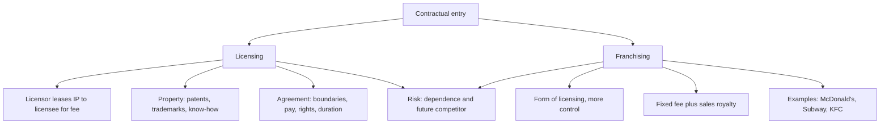

# ME-2 - Licensing and Franchising

Covers: licensing (definition, property, process, agreement terms, pros and cons), franchising (definition, fees, control, pros and cons), and the licensing vs franchising comparison. **(class)**

## Licensing (class)
**Definition:** a firm, the **licensor**, leases the right to use its intellectual property to another firm, the **licensee**, in return for a fee.

**Property that may be licensed:** patents, trademarks, copyrights, technology, technical know-how, specific business skills. **(class)** The slide also lists "brand names" and "work methods" in the definition.

**The licensing process (slide diagram):**
1. Licensor leases the rights to use its intellectual property.
2. Licensee uses the intellectual property to create products.
3. Licensee pays a royalty to the licensor.
4. Licensor earns new revenues with low investment.

**What the agreement must settle:**
- Boundaries of the agreement (territory, products)
- Compensation (fee and royalty)
- Rights, privileges and constraints
- Duration of the contract

**Examples on the slide:** PepsiCo and Coca-Cola bottling plants (the brand owner licenses the brand and formula; the bottler produces and distributes locally). **(general)** The trade also calls these franchise bottlers.

| Advantages | Disadvantages |
|---|---|
| Low financial risk | Limited market opportunities and profits |
| Low-cost way to assess market potential | Dependence on the licensee |
| Avoids tariffs, NTBs and foreign investment restrictions | Potential conflicts with the licensee |
| Licensee provides knowledge of local markets | Possibility of creating a future competitor |

## Franchising (class)
**Definition:** an independent organisation, the **franchisee**, operates the business under the name of another company, the **franchisor**, and pays a fee to the franchisor.

Key points from the slides:
- Franchising is a **form of licensing**, but the franchisor exercises **more control** over the franchisee than a licensor does.
- The franchisee pays a **fixed amount plus a royalty based on sales**.
- The slide reads: "Franchisee should agree to adhere to follow the franchisor's requirements". **(general)** In practice this means standards, operating manual, supplies and branding.
- The franchisor helps the franchisee set up the facilities.
- The franchisor allows the franchisee some flexibility (local adaptation, such as menu changes).
- **Examples:** McDonald's, Subway, KFC.

| Advantages | Disadvantages |
|---|---|
| Low financial risk | Limited market opportunities and profits |
| Low-cost way to assess market potential | Dependence on the franchisee |
| Avoids tariffs, NTBs and foreign investment restrictions | Potential conflicts with the franchisee |
| **Maintains more control than licensing** | Possibility of creating a future competitor |
| Franchisee provides knowledge of the local market | |

The only difference in the advantages column versus licensing is the extra control line. That is the one-line answer to "compare".

## Licensing vs franchising (exam table)
Rows tagged **(general)** go beyond the slides; the control and payment rows are **(class)**.
| Basis | Licensing | Franchising |
|---|---|---|
| Parties | Licensor and licensee | Franchisor and franchisee |
| What is given **(general)** | Patents, trademarks, know-how, skills | Whole business format and brand |
| Control by owner | Lower | Higher |
| Payment | Fee and royalty | Fixed fee plus sales-based royalty |
| Support **(general)** | Mostly none | Franchisor helps with set-up (class) and operations (general) |
| Typical users **(general)** | Manufacturing, technology, beverages | Fast food, retail, services |

## Extra detail from the student notes (student notes)
- The comparison grid in the note rates licensing as low capital, low control and low risk (market access without capital), and franchising as low capital, medium control and low risk (fast scaling of a proven concept).
- Main franchising risk: quality control across culturally different franchisees.
- Common licensing mistake: licensing core technology to a potential future competitor without safeguards.
- **Student-note corrections:** none on facts. The note says the franchisee "follows a royalty based on sales"; the correct wording is that the franchisee **pays** a fixed amount plus a sales-based royalty.

## Worked example: franchise income and the answer to give (exam layout)
**Q.** Rasam Express (illustrative Indian restaurant chain) grants a UAE franchisee a 5-year franchise: fixed fee ₹20 lakh once, plus royalty 6% of sales. Franchisee sales are ₹5 crore a year (illustrative). Compute the franchisor's income and advise.

1. Annual royalty = 6% × ₹5,00,00,000 = **₹30,00,000 (₹30 lakh)**.
2. Royalty over 5 years = 5 × ₹30 lakh = ₹1,50,00,000 (₹1.5 crore).
3. Add the fixed fee: ₹20 lakh + ₹150 lakh = **₹1,70,00,000 (₹1.7 crore)**.
4. Franchisor's own capital outlay in the UAE: no outlet investment; costs are training and monitoring (state this as an assumption).

| Item | ₹ lakh |
|---|---|
| Fixed fee (once) | 20 |
| Royalty per year (6% × 500) | 30 |
| Royalty, 5 years | 150 |
| Total, 5 years | 170 |

**Decision line:** Franchising earns about ₹1.7 crore over five years with almost no capital at risk, which fits the slide's advantages (low financial risk, local knowledge). The price is control risk and the chance of creating a future competitor, so the contract must fix quality standards, territory and duration.

## What to remember
- Licensing: licensor leases IP to licensee for a fee; franchising is licensing with more control and a full business system.
- Four things an agreement must settle: boundaries, compensation, rights and constraints, duration.
- Franchisee pays a fixed amount plus a sales-based royalty.
- Shared pros: low risk, low-cost market test, avoids tariffs and NTBs, local knowledge. Shared cons: limited profit, dependence, conflict, future competitor.
- Examples: PepsiCo and Coke bottlers (licensing; the trade also calls them franchise bottlers **(general)**); McDonald's, Subway, KFC (franchising).

## Concept map

## Flashcards
Q: Define licensing.
A: A firm, the licensor, leases the right to use its intellectual property (technology, patents, brands, trademarks) to another firm, the licensee, in return for a fee.
Q: List the property that may be licensed.
A: Patents, trademarks, copyrights, technology, technical know-how and specific business skills.
Q: What four things must a licensing agreement specify?
A: Boundaries of the agreement, compensation, rights, privileges and constraints, and the duration of the contract.
Q: Give the faculty's examples of licensing and franchising.
A: Licensing: PepsiCo and Coca-Cola bottling plants (the trade also calls these franchise bottlers, general). Franchising: McDonald's, Subway, KFC.
Q: Give four advantages of licensing.
A: Low financial risk, low-cost way to assess market potential, avoids tariffs, NTBs and investment restrictions, and the licensee provides local market knowledge.
Q: Give four disadvantages of licensing.
A: Limited market opportunities and profits, dependence on the licensee, potential conflicts, and the possibility of creating a future competitor.
Q: How does franchising differ from licensing?
A: Franchising is a form of licensing, but the franchisor exercises more control over the franchisee, supports set-up, and earns a fixed fee plus a sales-based royalty.
Q: What is the main franchising risk and the main licensing mistake? (student notes)
A: Franchising: keeping quality control across culturally different franchisees. Licensing: handing core technology to a future competitor without safeguards.
Q: What does the franchisee pay?
A: A fixed amount and a royalty based on sales.
Q: Franchise fee ₹20 lakh once, royalty 6% on ₹5 crore annual sales, 5 years. Total income?
A: Royalty ₹30 lakh a year, ₹150 lakh over five years, plus the fee, so ₹170 lakh (₹1.7 crore).
