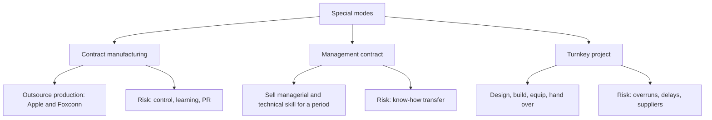

# ME-3 - Contract Manufacturing, Management Contracts and Turnkey Projects

Covers: the three specialised entry modes, each with definition, example, advantages and disadvantages. **(class)**

## Contract manufacturing (class)
**Definition:** outsourcing the entire or part of the manufacturing operations to a local firm.
**Industries:** pharmaceuticals, personal care products.
**Slide example:** Apple's iPad and iPhone are manufactured in China by Foxconn. Foxconn is the contract manufacturer and Apple benefits from a lower manufacturing cost.

| Advantages | Disadvantages |
|---|---|
| Low financial risk | Reduced control (may affect quality, delivery schedules) |
| Minimises resources devoted to manufacturing | Reduced learning potential |
| Resources freed for other elements of the value chain (marketing, design, brand) | Potential public relations problems |

**(general)** The "public relations problem" is usually labour or sourcing criticism that lands on the brand owner, not the factory.

## Management contract (class)
**Definition:** an agreement between two companies where one provides managerial assistance, technical expertise and specialised services to the second for a certain period, for monetary compensation.
**Slide examples:** schools, sports facilities, hospitals, office buildings, malls and large businesses that have on-site cafeterias and restaurants run by a specialist caterer. **(general)** Hotel management (a foreign brand running a hotel owned by a local investor) is the standard textbook example.

| Advantages | Disadvantages |
|---|---|
| Focus firm's resources on its area of contracts | Potential returns limited by contract expertise |
| Minimal financial exposure | May unintentionally transfer proprietary knowledge and techniques to contractee |

The cells are quoted as the slide words them. **(general)** Read advantage 1 as focusing the firm's resources on its area of expertise, and the first disadvantage as returns capped by the contract terms.

## Turnkey project (class)
**Definition:** a contract under which a firm agrees to fully **design, construct and equip** a manufacturing, business or service facility and **turn the project over** to the purchaser when it is ready for operation, for a remuneration.
**(general)** Typical turnkey buyers are governments or state firms: power plants, refineries, steel plants, metro systems.

| Advantages | Disadvantages |
|---|---|
| Focuses the firm's resources on its area of expertise | Financial risks |
| Avoids all long-term operational risks | Cost overruns |
| | Construction risks |
| | Delays |
| | Problems with suppliers |

Contrast to remember: management contract earns by running the business; turnkey earns by building it and leaving.

## Comparison (exam table)
| Basis | Contract manufacturing | Management contract | Turnkey project |
|---|---|---|---|
| Firm supplies **(general)** | Orders and specifications | Management and technical skills | Design, construction, equipping |
| Local partner does **(general)** | Manufacturing | Owns and funds the business | Buys and later operates |
| Duration **(general)** | Ongoing supply | Fixed period | Until handover |
| Main risk **(class)** | Loss of control and quality | Know-how leakage | Cost overruns and delays |
| Example | Apple with Foxconn (class) | Hospital or mall catering (class) | Plant built and handed over (general; the slide gives only the definition) |

## Worked example: which special mode? (exam layout)
**Q.** Three situations: (a) a US cosmetics brand has its shampoo made in India by a local plant; (b) an Indian hotel group runs a Maldives resort owned by a local investor for a 10-year term; (c) an Indian engineering firm builds a fertiliser plant in Africa and hands over the keys. Name the mode, one advantage and one risk.

1. (a) **Contract manufacturing.** Advantage: low financial risk and resources freed for brand building. Risk: reduced control over quality and delivery.
2. (b) **Management contract.** Advantage: minimal financial exposure, expertise earns the fee. Risk: proprietary know-how passes to the owner who may run it alone later.
3. (c) **Turnkey project.** Advantage: avoids long-term operating risk. Risk: cost overruns and delays on a fixed-price build.

| Case | Mode | Who owns the asset | Firm's capital at risk |
|---|---|---|---|
| (a) | Contract manufacturing | Local manufacturer | Low |
| (b) | Management contract | Local investor | Minimal |
| (c) | Turnkey | Handed to purchaser | Moderate during construction |

**Decision line:** all three earn a fee without owning a foreign operation, which suits capital-light entry, but each has a specific leak: control (a), knowledge (b), construction cost (c). Name the leak in the answer to earn the interpretation mark. Firm names here are generic and illustrative.

## What to remember
- Contract manufacturing: outsource entire or part of production (Apple and Foxconn; pharma, personal care).
- Management contract: sell management skill for a fee over a period; risk is know-how transfer.
- Turnkey: design, construct, equip, hand over; risks are overruns, delays, supplier problems.
- All three are low-capital routes; none gives long-term ownership of a foreign operation.
- Contract manufacturing's cost: reduced control and learning, possible PR problems.

## Concept map

## Flashcards
Q: Define contract manufacturing.
A: Outsourcing the entire or part of the manufacturing operations to another firm.
Q: What is the faculty's contract manufacturing example?
A: Apple's iPhone and iPad are made in China by Foxconn, giving Apple lower manufacturing cost.
Q: Which industries commonly use contract manufacturing per the slide?
A: Pharmaceuticals and personal care products.
Q: Give disadvantages of contract manufacturing.
A: Reduced control (quality, delivery schedules), reduced learning potential and potential public relations problems.
Q: Define a management contract.
A: An agreement where one company provides managerial assistance, technical expertise and specialised services to another for a certain period in return for monetary compensation.
Q: Advantages and disadvantages of a management contract, as the slide words them?
A: Advantages: focus the firm's resources on its area of contracts (expertise) and minimal financial exposure. Disadvantages: potential returns limited by contract expertise, and unintentionally transferring proprietary knowledge to the contractee.
Q: Define a turnkey project.
A: A contract to fully design, construct and equip a facility and hand it over to the purchaser when ready for operation, for a remuneration.
Q: List the disadvantages of turnkey projects.
A: Financial risks, cost overruns, construction risks, delays and problems with suppliers.
Q: Advantages of turnkey projects?
A: Focus resources on the firm's area of expertise and avoid all long-term operational risks.
