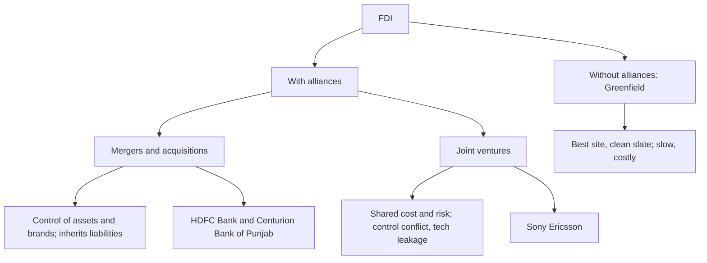

# ME-4 - FDI: Greenfield, Alliances, Mergers and Acquisitions, Joint Ventures

Covers: FDI without alliances (greenfield), the role of strategic alliances, M&A, joint ventures, and how to choose among them. **(class)**

## FDI without alliances: greenfield (class)
Companies enter through **FDI** by investing their own money and establishing manufacturing and marketing facilities with **ownership and control**.

**Greenfield strategy:** starting a company's operations from scratch in a foreign market.

| Advantages | Disadvantages |
|---|---|
| Best site | Huge time and patience needed |
| Modern facilities | Expensive |
| Economic development incentives | Must comply with local and national regulation |
| Clean slate | Local workforce needed |
| | Strongly perceived as a foreign owner (the slide wording is "foreign worker"; the intended point is foreign outsider status) |

## FDI with alliances (class)
**Strategic alliance:** a cooperative and collaborative approach to achieve larger goals.

**Role of alliances (slide):**
- Many complicated issues are solved through alliances.
- They provide the parties each other's strengths.
- Helps develop new products through the interaction of two or more industries.
- Meets the challenges of the technological revolution.
- Manages heavy outlay (capital cost).
- Lets firms become strong enough to compete with a multinational.

**Modes of FDI through alliances:** (1) mergers and acquisitions, (2) joint ventures.

## Mergers and acquisitions (class)
- **Merger:** combining two or more companies, generally by offering the stockholders of one company securities in the acquiring company in exchange for surrender of their stock.
- **Acquisition:** one company takes over another and clearly establishes itself as the new owner.
- **Slide example:** HDFC Bank's acquisition of Centurion Bank of Punjab for $2.4 billion (the slide figure; the deal was in 2008). It is a domestic Indian example, so say that if asked for an international case.

Points the slide lists for acquirers:
- Obtains control over the acquired firm, such as factories and brand names.
- Integrates the management of the firm into the overall international strategy.
- **Assumes all the liabilities**, financial and managerial (the downside).

**(general)** Cross-border acquisitions give speed and an existing customer base, but integration and cultural clashes cause many failures.

## Joint venture (class)
**Definition:** an entity formed between two or more parties to undertake economic activity together. They create a new entity by both contributing equity and share revenues, expenses and control.
**Slide example:** Sony Ericsson, a JV of Japan's Sony Corporation and Sweden's Ericsson to make mobile phones. **(general)** Sony bought out Ericsson in 2012 and the business became Sony Mobile.

| Advantages | Disadvantages |
|---|---|
| Benefit from the local partner's knowledge **(class)** | Risk of giving control of technology to the partner |
| Shared costs and risks with the partner | May not realise experience curve or location economies |
| Reduced political risk | Shared ownership can lead to conflict |

The slide lists three JV advantages: the local partner's knowledge, shared costs and risks, and reduced political risk. **(general)** A local partner is sometimes required or encouraged by regulation; check the host country's current rules before quoting any limit.

## Choosing among the three FDI routes (exam table)
| Basis | Greenfield | Acquisition | Joint venture |
|---|---|---|---|
| Ownership | 100% own | 100% or majority of existing firm | Shared |
| Speed | Slowest | Fast | Medium |
| Control | Highest | High | Shared |
| Capital | Highest | High | Shared, lower |
| Political risk | Highest | High | Reduced |
| Main problem | Time, cost, outsider status | Inherited liabilities, integration | Conflict, technology leakage |

## Worked example: greenfield, acquisition or JV? (exam layout)
**Q.** Sudarshan Auto Components (illustrative Indian firm) wants a plant in Vietnam. A local firm is for sale with 600 staff and existing OEM customers, and another local firm wants a 51:49 JV. Recommend a mode.

1. State needs: speed to supply OEMs, control of quality, limited capital, political-risk concern (assumptions, labelled).
2. Greenfield: best site and clean slate, but slow, expensive and the firm is a foreign outsider.
3. Acquisition: immediate plant, brand and customers, control, but assumes all liabilities and needs integration.
4. JV: shared cost and reduced political risk, but technology leakage and shared control conflict.
5. Rank against the needs.

| Need | Greenfield | Acquisition | JV |
|---|---|---|---|
| Speed | Poor | Good | Fair |
| Control | Good | Good | Fair |
| Capital light | Poor | Poor | Good |
| Political risk | Poor | Fair | Good |
| Liabilities avoided | Good | Poor | Fair |

**Decision line:** if due diligence on liabilities is clean, acquire for speed and control; if the firm cannot afford the price or fears political risk, choose the JV and protect its technology by contract. Greenfield is last because the firm needs OEM supply quickly. The answer depends on the stated assumptions, so write them.

## What to remember
- FDI means own investment with ownership and control; greenfield means starting from scratch.
- Greenfield: best site, modern plant, incentives, clean slate vs time, cost, regulation, foreign-outsider image.
- Alliances give the parties each other's strengths, help new products, meet technology change, manage heavy outlay, and help compete with MNCs (six roles on the slide).
- Alliance FDI modes: mergers and acquisitions, joint ventures.
- Acquisition: gains control of factories and brands, and also inherits all liabilities.
- JV: three advantages (local partner's knowledge, shared cost and risk, reduced political risk); disadvantages are technology control, no experience curve or location economies, and conflict.

## Concept map

## Flashcards
Q: What is the greenfield strategy?
A: Starting a company's operations from scratch in a foreign market through FDI, with its own ownership and control.
Q: Give advantages of greenfield.
A: Best site, modern facilities, economic development incentives and a clean slate.
Q: Give disadvantages of greenfield.
A: Huge time and patience, expensive, compliance with local and national regulation, a local workforce is needed, and the firm is perceived as an outsider.
Q: What is a strategic alliance?
A: A cooperative and collaborative approach to achieve larger goals.
Q: Name the two modes of FDI through alliances.
A: Mergers and acquisitions, and joint ventures.
Q: Differentiate merger and acquisition.
A: Merger combines companies, with shareholders of one swapping stock for securities in the acquirer; acquisition is a takeover where the acquirer is clearly the new owner.
Q: What does an acquirer gain and what does it inherit?
A: Control of factories and brand names and integration into its international strategy; but all financial and managerial liabilities.
Q: Define a joint venture.
A: A new entity formed by two or more parties each contributing equity, who share revenues, expenses and control. Example: Sony Ericsson.
Q: Advantages and disadvantages of a joint venture?
A: Advantages: the local partner's knowledge, shared costs and risks, and reduced political risk. Disadvantages: risk of giving technology control to the partner, possibly no experience curve or location economies, and ownership conflict.
Q: Which Indian acquisition does the slide cite?
A: HDFC Bank's acquisition of Centurion Bank of Punjab for $2.4 billion (the slide figure; 2008).
Q: List the six roles of strategic alliances on the slide.
A: Solve many complicated issues; give the parties each other's strengths; develop new products through the interaction of two or more industries; meet the challenges of the technological revolution; manage heavy outlay; become strong enough to compete with a multinational.
