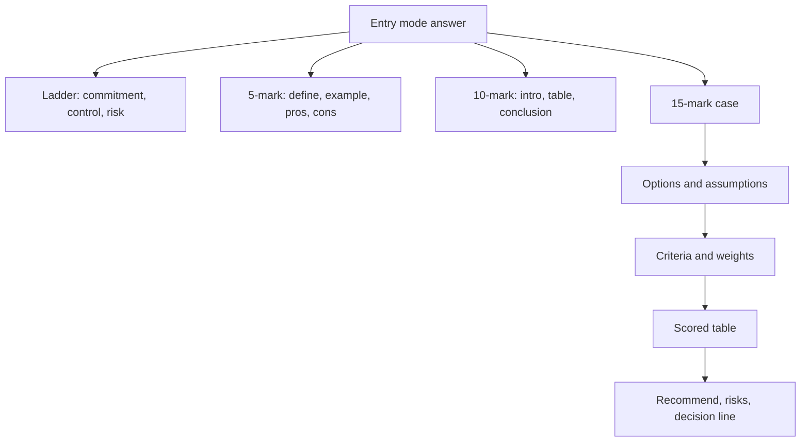

# ME-5 - Unit 3 Exam Answers

Covers: likely 5-mark and 10-mark questions with skeletons, and the 15-mark case layout with a worked entry-mode choice. **(class)** content from the faculty deck; the scoring method is **(general)**. The syllabus unit is titled Global Market Analysis and Entry Strategies, so the last section adds skeletons for research, screening and STP from the student notes (ME-6 to ME-8).

## The paper (assumed)
ESE: 50 marks, 2 hours (**no course plan on file, so assumed**). Section A: 3 of 5 x 5. Section B: 2 of 3 x 10. Section C: one compulsory 15-mark case. Budget about 7 minutes per 5-marker, 15 per 10-marker, 30 for the case. Unit 3 is a theory unit, and market entry is a natural case topic.

## 5-mark answers (about 120-150 words)
| Likely question | Skeleton (marks) |
|---|---|
| Explain the forms of exporting | Define exporting (1); indirect with the four home-based exporters: manufacturers' export agents, export commission agents, export merchants, international firms (1); direct (1); intra-corporate (1); one pro and one con (1) |
| Indirect vs direct involvement | Indirect: via intermediary, no foreign customer contact (2); direct: deals with customers, relationship (2); example (1) |
| Advantages and disadvantages of exporting | Four pros (2.5); three cons (2.5) |
| What is licensing? Pros and cons | Definition with licensor, licensee, fee (1); property licensed (1); process or agreement terms (1); pros and cons (2) |
| Franchising and how it differs from licensing | Definition (1); fixed fee plus royalty (1); more control (1); examples McDonald's, Subway, KFC (1); one risk (1) |
| Contract manufacturing | Definition (1); Apple and Foxconn (1); advantages (1.5); disadvantages (1.5) |
| Management contract | Definition (2); example (1); advantage and disadvantage (2) |
| Turnkey project | Design, construct, equip, hand over (2); advantages (1); disadvantages (2) |
| Greenfield strategy | Definition (1); advantages (2); disadvantages (2) |
| Joint venture | Definition with shared equity, revenue, control (2); Sony Ericsson (1); pros (1); cons (1) |
| Merger vs acquisition | Two definitions (2); HDFC Bank and Centurion Bank of Punjab (1); benefits and liabilities (2) |
| Role of strategic alliances | Define (1); roles from the slide, any four of six (4) |
| Steps in international marketing research (student notes, ME-6) | Why harder than domestic (1); six steps: problem, sources, instrument, sample, comparable analysis, MIS (3); one safeguard such as back-translation (1) |
| Secondary vs primary data abroad (student notes, ME-6) | Define each with sources (2); strengths and weaknesses table (2); when to use which (1) |
| Market screening funnel (student notes, ME-7) | Purpose (1); four stages (3); one tool such as CAGE or the attractiveness matrix (1) |
| CAGE framework (general, named in student notes, ME-7) | Four distances defined (3); one example each or one implication (2) |
| Bases of global segmentation (student notes, ME-8) | Five bases with one line each (4); intermarket segment example (1) |
| Global vs local positioning (student notes, ME-8) | Define both (2); country-of-origin lever (1); trade-off and example (2) |

## 10-mark answers (about 300-350 words)
**Layout:** introduction (1-2), body in headed points or a table (6), interpretation or conclusion (1-2).
| Likely question | Skeleton |
|---|---|
| Discuss the modes of entering international markets | Intro: modes along commitment, control, risk (1); exporting forms (2); licensing and franchising (2); special modes (2); FDI with and without alliances (2); conclusion: gradual move from exporting to FDI (1) |
| Compare licensing, franchising and joint venture | Definitions (2); comparison table on control, capital, risk, income, example (5); suitability and choice line (3) |
| Explain licensing and franchising with merits and demerits | Each defined (2); process or fee structure (2); two advantage-disadvantage tables (4); control as the differentiator (2) |
| Explain special entry modes: contract manufacturing, management contract, turnkey | Define each (3); examples (1); advantages and disadvantages table (4); comparison and leak per mode (2) |
| Explain FDI modes with advantages and disadvantages | FDI definition (1); greenfield (2); M&A (3); JV (3); selection line (1) |
| Evaluate exporting as an entry strategy | Three forms (3); pros and cons (4); when to graduate to licensing or FDI (3) |
| Explain how a firm screens and selects foreign markets (student notes, ME-7) | Why screen (1); four-stage funnel (3); tools and criteria table (3); weighted-score illustration with a decision line (2); link to entry mode (1) |
| Discuss international marketing research and the role of an MIS (student notes, ME-6) | Why different (2); six-step process (3); challenges and safeguards (3); MIS with its three feeds (2) |
| Explain global segmentation, targeting and positioning (student notes, ME-8) | Definitions (1); segmentation bases and intermarket segment (3); three targeting strategies (2); global vs adapted positioning (2); trade-off line (2) |

## 15-mark case layout (Section C)
The case describes a firm, a target country and constraints, then asks which entry mode to choose and why. Spend about 30 minutes.
| Block | Marks | What to write |
|---|---|---|
| 1. Context | 2 | Two lines on the firm, product, target market, objective; list your assumptions |
| 2. Entry options | 3 | Name 3-4 feasible modes in one table row each, and strike out infeasible ones with a reason |
| 3. Criteria and weights | 2 | Control, capital, speed, risk, local knowledge, with weights summing to 100 |
| 4. Scoring | 3 | Weighted score table; show the sum |
| 5. Recommendation | 2 | The winner, plus a staged route (for example start franchising, move to JV or own units) |
| 6. Risks and safeguards | 2 | The slide risks for that mode (future competitor, control, conflict) and contract safeguards |
| 7. Decision line and interpretation | 1 | One sentence stating the choice and what would change it |

### When one case combines screening and entry mode
A case may ask "which country should the firm enter and how". Answer in two linked tables. Table 1 (ME-7): knock out unviable countries, then score the survivors on size, growth, risk, competition, fit and ease. Table 2 (this node): score entry modes for the winning country on control, capital, speed, risk and local knowledge. Use different criteria and weights in each table, show both sums, and end with one decision line naming country and mode. Add research (ME-6) as the source of the scores and STP (ME-8) for the target segment and positioning if the case mentions consumers. Mark split for a 15-mark combined case: context and assumptions 2, screening table 4, entry-mode table 4, risks and safeguards 2, decision line and sensitivity 3.

## Worked case: Rasam Express enters the UAE (exam layout)
**Case.** Rasam Express (illustrative Indian quick-service restaurant chain, 60 outlets in India) wants to enter the UAE within 12 months, with limited capital, wanting control over taste and brand. Choose an entry mode. All figures and scores are illustrative judgements.

**Step 1: Options.** Exporting is struck out: food eaten in an outlet cannot be exported as a product. Contract manufacturing and turnkey do not fit a restaurant brand. Feasible: licensing, franchising, joint venture, greenfield.

**Step 2: Criteria and weights (total 100).** Control 25, capital saved 20, speed 20, low risk 20, local knowledge 15.

**Step 3: Scores (1 = poor, 5 = best).**
| Mode | Control (25) | Capital (20) | Speed (20) | Risk (20) | Local knowledge (15) | Weighted total | Score out of 5 |
|---|---|---|---|---|---|---|---|
| Licensing | 1 | 5 | 4 | 4 | 4 | 345 | 3.45 |
| Franchising | 3 | 5 | 4 | 4 | 4 | 395 | 3.95 |
| Joint venture | 3 | 3 | 3 | 3 | 5 | 330 | 3.30 |
| Greenfield | 5 | 1 | 1 | 1 | 2 | 215 | 2.15 |

Working for franchising: 3 x 25 + 5 x 20 + 4 x 20 + 4 x 20 + 4 x 15 = 75 + 100 + 80 + 80 + 60 = **395**, so 395 / 100 = **3.95**.

**Step 4: Recommendation.** **Franchising** ranks first. It keeps more control than licensing (the slide's key difference), needs almost no capital, and the UAE franchisee supplies local knowledge. Revenue is a fixed fee plus a sales-based royalty (see the ME-2 numbers).

**Step 5: Risks and safeguards.** Dependence on and conflict with the franchisee, and the chance of creating a future competitor. Safeguards: contract fixing menu standards, supplier approvals, territory, duration and a training programme; franchisor allows limited menu flexibility for local taste.

**Decision line:** Enter the UAE by franchising, since it scores 3.95 against 3.45, 3.30 and 2.15 on weights that value control and speed. If the firm later wants full control of a proven market, it can buy out the franchisee or open own outlets. The ranking is a judgement, so state the weights as assumptions. Sensitivity: raising control to 40 (others scaled to 60: capital 16, speed 16, risk 16, local knowledge 12) does not change the winner. Franchising stays first at 3.76 (376 / 100), against JV 3.24, licensing 2.96 and greenfield 2.72. Only a control weight above about 60 (greenfield overtakes at roughly 60.5) would favour greenfield; the JV never overtakes franchising.

**(general)** Real-world check: Starbucks entered India in 2012 through Tata Starbucks, a 50:50 joint venture with the Tata group, an example of a JV chosen where local knowledge and regulation mattered. Use qualitatively only.

## What to remember
- Always start an entry-mode answer with the commitment-control-risk ladder: exporting, licensing and franchising, special modes, FDI.
- Indirect vs direct hinges on foreign customer contact; intra-corporate means to your own unit.
- Franchising is licensing with more control, a fixed fee and a sales royalty.
- Contract manufacturing, management contract and turnkey: low capital, each with a named leak (control, know-how, overruns).
- FDI: greenfield (time, cost), acquisition (control and inherited liabilities), JV (shared risk, conflict).
- In the case, show assumptions, a weighted table with the sum, and a one-line decision.

## Concept map

## Flashcards
Q: What is the first line of any entry-mode answer?
A: Entry modes lie on a ladder: exporting, licensing and franchising, special modes, FDI, with commitment, control and risk rising together.
Q: Layout of a 10-mark answer?
A: Introduction (1-2 marks), body in headed points or a table (about 6), interpretation or conclusion (1-2).
Q: Steps of the 15-mark entry-mode case?
A: Context and assumptions, feasible options, criteria and weights, scored table, recommendation, risks and safeguards, decision line.
Q: Rasam Express franchising score with scores 3, 5, 4, 4, 4 and weights 25, 20, 20, 20, 15?
A: 75 + 100 + 80 + 80 + 60 = 395, so 3.95 out of 5.
Q: In the Rasam case, what happens to the ranking if the control weight rises to 40 with the other weights scaled to 60?
A: Franchising still wins at 3.76 (JV 3.24, licensing 2.96, greenfield 2.72). Greenfield would overtake only above a control weight of about 60.
Q: Why was exporting struck out for a restaurant chain?
A: A restaurant service consumed in the outlet cannot be shipped as a product.
Q: Single-sentence difference between licensing and franchising for a case answer?
A: Franchising gives the owner more control and a full business system, paid by a fixed fee plus a sales royalty.
Q: Which risks must a franchise or licence contract guard against?
A: Dependence on the partner, conflict, and creating a future competitor.
Q: Which mode suits a client wanting a finished plant handed over?
A: A turnkey project: the firm designs, constructs, equips and hands over.
Q: When should a firm choose acquisition over greenfield?
A: When speed, existing plants, brands and customers matter and liabilities are acceptable after due diligence.
Q: How do you answer a case that asks for both the country and the entry mode?
A: Two linked scored tables: a country screen first (size, growth, risk, competition, fit, ease), then an entry-mode table for the winning country (control, capital, speed, risk, local knowledge), with different weights and one decision line.
Q: What caveat should a scored entry-mode table carry?
A: The weights and scores are judgements, so state them as assumptions and say what change would alter the result.
