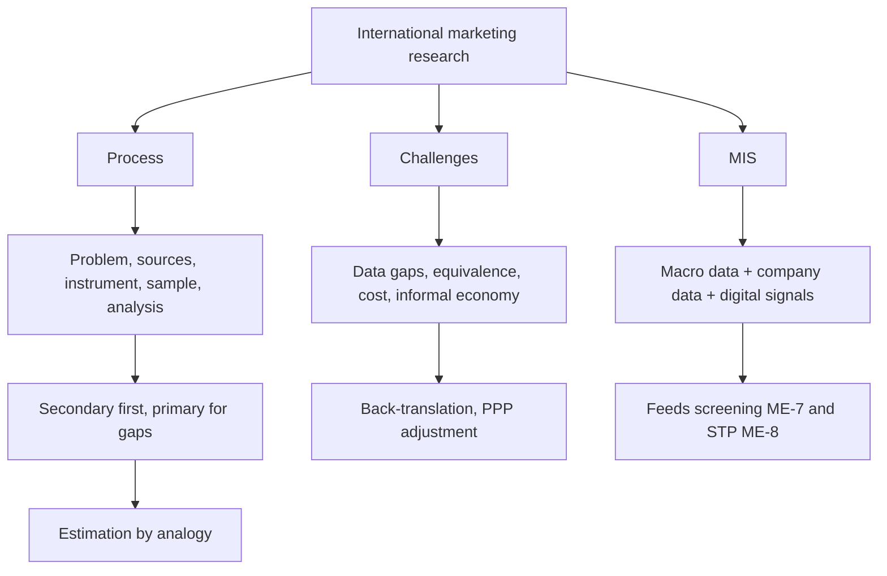

# ME-6 - International Marketing Research and Information Systems

Covers: why international research is harder than domestic, the six-step process, secondary vs primary data, cross-cultural pitfalls, estimation by analogy, and the marketing information system (MIS). Not in the faculty slides. Content is **(student notes)** unless tagged **(general)**.

## Why it matters (student notes)
International decisions are made under more uncertainty and information asymmetry than domestic ones. Data quality, availability and comparability vary across countries, so the research process is itself a strategic capability. Research feeds the screening in ME-7 and the segmentation in ME-8.

## The research process, adapted for international use (student notes)
1. **Define the problem.** Harder because several culturally different markets must be covered at once.
2. **Determine data sources.**
   - **Secondary data:** World Bank, WTO, UNCTAD, IMF, Statista, government trade statistics, industry and company reports. Fast and cheap, but definitions and quality differ across countries.
   - **Primary data:** surveys, interviews, focus groups, ethnographic work done locally. Needed when secondary data is missing or culturally unreliable; costly and complex (translation, sampling, response bias).
3. **Design the instrument.** Check translation equivalence (back-translation), response-style differences (acquiescence bias, avoidance of extreme answers) and literacy or technology access (online vs in-person).
4. **Sample.** Representative sampling is harder where population data is poor or the informal sector is large.
5. **Analyse for comparability.** Currency-adjust and purchasing-power-adjust before comparing countries.
6. **Decision support through an MIS.** Continuous dashboards, increasingly analytics-driven, rather than one-off projects.

**(general)** Order of play: start with secondary data, and commission primary research only for the gaps secondary data cannot fill. This saves money and tells you what to ask.

## Challenges specific to international research (student notes)
- Data gaps and quality problems, especially in developing and frontier markets.
- Cross-cultural measurement equivalence: a satisfaction scale may not mean the same thing everywhere.
- Cost and logistics of multi-country fieldwork.
- Digital sources (social listening, e-commerce transactions) now supplement or replace surveys.
- Informal-economy behaviour is missed by formal data sources.
- Comparability trade-off: one standard instrument allows comparison but may lose local relevance; a fully localised one does the reverse.

## Back-translation and equivalence (general)
Translate the questionnaire into the local language, have a second translator translate it back, and compare with the original. Differences expose meaning shifts. Equivalence has three layers: translation (words), conceptual (the idea exists locally) and measurement (the scale is used the same way).

## Estimation by analogy (general; named in the student screening note)
When direct data is missing, borrow a ratio from a comparable market and adjust it. Method: benchmark penetration x adjustment factor x population. State the proportionality assumption, since it is the weak point.

## The international marketing information system (student notes)
A good MIS gives continuous intelligence by combining three feeds: secondary macro data (World Bank, UNCTAD), company data (sales, customer analytics) and digital signals (search trends, social sentiment). It supports ongoing screening (ME-7) and segmentation (ME-8) decisions.

## Worked example: plan the research and size the market (exam layout)
**Q.** Nilgiri Appliances (illustrative Indian firm) is considering Country B for a compact washing machine. Plan the research, cost the primary survey, and estimate demand. All data below is illustrative.

**Part 1: sources.**
1. Secondary first: population, income, household data and import statistics from World Bank and trade statistics.
2. Primary survey only for what secondary data cannot give: price sensitivity, usage habits, preferred features.

**Part 2: survey budget (3 countries compared: A, B, C; 400 interviews each).**
| Country | Interviews | Cost per interview (₹) | Fieldwork (₹) |
|---|---|---|---|
| A | 400 | 350 | 1,40,000 |
| B | 400 | 500 | 2,00,000 |
| C | 400 | 250 | 1,00,000 |
| Fieldwork total | | | **4,40,000** |

Translation and back-translation: 3 x ₹60,000 = ₹1,80,000. Analysis and project management: 3 x ₹1,50,000 = ₹4,50,000. **Total = 4,40,000 + 1,80,000 + 4,50,000 = ₹10,70,000 (₹10.7 lakh).**

Sampling error: at 95% confidence and a 50% proportion, margin of error = 1.96 x sqrt(0.25 / 400) = **plus or minus 4.9 percentage points** per country.

**Part 3: demand by analogy.** Benchmark country A has 12 washing machines per 1,000 population. Country B's income is 70% of A's; assume penetration moves in proportion to income. B's population is 60 million.
1. Penetration B = 12 x 0.70 = 8.4 per 1,000 = 0.0084.
2. Potential = 60,000,000 x 0.0084 = **5,04,000 units**.
3. If the firm can realistically reach 25%: 5,04,000 x 0.25 = **1,26,000 units**.

**Decision line:** Commission the survey (₹10.7 lakh, error under 5 points) only if the analogy estimate of about 5 lakh units clears the firm's volume threshold; the analogy is cheap and rough, so test the income-proportional assumption in the survey itself.

## Exam skeleton hint
Name specific sources (World Bank, Statista, company reports), justify secondary vs primary, and state the translation and comparability safeguards.

## Common mistakes (student notes)
- Using one country's instrument unchanged elsewhere.
- Relying on stale secondary data in fast-moving digital markets.
- Ignoring informal-economy behaviour.

## What to remember
- International research faces data gaps, cultural equivalence problems and high fieldwork cost.
- Six steps: problem, sources, instrument, sample, comparable analysis, MIS.
- Secondary first, primary for gaps; back-translate every questionnaire.
- Comparability vs local relevance is the core trade-off.
- Estimation by analogy: benchmark x adjustment x population, with the assumption stated.
- An MIS is continuous: macro data, company data and digital signals.

## Concept map

## Flashcards
Q: Why is international marketing research harder than domestic research?
A: Greater uncertainty and information asymmetry; data quality, availability and comparability differ across countries, and culture affects how people respond.
Q: Name the six steps of the international research process.
A: Define the problem, determine data sources, design instruments, sample, analyse for comparability, and decision support through an MIS.
Q: Give examples of secondary sources and their weakness.
A: World Bank, WTO, UNCTAD, IMF, Statista and trade statistics; fast and cheap but inconsistent in definition and quality across countries.
Q: When is primary research needed?
A: When secondary data is unavailable or culturally unreliable; it is costly (translation, sampling, response bias).
Q: What is back-translation?
A: Translating a questionnaire into the local language and back again, then comparing with the original to catch meaning shifts.
Q: What is the comparability trade-off?
A: A standard instrument allows cross-country comparison but may lose local relevance; a localised one gains relevance but loses comparability.
Q: Margin of error for n = 400 at 95% confidence and a 50% proportion?
A: 1.96 x sqrt(0.25 / 400) = plus or minus 4.9 percentage points.
Q: Estimate B's market: benchmark 12 per 1,000, B's income 70% of benchmark, population 60 million.
A: 12 x 0.70 = 8.4 per 1,000; 60 million x 0.0084 = 5,04,000 units, assuming penetration is proportional to income.
Q: What three feeds make up a good international MIS?
A: Secondary macro data, company data (sales, customer analytics) and digital signals (search trends, social sentiment).
