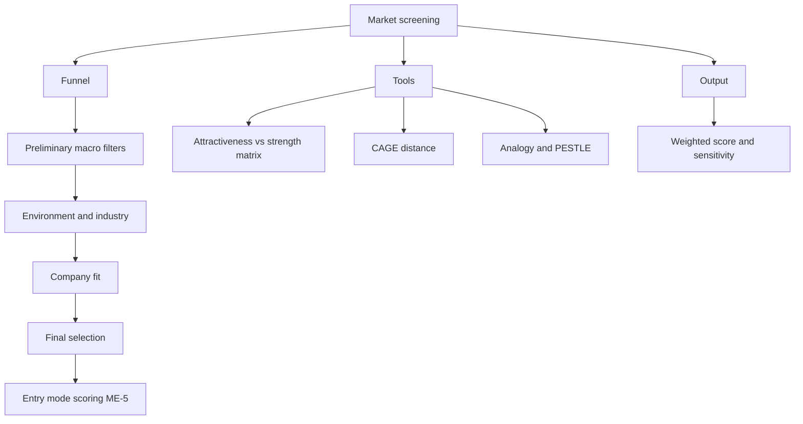

# ME-7 - Market Screening and Country Selection

Covers: the screening funnel, the tools (attractiveness matrix, CAGE, analogy, PESTLE), a weighted country screen with sensitivity, and the handoff to entry-mode scoring in ME-5. Not in the faculty slides. Content is **(student notes)** unless tagged **(general)**.

## Why screen (student notes)
There are roughly 190 countries. A disciplined funnel takes the firm from "all countries" to a short-list worth detailed study. It prevents wasted analysis and ad-hoc entry such as "a distributor in Country X wrote to us, so let's enter".

## The screening funnel (student notes)
1. **Preliminary screening.** Broad macro filters: market size, GDP growth, political stability, basic demand indicators. Eliminates clearly unviable markets fast.
2. **Environment and industry screening.** Economic, political, legal and cultural environment (Unit 2) plus competitive intensity in the specific industry.
3. **Company-level screening.** Fit with the firm's resources, capabilities and objectives; can its competitive advantage transfer?
4. **Final selection and entry-mode decision.** Deep feasibility study, often with primary research (ME-6), ending in the entry-mode choice (ME-1 to ME-5).

**(general)** Stage 1 usually works as knock-out criteria (pass or fail: sanctions, import ban, no payment route). Stages 2 and 3 work as scored criteria.

## Tools (student notes)
- **Country attractiveness vs competitive strength matrix** (GE/McKinsey style): market attractiveness (size, growth, risk) on one axis, the firm's strength in that market on the other. High-high means invest; low-low means avoid.
- **CAGE distance framework:** Cultural, Administrative, Geographic and Economic distance from home. **(general)** Larger distance means higher cost and risk; examples are language and religion (cultural), colonial ties and trade blocs (administrative), distance and infrastructure (geographic), income gaps (economic).
- **Market indicators and estimation by analogy:** use proxy indicators (mobile penetration, car ownership) or borrow ratios from a comparable market (worked in ME-6).
- **PESTLE:** a structured environment scan that feeds the screening criteria.

## Managerial perspective (student notes)
Screening must be criteria-driven and documented so the board can defend it. Do not chase growth headlines without risk-adjusted attractiveness.

## Common mistakes (student notes)
- Screening on market size alone; a large market with strong incumbents may be unattractive.
- Using national averages that hide regional variation (India, China, Brazil).
- Skipping company-level fit.

## Rigor vs speed (student notes)
Over-screening can cost first-mover advantage in fast digital categories. In frontier markets with little data, local visits and partner networks replace secondary data.

## Worked example: weighted country screen, then entry mode (exam layout)
**Q.** Nilgiri Snacks (illustrative Indian packaged-snacks firm) has passed four candidate countries (P, Q, R, S) through the knock-out filter. Select a country and an entry mode. Weights and scores are illustrative judgements (1 = poor, 5 = best; risk and competition are scored so that 5 means low risk and weak competition).

**Step 1: criteria and weights (total 100).** Market size 25, growth 20, country risk 20, competitive intensity 15, cultural fit 10, ease of entry and infrastructure 10.

**Step 2: scores and weighted totals.**
| Country | Size (25) | Growth (20) | Risk (20) | Competition (15) | Fit (10) | Ease (10) | Total | Out of 5 |
|---|---|---|---|---|---|---|---|---|
| P | 4 | 5 | 2 | 3 | 3 | 3 | 345 | 3.45 |
| Q | 3 | 3 | 4 | 4 | 4 | 4 | 355 | 3.55 |
| R | 5 | 3 | 3 | 2 | 2 | 2 | 315 | 3.15 |
| S | 2 | 4 | 5 | 5 | 5 | 4 | 395 | 3.95 |

Working for S: 2 x 25 + 4 x 20 + 5 x 20 + 5 x 15 + 5 x 10 + 4 x 10 = 50 + 80 + 100 + 75 + 50 + 40 = **395**, so 395 / 100 = **3.95**.

**Step 3: sensitivity.**
- Risk-heavy weights (size 15, growth 15, risk 35, competition 15, fit 10, ease 10): S 4.30, Q 3.70, P 3.10, R 2.95. S stays first.
- Size-heavy weights (size 45, growth 20, risk 10, competition 10, fit 5, ease 10): P 3.75, R 3.65, Q 3.35, S 3.35. **P overtakes S**, so S wins only while the size weight stays below 40 (with the other weights scaled in proportion, P ties S at 3.56 when size is 40). State this.

**Step 4: matrix check (firm strength scored 1-5, cut-off 3.5).**
| Country | Attractiveness | Firm strength | Verdict |
|---|---|---|---|
| S | 3.95 | 4.0 | Invest (high, high) |
| Q | 3.55 | 3.5 | Invest selectively |
| P | 3.45 | 3.0 | Monitor; enter only via low-commitment mode |
| R | 3.15 | 2.0 | Avoid for now |

**Step 5: handoff to entry mode (the method of ME-5).** For S, use weights control 20, capital saved 25, speed 20, low risk 20, local knowledge 15.
| Mode | Control | Capital | Speed | Risk | Local | Total | Out of 5 |
|---|---|---|---|---|---|---|---|
| Exporting | 2 | 5 | 4 | 4 | 2 | 355 | 3.55 |
| Franchising/licensing partner | 3 | 4 | 4 | 4 | 4 | 380 | 3.80 |
| Joint venture | 3 | 3 | 3 | 3 | 5 | 330 | 3.30 |
| Greenfield | 5 | 1 | 1 | 2 | 2 | 215 | 2.15 |

Working for the partner route: 3 x 20 + 4 x 25 + 4 x 20 + 4 x 20 + 4 x 15 = 60 + 100 + 80 + 80 + 60 = **380**.

**Decision line:** Enter Country S (3.95, ahead of Q at 3.55) through a partner-based route (3.80), then escalate to a JV or own plant once volumes prove the market. Ranking depends on the weights; a size-obsessed board would pick P, so the answer is only as good as the stated assumptions.

## When the case combines both
A single case can ask "which country and how". Run two scored tables in sequence: the country screen (this node) then the entry-mode table (ME-5). Use different criteria in each; do not reuse the same weights.

## What to remember
- Funnel: preliminary, environment and industry, company fit, final selection with entry mode.
- Knock-out first, then weighted scores; show the sum and a one-line decision.
- Tools: attractiveness-strength matrix, CAGE, analogy, PESTLE.
- Never screen on size alone, and never skip company-level fit.
- Always add a sensitivity line: what weight change flips the winner.
- Output of screening is the input to entry-mode choice (ME-5).

## Concept map

## Flashcards
Q: What is market screening?
A: A funnel that progressively filters candidate countries with increasingly specific criteria, ending in a short-list and final selection.
Q: Name the four stages of the screening funnel.
A: Preliminary macro screening; environment and industry screening; company-level screening; final selection with the entry-mode decision.
Q: What does CAGE stand for?
A: Cultural, Administrative, Geographic and Economic distance between home and target market.
Q: What two axes does the country attractiveness matrix use?
A: Market attractiveness (size, growth, risk) against the firm's competitive strength in that market.
Q: Why not screen on market size alone?
A: A large market can be unattractive if strong incumbents, high risk or entry barriers exist; fit and risk matter too.
Q: Country S scores 2, 4, 5, 5, 5, 4 on weights 25, 20, 20, 15, 10, 10. Total?
A: 50 + 80 + 100 + 75 + 50 + 40 = 395, so 3.95 out of 5.
Q: In the Nilgiri screen, what flips the winner from S to P?
A: Size-heavy weights (size 45, growth 20, risk 10, competition 10, fit 5, ease 10) give P 3.75 against S 3.35.
Q: How do screening and entry mode connect in a case?
A: Screen countries first, then score entry modes for the winning country with a separate weighted table (ME-5 method).
Q: What is the trade-off between screening rigour and speed?
A: Too much screening can lose first-mover advantage in fast digital categories; too little gives ad-hoc, indefensible entry.
