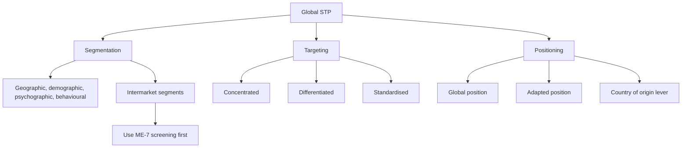

# ME-8 - Global Segmentation, Targeting and Positioning

Covers: global bases of segmentation, intermarket segments, three targeting strategies, global vs local positioning, and a worked segment-selection table. Not in the faculty slides. Content is **(student notes)** unless tagged **(general)**.

## Definition (student notes)
STP = divide global markets into groups with similar needs (segmentation), choose which to serve (targeting), and define how the brand should be perceived against competitors (positioning). In international marketing it is applied across, not only within, national borders.

## Approaches to global segmentation (student notes)
| Basis | Idea | Caution |
|---|---|---|
| Geographic or country | Each country, region or bloc is a segment | Simple, but misses cross-border similarity |
| Demographic | Age, income, education across countries (global middle class) | Same income buys different things in different places |
| Psychographic or lifestyle | Values, attitudes, aspirations; urban connected consumers resemble each other more than rural compatriots (global consumer culture) | Needs research (ME-6) |
| Behavioural | Usage rate, loyalty, benefit sought (heavy streaming users) | Works where categories are similar |
| Intermarket | Segments cutting across borders with similar needs (global luxury buyers, enterprise IT buyers) | Needs reachable media and channels |

**(general)** Country-based and intermarket are often combined: screen countries first (ME-7), then segment inside the short-listed ones.

## Targeting strategies (student notes)
- **Concentrated:** a few priority countries or segments; efficient, but risk is concentrated.
- **Differentiated:** tailored offers for several distinct country segments.
- **Standardised (undifferentiated):** one global offer for a broadly similar global segment; feasible mainly for converging categories such as premium electronics.

Targeting should follow the screening and attractiveness work in ME-7.

## Positioning (student notes)
- **Global positioning:** one consistent position worldwide (a premium-innovation brand).
- **Adapted or local positioning:** the same brand positioned differently by market, for example aspirational in an emerging market and mainstream at home.
- **Country-of-origin effect:** a deliberate lever, such as "Made in Germany" for engineering or "Made in Italy" for design.

Central trade-off: global consistency builds brand equity; local relevance wins against local competitors. This echoes the standardisation vs adaptation debate (Unit 4).

## Examples (student notes, qualitative)
- Netflix uses viewing data to find content-preference segments across markets while keeping a standard platform and subscription.
- Unilever's "glocal" approach adapts global master brands such as Dove and Lifebuoy in formulation, pack size and messaging for income and cultural segments.

## Common mistakes (student notes)
- Assuming the domestic segmentation transfers abroad unvalidated.
- Over-standardising positioning where competitors or cultural meanings differ.
- Ignoring intermarket segments such as global affluent travellers.

## Worked example: pick the segment and the targeting strategy (exam layout)
**Q.** Nilgiri Skincare (illustrative Indian firm) has short-listed Countries X, Y and Z. It wants to test whether an intermarket segment, "young urban professionals", beats a country-based approach. Illustrative data below.

**Step 1: size the intermarket segment.** Segment = population x urban share x segment share of urban people.
| Country | Population (mn) | Urban share | Segment share of urban | Segment size (mn) |
|---|---|---|---|---|
| X | 80 | 60% | 15% | 7.20 |
| Y | 40 | 80% | 20% | 6.40 |
| Z | 120 | 45% | 8% | 4.32 |
| Total | | | | **17.92** |

Working for X: 80 x 0.60 = 48 mn urban; 48 x 0.15 = 7.20 mn. Country-based thinking would rank Z first (54 mn urban people against X 48 and Y 32), but Z has the **smallest** segment. Intermarket sizing reverses the ranking, which is the point of segmenting beyond country lines.

**Step 2: score three candidate segments (weights total 100: size 30, growth 20, spending power 20, reachability 15, brand fit 15; scores 1-5).**
| Segment | Size | Growth | Spend | Reach | Fit | Total | Out of 5 |
|---|---|---|---|---|---|---|---|
| Young urban professionals | 4 | 5 | 4 | 5 | 5 | 450 | 4.50 |
| Family value seekers | 5 | 3 | 2 | 3 | 3 | 340 | 3.40 |
| Affluent premium buyers | 2 | 3 | 5 | 3 | 4 | 325 | 3.25 |

Working for the first: 4 x 30 + 5 x 20 + 4 x 20 + 5 x 15 + 5 x 15 = 120 + 100 + 80 + 75 + 75 = **450**.

**Step 3: targeting and positioning.**
- Targeting: concentrated on one intermarket segment (17.92 mn people) across X, Y and Z, with a standardised core offer and local pack sizes (a light differentiation).
- Positioning statement: "For young urban professionals who want dermatologist-grade care at a fair price, Nilgiri is the science-led daily skincare brand." Keep the global position; adapt the proof points (local climate, local ingredients) per country.

**Decision line:** Target young urban professionals (4.50 against 3.40 and 3.25) as one intermarket segment of about 17.9 mn people, starting in X and Y where the segment is largest per country. The risk is concentration on a single segment, so validate with local research (ME-6) before launch.

## Exam hint (student notes)
State which segmentation basis you use, justify it against the country's demographic and psychographic profile (Unit 2), then give a clear positioning statement.

## What to remember
- Five bases: geographic, demographic, psychographic, behavioural, intermarket.
- Intermarket segments cut across borders and can reorder country rankings.
- Targeting: concentrated, differentiated, standardised.
- Positioning: global, adapted, or built on country of origin.
- Core trade-off: global brand consistency vs local relevance.
- Revalidate STP in every new market; domestic segments do not transfer automatically.

## Concept map

## Flashcards
Q: Define segmentation, targeting and positioning in global terms.
A: Dividing global markets into groups of similar needs, choosing which groups to serve, and defining the brand's perceived place against competitors.
Q: Name the five bases of global segmentation.
A: Geographic or country, demographic, psychographic or lifestyle, behavioural and intermarket.
Q: What is an intermarket segment?
A: A group sharing similar needs regardless of nationality, such as global luxury consumers or enterprise IT buyers.
Q: Why does psychographic segmentation work globally?
A: Urban, digitally connected consumers in different countries often share more values with each other than with rural compatriots (global consumer culture).
Q: Name the three targeting strategies.
A: Concentrated, differentiated and standardised (undifferentiated).
Q: Global vs adapted positioning?
A: Global uses one consistent position worldwide; adapted positions the same brand differently by market to fit local competition and culture.
Q: What is the central trade-off in global positioning?
A: Global brand consistency (equity, efficiency) against local market relevance.
Q: Segment size for country X: population 80 mn, urban 60%, segment 15% of urban?
A: 80 x 0.60 x 0.15 = 7.20 mn.
Q: Total intermarket segment across X (7.20), Y (6.40) and Z (4.32), and what does it reveal?
A: 17.92 mn; Z has the largest urban population but the smallest segment, so country-based ranking misleads.
Q: Score for a segment with scores 4, 5, 4, 5, 5 on weights 30, 20, 20, 15, 15?
A: 120 + 100 + 80 + 75 + 75 = 450, so 4.50 out of 5.
