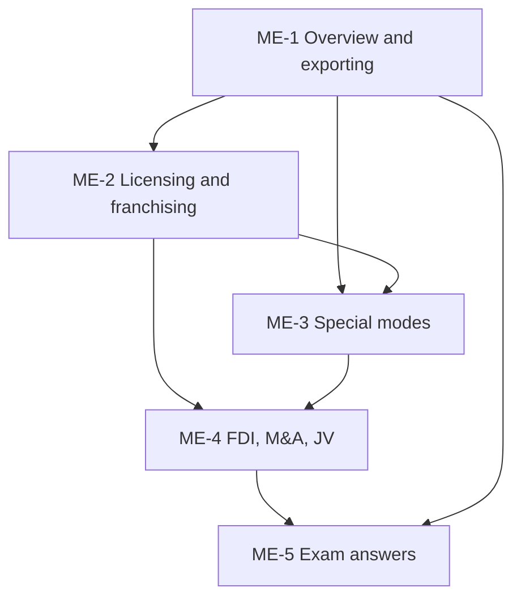

# International Marketing Unit 3: Market Entry Strategies, node map

ESE (assumed): 50 marks, 2 hours. Section A 3 of 5 x 5, Section B 2 of 3 x 10, Section C one compulsory 15-mark case. The **faculty deck is the single source**; general knowledge only fills gaps and is tagged. Firms in worked examples are **illustrative**.

## Nodes

| Node | Topic | Deps | Minutes | Exam focus |
|---|---|---|---|---|
| ME-1 | Entry Modes Overview and Exporting | none | 30 | yes |
| ME-2 | Licensing and Franchising | ME-1 | 35 | yes |
| ME-3 | Contract Manufacturing, Management Contracts and Turnkey | ME-1, ME-2 | 30 | yes |
| ME-4 | FDI: Greenfield, Mergers and Acquisitions, Joint Ventures | ME-1, ME-2, ME-3 | 40 | yes |
| ME-5 | Unit 3 Exam Answers (5, 10 and 15-mark case layouts) | ME-1 to ME-4 | 35 | yes |

Total reading time: about 170 minutes.

## Dependency graph

## Headline facts to know
- Modes: exporting (indirect, direct, intra-corporate), licensing, franchising, contract manufacturing, management contracts, turnkey, FDI without alliances (greenfield), FDI with alliances (M&A, JV).
- Franchising = licensing with more control; fixed fee plus sales royalty.
- Examples from the deck: PepsiCo/Coke bottlers, McDonald's/Subway/KFC, Apple and Foxconn, HDFC Bank and Centurion Bank of Punjab, Sony Ericsson.
- Worked numbers: franchise income ₹1.7 crore over 5 years; entry-mode score franchising 3.95 vs licensing 3.45, JV 3.30, greenfield 2.15 (illustrative).

## Links
- [[International Marketing MOC]]
