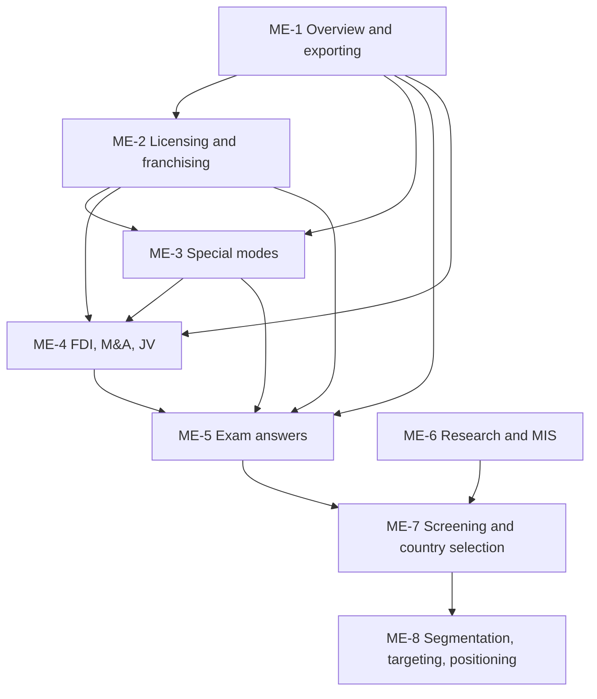

# International Marketing Unit 3: Global Market Analysis and Entry Strategies, node map

ESE (assumed): 50 marks, 2 hours. Section A 3 of 5 x 5, Section B 2 of 3 x 10, Section C one compulsory 15-mark case. The **faculty deck is the single source**; general knowledge only fills gaps and is tagged. Firms in worked examples are **illustrative**. ME-1 to ME-5 follow the deck; ME-6 to ME-8 cover syllabus topics the deck omits (research, screening, STP) and come from the student notes, tagged **(student notes)**; ME-1 to ME-4 also carry student-note additions and corrections.

## Nodes

| Node | Topic | Deps | Minutes | Exam focus |
|---|---|---|---|---|
| ME-1 | Entry Modes Overview and Exporting | none | 35 | yes |
| ME-2 | Licensing and Franchising | ME-1 | 35 | yes |
| ME-3 | Contract Manufacturing, Management Contracts and Turnkey | ME-1, ME-2 | 30 | yes |
| ME-4 | FDI: Greenfield, Mergers and Acquisitions, Joint Ventures | ME-1, ME-2, ME-3 | 45 | yes |
| ME-5 | Unit 3 Exam Answers (5, 10 and 15-mark case layouts, including the combined screening and entry-mode case) | ME-1 to ME-4 | 40 | yes |
| ME-6 | International Marketing Research and Information Systems | none | 30 | yes |
| ME-7 | Market Screening and Country Selection | ME-5, ME-6 | 35 | yes |
| ME-8 | Global Segmentation, Targeting and Positioning | ME-7 | 30 | yes |

Total reading time: about 245 minutes (35 + 35 + 30 + 45 + 40 + 30 + 35 + 30).

## Dependency graph

## Headline facts to know
- Modes: exporting (indirect, direct, intra-corporate), licensing, franchising, contract manufacturing, management contracts, turnkey, FDI without alliances (greenfield), FDI with alliances (M&A, JV).
- Franchising = licensing with more control; fixed fee plus sales royalty.
- Examples from the deck: PepsiCo/Coke bottlers, McDonald's/Subway/KFC, Apple and Foxconn, HDFC Bank and Centurion Bank of Punjab, Sony Ericsson.
- Worked numbers: franchise income ₹1.7 crore over 5 years; entry-mode score franchising 3.95 vs licensing 3.45, JV 3.30, greenfield 2.15 (illustrative).
- Student-note nodes (illustrative): survey budget ₹10.7 lakh with plus or minus 4.9 points at n = 400 and 5,04,000 units by analogy (ME-6); country S 3.95 vs Q 3.55, P 3.45, R 3.15, flipping to P under size-heavy weights (ME-7); intermarket segment 17.92 mn people and top segment score 4.50 (ME-8).
- Syllabus reading order: ME-6 research, ME-7 screening and country selection, then ME-1 to ME-5 for entry mode, with ME-8 for STP. File order stays ME-1 to ME-8 so existing ids do not change.

## Links
- [[International Marketing MOC]]
