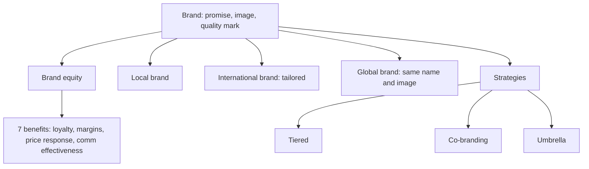

# MM-1: Brands, Brand Equity and Local, International, Global Brands

Covers: what a brand is, brand image, brand equity and its seven benefits, the three brand levels (local, international, global), the branding strategies on the slide (tiered, co-branding, umbrella) and the ChaiConnect opener. **(class)** throughout unless tagged.

## Why this matters
Unit 4 is the 4 Ps taken across borders. The slides open with brand and product decisions because every other P (price, place, promotion) is set after the company has decided what it is selling and under what name. The slide's key tension: **product standardisation vs adaptation**, and **global branding vs local branding**. Firms balance the efficiency of standardising with the fit of adapting, usually through a mix.
Assignment slide (Apple vs Samsung global strategy): no exam content; see Unit 5 (SL-2).

## What a brand is (class)
The slides give five ways to say it:
1. A bundle of images and experiences in the customer's mind.
2. A promise made by a particular company about a particular product.
3. A quality certification.
4. A differentiator between competing products.
5. The sum of impressions about a brand is the **brand image**.

## Brand equity (class)
- **Definition 1:** the added value that accrues to a product as a result of investments in the marketing of the brand.
- **Definition 2:** an asset that represents the value created by the relationship between the brand and the customer over time.

### Seven benefits of strong brand equity
| No. | Benefit | Plain meaning |
|---|---|---|
| 1 | Greater loyalty | Customers repeat-buy |
| 2 | Less vulnerability to marketing actions | Rival promotions bite less |
| 3 | Less vulnerability to marketing crises | The brand survives a recall or scandal better |
| 4 | Larger margins | A premium can be charged |
| 5 | More inelastic response to price increases | Volume holds when price rises |
| 6 | More elastic response to price decreases | Volume jumps when price falls |
| 7 | Increased marketing communication effectiveness | Each rupee of advertising works harder |
Exam trap: points 5 and 6 are opposite on purpose. Inelastic to increases, elastic to decreases. Writing "inelastic" for both loses the mark.

## Local, international and global brands (class)
| Level | Slide definition | Slide examples and notes |
|---|---|---|
| **Local** | Success in a single national market or a narrow geographical area; the lifeblood of domestic companies; can be a significant competitive hurdle to global firms | Haier, said on the slide to hold 40% of China's refrigerator sales **[VERIFY]** (a dated slide figure) |
| **International** | Offered in several markets of a region; operate in multiple countries but **tailor** the offering (marketing, packaging, sometimes the product) to local culture, law and tastes | McDonald's menu differs by country; Unilever sells the same product under different names in different regions |
| **Global** | Meets the wants of a global market and is offered in all world regions; **same name, similar image and positioning worldwide** | Nestle "Makes the very best"; Gillette "The best a man can get"; GE "Imagination at work"; BMW "The ultimate driving machine"; Harley-Davidson "The American legend" |
Taglines are the slide's own wording. **[VERIFY]** that taglines are still current before quoting them as "the" slogan; companies change them.

Note on the slide's own overlap: McDonald's is called a global brand in one line (consistent name and image) and an international one in another (menu adapted). Resolve it in the exam by separating **brand** (global, same name and image) from **offering** (adapted, McAloo Tikki in India, see MM-3).

## Branding strategies on the slide (class)
| Strategy | Meaning | Slide examples |
|---|---|---|
| **Combination or tiered branding** | Leverage the company reputation while giving a line of products a distinctive identity | General pattern, no example on slide |
| **Co-branding** | Two or more company or product brands featured together; works best when the products **complement** each other | Intel Inside; ICICI HP **[VERIFY]** (slide example; confirm the tie-up before quoting) |
| **Umbrella branding** | One brand acts as an umbrella for new products | Tata, Sony, Apple |
The slide also lists **brand extensions** as a consideration (using an established brand name to launch a new product). A global-brand extension carries the home reputation into a new category.

## Worked example: ChaiConnect opener, adapt the product or reposition the brand? (exam layout)
The slide poses it as a discussion case. Fictional start-up **ChaiConnect** (premium tea subscription boxes and cafes in India) is entering **Japan, Germany and the United States**. The question: adapt the product, or reposition the brand?
No figures are given, so the answer is a structured argument.
| Step | Content |
|---|---|
| 1. Separate the two decisions | Brand = promise and image (positioning). Product = blend, format, packaging, serving. They can be settled independently |
| 2. Market scan (general knowledge, state as assumption) | Japan: tea-literate, green-tea tradition, high quality bar. Germany: herbal and fruit infusion habits, organic and eco labelling matter. US: iced and sweetened tea, convenience, subscription culture. **(general)** |
| 3. Apply the slide's three factors | Market needs (taste, usage), cost (cost of adaptation vs scale economies), competition (local tea brands are the "local brand hurdle") |
| 4. Choose | Keep the **brand core** (premium, Indian craft, origin story) and adapt the **offering** (blends, pack sizes, labels) market by market |
| 5. Brand check | Does "India" help or hurt as country of origin for premium tea? (see MM-2) |
Decision line: the biggest concern is **fit between promise and local usage**. Reposition only where the home positioning fails with local buyers; otherwise hold one premium brand and adapt the product. State the assumption that the premium positioning travels.

## 5-mark skeleton: "Explain brand equity and its benefits"
Definition (1); added value from marketing investment plus relationship over time (1); any four benefits with a clause each (2); inelastic to increases, elastic to decreases (1).

## What to remember
- A brand is a promise and an image; the sum of impressions is brand image.
- Brand equity: added value from marketing investment, and an asset built through the customer relationship over time.
- Seven benefits; price response is inelastic to rises and elastic to cuts.
- Local = one country; international = region, tailored; global = same name, image and positioning everywhere.
- Co-branding needs complementary products; umbrella brands launch new products on an existing name.
- In exams, separate the brand (can be global) from the offering (can be adapted).

## Concept map

## Flashcards
Q: Give two class definitions of brand equity.
A: (1) The added value that accrues to a product from investments in the marketing of the brand. (2) An asset representing the value created by the relationship between the brand and the customer over time.
Q: Name the seven benefits of strong brand equity.
A: Greater loyalty; less vulnerability to marketing actions; less vulnerability to marketing crises; larger margins; more inelastic response to price increases; more elastic response to price decreases; increased communication effectiveness.
Q: How does a strong brand change price response?
A: Customers react little to a price rise (inelastic) and respond strongly to a price cut (elastic).
Q: Define a local brand and give the slide's example.
A: A brand successful in a single national market or narrow area; Haier in China refrigerators (slide figure 40%, verify).
Q: How do international brands differ from global brands?
A: International brands operate in several countries but tailor marketing, packaging or product to each; global brands keep the same name, image and positioning worldwide.
Q: Name four global brand taglines from the slide.
A: Nestle "Makes the very best"; Gillette "The best a man can get"; GE "Imagination at work"; BMW "The ultimate driving machine" (Harley-Davidson "The American legend" is the fifth).
Q: What is co-branding and when does it work best?
A: Featuring two or more company or product brands together; it works best when the products complement each other (Intel Inside).
Q: Give the slide's umbrella-brand examples.
A: Tata, Sony and Apple.
Q: In the ChaiConnect case, what should be kept and what adapted?
A: Keep the brand core (premium, Indian origin); adapt the offering (blends, pack sizes, labels) to Japan, Germany and the US.
