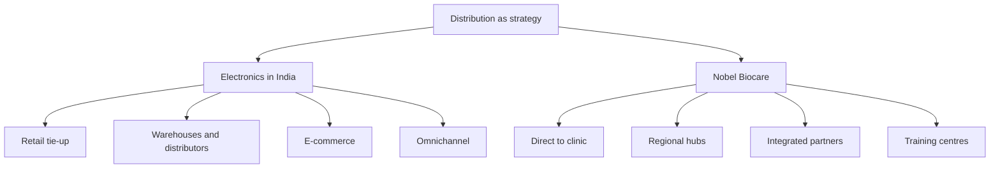

# MM-10: Distribution Cases, Electronics in India and Nobel Biocare

Covers: the Japanese consumer electronics entry into India with its four distribution options, the Nobel Biocare case (four-part model and four discussion questions) and a scoring method to answer "which option" questions. **(class)** unless tagged. Both cases are qualitative; the slides give no numbers.

## Case 1: Japanese consumer electronics brand entering India (class)
The firm is famous for **eco-friendly smart home appliances**. It sells in Europe and North America through large retail chains and e-commerce. India has unique distribution challenges. **Decision:** structure physical distribution to balance **cost, speed and customer reach**.
| Option | What it is | Pros | Cons |
|---|---|---|---|
| **1. Exclusive tie-up with modern retail chains** | Partner with Reliance Digital, Croma and other large electronics retailers | Strong brand visibility; standardised customer experience | Limited reach in tier-2 and tier-3 cities |
| **2. Regional warehousing plus local distributors** | Warehouses in Bengaluru, Delhi and Mumbai, local distributors for smaller towns | Faster delivery; deeper market penetration | Higher logistics cost; complexity of managing many partners |
| **3. Direct to consumer via e-commerce** | Amazon, Flipkart and its own website | Wide reach; lower overheads; data-driven customer insights | Delivery delays in rural areas; weaker physical presence for premium products |
| **4. Hybrid omnichannel** | Combines retail partnerships, regional warehouses and e-commerce | Flexibility; maximised reach; customer convenience | Needs strong coordination and investment in supply chain technology |
Companies named are the slide's. Do not add figures to them.

### Worked example: score the four options (exam layout, illustrative)
Weights and scores are judgemental and set for this note; state that in the exam. Score 1 (poor) to 5 (strong). Weights sum to 100%.
| Criterion | Weight | Retail tie-up | Warehouse + distributors | E-commerce | Omnichannel |
|---|---|---|---|---|---|
| Reach (tier 2 and 3) | 30% | 2 | 4 | 3 | 5 |
| Speed of delivery | 25% | 3 | 4 | 3 | 4 |
| Cost | 25% | 3 | 2 | 4 | 2 |
| Brand and premium fit | 20% | 5 | 3 | 2 | 4 |
Weighted score = sum of weight × score:
- Retail tie-up: 0.30×2 + 0.25×3 + 0.25×3 + 0.20×5 = 0.60 + 0.75 + 0.75 + 1.00 = **3.10**
- Warehouse + distributors: 0.30×4 + 0.25×4 + 0.25×2 + 0.20×3 = 1.20 + 1.00 + 0.50 + 0.60 = **3.30**
- E-commerce: 0.30×3 + 0.25×3 + 0.25×4 + 0.20×2 = 0.90 + 0.75 + 1.00 + 0.40 = **3.05**
- Omnichannel: 0.30×5 + 0.25×4 + 0.25×2 + 0.20×4 = 1.50 + 1.00 + 0.50 + 0.80 = **3.80**
Decision line: **omnichannel** scores highest (3.80), but it needs the supply-chain investment the slide warns about. Recommend a **phased** hybrid: start with retail tie-up plus e-commerce in the three metros, add regional warehouses and distributors as volume justifies. If the firm cannot fund technology, option 2 (3.30) is the fallback. The ranking depends on the weights, so name them.

## Case 2: Nobel Biocare, distribution as a strategic edge (class)
Nobel Biocare, headquartered in Zurich, Switzerland, is a global leader in dental implant solutions. It competes with Straumann and other implant providers. It differentiated through innovation (the slide cites the All-on-4 treatment concept) **and** through its **distribution system**, which became a source of competitive advantage. **[VERIFY]** the slide's company facts if quoted outside the class case.
### Four-part distribution model
| Element | What it did | Benefit |
|---|---|---|
| **1. Direct-to-clinic distribution** | Bypassed traditional wholesalers in key markets and delivered implants and prosthetics directly to dental clinics and hospitals | Fewer delays, product authenticity, stronger relationships with clinicians |
| **2. Regional warehousing and logistics hubs** | Warehouses in Europe, North America and Asia | Faster delivery and inventory control; implants and components reach clinics within days, reducing patient downtime |
| **3. Integrated partnerships** | Collaboration with 3Shape (digital scanners) and other CAD/CAM providers | Distributes a complete digital workflow (scan, plan, place, restore); a one-stop solution that raises loyalty |
| **4. Education and training centres** | Training centres set up alongside logistics hubs | Dentists get products and hands-on training, so distribution becomes a value-added service |

### The four discussion questions and model answers
1. **How did direct distribution strengthen its position against Straumann and others?** Direct control removed wholesaler delay, protected authenticity (important for a clinical product) and built relationships, while regional hubs gave speed that rivals using wholesalers could not easily match.
2. **How does bundling education and digital workflows with distribution enhance loyalty?** Switching means leaving the whole system, the training and the digital tools, not just changing a product, so switching costs rise.
3. **Could the model be replicated in other industries?** Yes in pharmaceuticals (authenticity, cold chain, doctor education) and in consumer electronics (installation, after-sales, data) if the product is high-value and technical, buyers need support and the volume covers the cost of direct reach. Less suited to low-margin commodities.
4. **How does it align with the premium brand image?** A premium promise needs reliable supply, authenticity and expertise, which direct delivery and training deliver. A discount wholesaler channel would dilute it.
Linking utilities (MM-8): speed gives time utility, hubs give place utility, bundling gives form utility, training gives information utility. Excellent exam bridge: **Nobel Biocare delivers all four channel utilities**.

## 15-mark case layout using these cases (see MM-14)
Facts and objective (2); options with pros and cons (4); scoring or criteria (3); recommendation with phasing (3); risks, KPIs and the decision line (3).

## What to remember
- Electronics-in-India options: retail tie-up, regional warehouses plus distributors, e-commerce, hybrid omnichannel; the trade-off is cost, speed and reach.
- Retail tie-up lacks tier-2 and tier-3 reach; e-commerce lacks rural delivery and premium presence; omnichannel needs technology investment.
- Nobel Biocare: direct to clinic, regional hubs, integrated digital partners, training centres.
- Distribution became the competitive advantage, not only the product.
- A scoring grid with stated weights makes a recommendation defensible.

## Concept map

## Flashcards
Q: What are the four distribution options for the Japanese electronics firm in India?
A: Exclusive tie-up with modern retail chains; regional warehousing plus local distributors; direct-to-consumer e-commerce; hybrid omnichannel.
Q: What is the main drawback of the retail-chain tie-up?
A: Limited reach in tier-2 and tier-3 cities.
Q: What is the main drawback of regional warehousing plus distributors?
A: Higher logistics cost and complexity in managing multiple partners.
Q: What are the drawbacks of e-commerce for this brand?
A: Delivery delays in rural areas and a weaker physical presence for premium products.
Q: What does the omnichannel option require?
A: Strong coordination and investment in supply chain technology.
Q: What was Nobel Biocare's four-part distribution model?
A: Direct-to-clinic distribution, regional warehousing and logistics hubs, integrated partnerships (3Shape, CAD/CAM), and education and training centres.
Q: Why did bypassing wholesalers help Nobel Biocare?
A: It cut delays, assured product authenticity and built closer clinician relationships.
Q: How does bundling training and digital workflow raise loyalty?
A: It creates a one-stop solution so switching means giving up the whole system, raising switching costs.
Q: In the illustrative scoring, which option wins and with what score?
A: Omnichannel with 3.80 (against 3.30, 3.10 and 3.05), subject to the stated weights.
