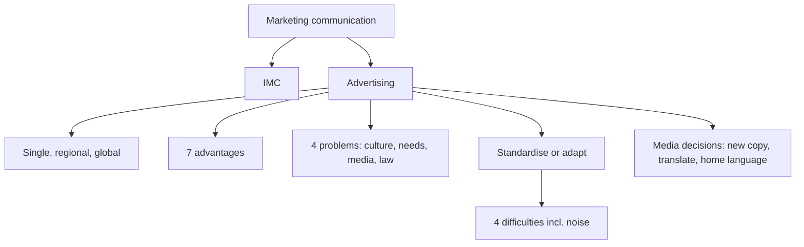

# MM-11: Global Communications, IMC and Advertising

Covers: purpose of marketing communication, IMC, definition of advertising and its three scopes, advantages and problems of global advertising, the standardisation vs adaptation question, the four communication difficulties and the three language options in media decisions. **(class)** unless tagged.

## Purpose and IMC (class)
- The primary purpose of marketing communications is to tell customers about the **benefits and values** that a company, product or service offers.
- **Integrated Marketing Communications (IMC)** is growing in popularity because of the challenges of communicating across borders. **(general)** IMC means all tools (advertising, PR, promotion, personal selling, direct, digital) deliver one coordinated message.

## Global advertising (class)
- **Advertising:** any sponsored, paid message communicated in a **non-personal** way.
- Scopes: **single country, regional, global**.
- **Global advertising:** the use of the **same advertising appeals, messages, art, copy, photographs, stories and video segments in multiple country markets**.
Exam point: "global" means the same creative core, not necessarily the same media or translation.

## Advantages of global marketing and advertising (class)
1. Economies of scale in production and distribution.
2. Lower costs from less planning and control effort.
3. Lower advertising production costs.
4. Ability to exploit good ideas worldwide.
5. Ability to introduce products quickly, worldwide.
6. Consistent international brand and company image.
7. Simplification of coordination and control.

## Problems with global advertising (class)
1. **Differences in culture, market and economic development** make a single approach difficult.
2. **Consumer needs and usage patterns** vary by country or region.
3. **Media availability or usage** varies by country or region.
4. **Legal restrictions** may prevent an effective universal appeal.
Memory hook: C-N-M-L, "Culture, Needs, Media, Law".

## Standardisation vs adaptation (class)
Primary question: must the **specific advertising message and media strategy** be changed from region to region or country to country?

### Four difficulties that compromise communication
| No. | Difficulty |
|---|---|
| 1 | The message may **not get through** to the intended recipient |
| 2 | The message may reach the target but may **not be understood**, or be **misunderstood** |
| 3 | The message may reach and be understood, yet **not induce the action** the sender wants |
| 4 | **Noise** can impair the message's effectiveness |
Link to the communication model **(general)**: sender, encoding, channel, decoding, receiver, feedback, with noise between. Cultural differences and language errors are noise at the decoding step.

## Global media decisions (class)
Three language options for copy in foreign markets:
1. **Prepare new copy** in the host country's language.
2. **Translate** the original copy into the target language.
3. **Leave some or all copy elements** in the home-country language.
And: media decisions must take into account **country-specific regulations**. Trade-off **(general)**: new copy fits best and costs most; translation is cheap but can mis-translate idiom; home language can signal foreign prestige in some categories but hurts clarity.

## Worked example: standardise or adapt the campaign (exam layout, illustrative)
Illustrative figures to show the saving: one ad film costs ₹60 lakh to produce. A fully local film per market for 3 markets costs 3 × ₹60 lakh = ₹1.8 crore. A global film at ₹60 lakh plus local adaptation (language, locations, legal changes) of ₹8 lakh per market costs 60 + 3 × 8 = ₹84 lakh.
| Step | Content |
|---|---|
| 1. Compute the production saving | 180 minus 84 = ₹96 lakh saved, which is 53% (96 ÷ 180) of the all-local cost |
| 2. Test the problems list | Culture (colours, gestures, humour), needs and usage (how the product is used), media (TV vs mobile), law (health claims, comparative ads) |
| 3. Classify the message | Universal appeal (family, quality) can be standardised; culture-bound claims must be adapted |
| 4. Choose media language | New copy for the key market, translation for the others, check for mistranslation |
| 5. Check the four difficulties | Reach (media habits), understanding (language), action (offer and call to action), noise (clutter) |
Decision line: **standardise the idea and adapt the execution** (a middle path), keeping the 53% saving while fixing what culture and law demand. The saving assumes adaptation stays near ₹8 lakh per market. **Break-even:** 60 + 3x = 180, so x = ₹40 lakh per market. Above that, the global film plus adaptation costs more than making each film locally.

## 5-mark skeleton: "Discuss the pros and cons of global advertising"
Define global advertising (1); three advantages (2); three problems (2).

## 10-mark skeleton: "Standardisation vs adaptation in global communication"
Primary question and definition (2); advantages (2); problems (2); four difficulties (2); media decisions and conclusion with IMC (2).

## What to remember
- Communication purpose: tell customers the benefits and values on offer; IMC coordinates all messages.
- Global advertising uses the same appeals, copy, art and video in multiple countries.
- Seven advantages (scale, lower cost, quick launch, consistent image); four problems (culture, needs, media, law).
- Four difficulties: no reach, no understanding, no action, noise.
- Media language: new copy, translation, or home language; follow local regulation.

## Concept map

## Flashcards
Q: What is the primary purpose of marketing communications?
A: To tell customers about the benefits and values that a company, product or service offers.
Q: Why is IMC becoming popular for global firms?
A: Because of the challenges of communicating across national borders; it coordinates all tools into one message.
Q: Define advertising and global advertising.
A: Advertising is any sponsored, paid, non-personal message; global advertising uses the same appeals, messages, art, copy, photographs, stories and video in multiple country markets.
Q: List four advantages of global advertising.
A: Economies of scale; lower advertising production cost; quick worldwide product introduction; consistent brand image (also: exploit good ideas, lower planning and control costs, simpler coordination).
Q: List the four problems of global advertising.
A: Culture, market and economic differences; varying needs and usage; varying media availability; legal restrictions.
Q: Name the four difficulties that compromise communication.
A: Message does not reach the recipient; it is not understood or is misunderstood; it does not induce the desired action; noise impairs it.
Q: What are the three copy options in global media decisions?
A: Prepare new copy in the host language, translate the original, or leave some or all copy in the home-country language.
Q: In the illustration, what is the saving from a global film plus local adaptation?
A: ₹96 lakh (₹1.8 crore minus ₹84 lakh), about 53%.
Q: What is the break-even adaptation cost per market in that illustration?
A: ₹40 lakh per market, where 60 + 3x equals 180.
