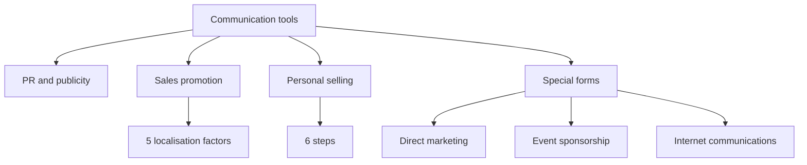

# MM-12: PR, Sales Promotion, Personal Selling and Special Forms

Covers: public relations and publicity tools, sales promotion and the five localisation factors, the six-step personal selling process, direct marketing, event sponsorship and internet communications. **(class)** unless tagged.

## Public relations and publicity (class)
- Purpose: **foster goodwill and understanding**; **generate favourable publicity**.
- Tools: news releases, media kits, press conferences, tours, articles in trade and professional journals, TV and radio talk-show appearances, special events.
- **(general)** Publicity is unpaid media coverage; advertising is paid. Global firms use PR to manage local reputation, for example in a crisis or after a product withdrawal.

## Sales promotion (class)
**Definition:** any paid consumer or trade communication programme of **limited duration** that adds **tangible value** to a product or brand.
Two splits: **price vs non-price** promotions; **consumer vs trade** promotions.
**(general)** Examples: coupons and price-offs (price, consumer), free samples and contests (non-price, consumer), trade allowances and dealer contests (trade).

### Localisation factors (class)
Take these into account to decide how far a promotion must be localised:
| No. | Factor | Effect |
|---|---|---|
| 1 | **Level of economic development** | Low incomes limit the range of promotional tools |
| 2 | **Market maturity** | Differs by country |
| 3 | **Local perception** of a tool or programme | Can vary; a coupon may signal poverty or thrift |
| 4 | **Local regulation** | May rule out a particular promotion in some countries |
| 5 | **Trade structure** in retailing | Affects which tools work, for example fragmented small stores vs big chains |
Memory hook: Economy, Maturity, Perception, Regulation, Trade structure (E-M-P-R-T).

## Personal selling (class)
- **Person-to-person communication** between a company representative and potential buyers.
- Focus: **inform and persuade** the prospect.
- Short-term goal: make a sale. Long-term goal: **build the relationship**.
### Six-step personal selling process
Approach, Presentation, Demonstration, Negotiation, Closing, Servicing the sale.
Memory hook: A-P-D-N-C-S, "A Persuasive Deal Needs Careful Service".
Global points **(general)**: negotiation style, gift norms and time orientation differ by culture, so training and local sales staff matter (link to cultural environment, Unit 2).

## Special forms of marketing communication (class)
| Form | Slide content |
|---|---|
| **Direct marketing** | Direct mail, catalogues, infomercials, teleshopping |
| **Event sponsorship** | Concerts, sporting events, **product placement in movies** |
| **Internet communications** | Reached in MM-13 |

## Worked example: choose the promotion mix for a new market (exam layout, illustrative)
Case: a mid-range Indian packaged-snacks brand enters a low-income, fragmented-retail market in Africa. Illustrative; no data on the slide.
| Step | Content |
|---|---|
| 1. Apply the five factors | Low income: avoid costly tools. Fragmented small stores: trade structure favours push through wholesalers. Local perception: samples trusted more than coupons. Regulation: check rules on contests and free goods. Maturity: low awareness, so build trial |
| 2. Pick promotion type | Non-price consumer (small free samples) plus trade promotion (volume allowance to distributors) |
| 3. Add PR | News release on local sourcing and jobs, to earn goodwill |
| 4. Personal selling | Route salespeople to wholesalers and kiosk owners; run the six-step process: approach, present, demonstrate, negotiate, close, service |
| 5. Direct and event | Sponsor a local sports event (event sponsorship) to build visibility |
| 6. Review | Trial rate, distributor orders, repeat buying |
Decision line: in a low-income, small-store market, **push (trade and personal selling) plus sampling beats price coupons and mass media**, because the five localisation factors point away from the tools used at home. State the assumptions.

## 5-mark skeleton: "Explain sales promotion and the factors in localising it"
Definition (limited duration, tangible value) (1); price vs non-price, consumer vs trade (1); five factors (3).

## 5-mark skeleton: "Explain the personal selling process"
Definition and goals (short-term sale, long-term relationship) (1); six steps with a clause each (4).

## What to remember
- PR fosters goodwill and generates favourable publicity; seven tools.
- Sales promotion: paid, limited duration, tangible value; price vs non-price, consumer vs trade.
- Localise promotions by economy, maturity, perception, regulation and trade structure.
- Personal selling: six steps, short-term sale, long-term relationship.
- Direct marketing, event sponsorship (including movie placement) and internet are special forms.

## Concept map

## Flashcards
Q: What are the aims of public relations and publicity?
A: To foster goodwill and understanding and to generate favourable publicity.
Q: Name four PR tools.
A: News releases, media kits, press conferences, tours (also trade articles, talk-show appearances, special events).
Q: Define sales promotion.
A: Any paid consumer or trade communication programme of limited duration that adds tangible value to a product or brand.
Q: What are the two classifications of sales promotion?
A: Price vs non-price promotions; consumer vs trade promotions.
Q: List the five factors affecting localisation of promotions.
A: Level of economic development, market maturity, local perception of the tool, local regulation, and retail trade structure.
Q: Define personal selling and its two goals.
A: Person-to-person communication between a company representative and buyers; short-term goal is a sale, long-term goal is a relationship.
Q: List the six steps of the personal selling process.
A: Approach, presentation, demonstration, negotiation, closing, servicing the sale.
Q: Name the special forms of marketing communication on the slide.
A: Direct marketing (direct mail, catalogues, infomercials, teleshopping), event sponsorship (concerts, sports, movie product placement) and internet communications.
