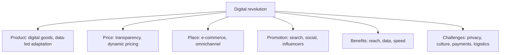

# MM-13: Global Marketing and the Digital Revolution

Covers: what the slides say (little), then the standard exam content tagged **(general)**: how digital changes each of the 4 Ps, tools, benefits, challenges and an exam-format plan. **Slide gap:** the topic is on the Unit 4 agenda but no slide teaches it. Use the **(class)** scraps first, then build the answer from the 4 P structure below.

## What the slides do say (class)
- **Internet communications** appears as a special form of marketing communication, beside direct marketing and event sponsorship (slide 83).
- **Internet** is a direct channel in both channel diagrams: manufacturer to customers by internet, mail order or interactive TV (consumer), and manufacturer to customers by internet (industrial) (slides 62 and 64).
- **Internet** is a row in the transport table: reliability **high**, cost **low**, speed **moderate to fast**, accessibility **moderate and increasing**, capability **low**, ease of tracing **high** (slide 72). It moves digital products only.
- The consumer-electronics case includes **e-commerce** (Amazon, Flipkart, own website) with pros: wide reach, lower overheads, data-driven insights; cons: rural delivery delays, weaker premium presence (MM-10).

## The digital revolution through the 4 Ps (general)
| P | What digital changes | Global example of the idea (illustrative, no figures) |
|---|---|---|
| **Product** | Data from users guides adaptation; digital products (software, streaming, apps) cross borders at near-zero shipping; products become services | Streaming services with local-language catalogues |
| **Price** | Prices are visible across borders, so price gaps are exposed and gray markets grow (MM-7); dynamic pricing and local-currency pricing become easy | Price comparison sites |
| **Place** | Direct-to-consumer reach, marketplaces, cross-border e-commerce, omnichannel (MM-10); intermediaries can be bypassed | Selling through Amazon or own site |
| **Promotion** | Search, social media, influencers, email, mobile, programmatic ads; precise targeting and measurable response; user-generated content | Global brand with local social pages |
Mnemonic: digital makes each P **more visible, more measurable and more global**.

## Benefits for global marketers (general)
1. Low-cost reach to many countries and small niches ("born global" firms).
2. Real-time customer data and feedback; faster testing of messages.
3. Personalisation at scale and lower communication cost per customer.
4. Quicker market entry with less capital than stores (compare retail strategies, MM-9).
5. 24x7 service and direct relationships.

## Challenges and constraints (general)
| Challenge | Detail |
|---|---|
| **Data privacy and law** | Rules differ: EU GDPR; India's DPDP Act 2023; the DPDP Rules were notified in November 2025 with phased commencement; confirm current dates **[VERIFY]** |
| **Language and culture** | Poor translation, wrong colours, humour; localisation beyond translation |
| **Payments and trust** | Preferred payment methods differ; fraud and currency conversion |
| **Infrastructure** | Internet speed and smartphone access vary; rural last-mile delivery (slide case) |
| **Logistics and returns** | Cross-border shipping, customs, duties and returns are costly (MM-5 Incoterms: DDP vs buyer-pays) |
| **Platform and censorship risk** | Dependence on a few platforms; some markets restrict them |
| **Price transparency** | Gray market and price comparison pressure (MM-7) |
| **Content regulation** | Advertising rules, influencer disclosure |
Link to MM-11: global advertising problems (culture, needs, media, law) apply equally online.

## Worked example: digital entry plan for a mid-sized firm (exam layout)
Illustrative: an Indian handicraft brand (assume ₹ premium, small volumes) tests sales in Germany and the UK. No figures given on the slides.
| Step | Content |
|---|---|
| 1. Objective | Test demand with low capital before committing to stores or distributors |
| 2. Product | Pick a few best-selling items; adapt sizes, labels (EU rules, MM-2) and descriptions in German |
| 3. Price | Landed price with duty and shipping shown in local currency; use DDP for the online buyer's confidence (MM-5) |
| 4. Place | Marketplace listing plus own website; local returns address or partner; later a distributor if orders build |
| 5. Promotion | Search ads in German, social content about craft and origin (country of origin, MM-2), influencer sampling, email list |
| 6. Compliance | GDPR-style consent for data; consumer-return rules |
| 7. Metrics | Visitors, conversion rate, cost per acquisition, return rate, repeat purchase |
Decision line: scale up only if the **cost per acquisition plus delivery cost stays below the contribution margin** per order. If the rate of returns or the delivery cost is too high, move to distributor or retail channels. Name the metric thresholds as your assumptions.

## 5-mark skeleton: "Explain the impact of the digital revolution on global marketing"
Intro: digital reduces borders in information and cost (1); impact on each P (2); benefits (1); one challenge with a law or logistics example (1). State that points beyond the internet scraps are general knowledge.

## What to remember
- The slides give little: internet as communication, channel and low-cost transport mode, and e-commerce in the electronics case.
- Digital transforms all four Ps: more global, visible and measurable.
- Benefits: reach, data, personalisation, speed, lower entry cost.
- Challenges: privacy law, language and culture, payments, infrastructure, returns, price transparency.
- Scale up only when acquisition plus delivery cost sits below contribution margin.

## Concept map

## Flashcards
Q: Where does the Unit 4 deck mention the internet?
A: As internet communications (a special form), as a direct channel in the consumer and industrial diagrams, as a row in the transport table, and as e-commerce in the electronics case.
Q: What does the slide table rate the internet as a transport mode?
A: Reliability high, cost low, speed moderate to fast, accessibility moderate and increasing, capability low, ease of tracing high.
Q: How does digital change pricing in global markets?
A: Prices become visible across borders, which exposes gaps and fuels gray markets, and makes dynamic and local-currency pricing easy.
Q: How does digital change place or distribution?
A: Direct-to-consumer reach, marketplaces and cross-border e-commerce; intermediaries can be bypassed and omnichannel models emerge.
Q: Name three digital promotion tools.
A: Search advertising, social media, influencer marketing (also email, mobile, programmatic).
Q: List three benefits of digital for global marketers.
A: Low-cost reach to many countries, real-time customer data, and personalisation at scale (also speed and lower entry cost).
Q: List three challenges of digital global marketing.
A: Data privacy and law (GDPR, India's DPDP Act), language and culture, and cross-border logistics and returns.
Q: What condition justifies scaling a cross-border e-commerce test?
A: Cost per acquisition plus delivery cost stays below the contribution margin per order.
Q: Which slide case shows e-commerce pros and cons?
A: The Japanese electronics firm in India: wide reach, lower overheads and data insights, against rural delivery delays and weak premium presence.
