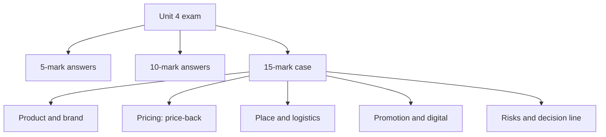

# MM-14: Unit 4 Exam Answers

Covers: likely 5-mark and 10-mark questions with skeletons, and the 15-mark case layout with a worked case. **(class)** content from the Unit 4 slides. No course plan is on file, so the standard Christ BBA ESE pattern is assumed.

## The paper (assumed from the plan)
ESE: 50 marks, 2 hours. **Section A:** 3 of 5 × 5. **Section B:** 2 of 3 × 10. **Section C:** one compulsory 15-mark case. Budget about 7 minutes per 5-mark answer, 15 per 10-mark, 30 for the case. Unit 4 is the 4 Ps, so it feeds the case heavily: expect a market-entry firm that needs a **mix recommendation**.

## 5-mark answers (about 120-150 words, one table or list)
| Likely question | Skeleton (marks) | Node |
|---|---|---|
| Explain brand equity and its benefits | Definition (1); added value and relationship (1); four benefits (2); inelastic to rises, elastic to cuts (1) | MM-1 |
| Local, international and global brands | One definition each (3); examples: Haier, McDonald's, Nestle or BMW (2) | MM-1 |
| Strategic alternatives in global product planning | Extend, adapt, create (1); five strategies (3); one example (1) | MM-3 |
| Skimming vs penetration pricing | Definition each (2); stage and objective (2); Sony camcorder and Walkman (1) | MM-4 |
| Price floor, ceiling and optimum price, and factors | Three levels (1); four factors (3); one line on objectives (1) | MM-4 |
| Explain any four Incoterms | EXW, FOB, CIF, DDP, one line each (4); who does export tasks (1) | MM-5 |
| Currency fluctuations and pricing | Weak currency actions (2); strong currency actions (2); logic (1) | MM-6 |
| Ethnocentric, polycentric, geocentric pricing | One line and issue each (3); gray market link (1); geocentric inputs (1) | MM-7 |
| Dumping and gray market | Dumping with two limbs (2); gray market definition and causes (2); one consequence (1) | MM-7 |
| Distribution channel utilities and intermediaries | AMA definition (1); four utilities (2); distributor vs agent (1); guideline (1) | MM-8 |
| Physical distribution components | Supply chain and logistics (1); order processing, warehousing, inventory, transport (4) | MM-9 |
| Pros and cons of global advertising | Definition (1); three advantages (2); three problems (2) | MM-11 |
| Sales promotion and localisation factors | Definition (1); two splits (1); five factors (3) | MM-12 |
| Personal selling process | Definition and goals (1); six steps (4) | MM-12 |
| Digital revolution in global marketing | Impact on each P (3); benefits (1); challenge (1) | MM-13 |

## 10-mark answers (about 300-350 words)
**Layout:** introduction (1-2), body in headed points or a table (6), interpretation or conclusion (1-2).
| Likely question | Skeleton |
|---|---|
| Discuss product and brand decisions in global marketing | Standardisation vs adaptation (1); brand equity and three brand levels (2); branding strategies and COO (2); five-strategy grid (3); factors and conclusion: choose the least adaptation that fits (2) |
| Explain global pricing decisions: objectives, strategies, environment | Floors, ceilings, optimum (1); objectives and skimming vs penetration (2); cost-plus, rigid vs flexible, with a short escalation example (2); currency, inflation, government, competition, sourcing (3); conclusion (1) |
| Discuss global pricing policies and their legal issues | Three policies (3); gray market (2); dumping and price fixing (3); transfer pricing (1); conclusion (1) |
| Explain Incoterms and their role in pricing | Nine export tasks (1); six terms with seller burden order (4); quote ladder idea: same total, different risk (3); conclusion (2) |
| Discuss global distribution: channels, retailing and logistics | Utilities and channel types (2); direct vs indirect and guidelines (2); retailing strategies (2); logistics and transport modes (3); conclusion (1) |
| Discuss global marketing communication decisions | IMC and purpose (1); global advertising, advantages and problems (3); standardise vs adapt and four difficulties (2); media decisions (1); PR, promotion, selling, special forms (2); digital (1) |
| Discuss the digital revolution's effect on the global mix | Slide scraps (1); each P (4); benefits (2); challenges (2); conclusion (1) |

## 15-mark case layout (Section C)
The case will describe a firm entering one or more foreign markets and ask for a **mix recommendation**. Unit 4 supplies the frame; combine with entry mode (Unit 3) and environment (Unit 2). Spend about 30 minutes.
| Block | Marks | What to write |
|---|---|---|
| 1. Context and objective | 2 | Two lines on firm, markets and the objective (share, profit, brand) |
| 2. Product and brand | 3 | Extend, adapt or create (use the grid); brand level (local, international, global); country of origin; label and packaging rules |
| 3. Pricing | 3 | Objective (skimming or penetration), cost-plus vs price-back, a landed-price calculation, Incoterm, currency and gray market risks |
| 4. Place | 3 | Channel (direct or indirect), utilities, intermediary guidelines, logistics and transport mode; digital route |
| 5. Promotion | 2 | Standardise the idea, adapt the execution; media language; sales promotion localisation; personal selling and PR |
| 6. Risks and control | 1 | Two risks with a mitigation (dumping, gray market, currency, regulation) |
| 7. Decision line and interpretation | 1 | One sentence that ranks the actions and says what is assumed |
Always show **at least one number** (a landed price or price-back) and **state assumptions**: slides give no pricing data, so any figure you use is illustrative.

### Worked case: Nirmal Cookware enters Germany (illustrative; figures built for this note)
**Case.** Nirmal Cookware, an Indian steel-cookware maker, plans to sell in Germany at a **shelf price of about ₹6,000 per set including 19% sales tax** (illustrative). It also considers a lower-priced entry in Kenya. Unit cost ₹2,600 ex-factory. Packing and documents ₹50 per set; freight and insurance ₹150 per set; duty 5% of CIF; combined importer-wholesaler mark-up 20%; retailer mark-up 30%. (All mark-ups on cost.) Recommend the mix.

**Answer layout (Germany).**
| Block | Content |
|---|---|
| 1. Objective | Premium entry with credibility; share is secondary |
| 2. Product and brand | Dual adaptation or Strategy 3: adapt the product (induction-compatible bases) and the German labelling; keep the craft story and brand. Check country of origin: India as steel and craft origin works if quality marks (CE and German tests **[VERIFY]**) back it |
| 3. Pricing: price-back | See the table below |
| 4. Place | German department-store or online marketplace listing; distributor-importer to handle customs; DAP or DDP for online buyers; sea freight, truck for last mile |
| 5. Promotion | One global creative idea (craft heritage), German-language copy, product-quality PR, trade-fair presence |
| 6. Risks | Currency, gray imports if India price is lower, anti-dumping query if prices look low |
| 7. Decision line | See below |

**Price-back (illustrative):**
| Step | Calculation | Result (₹) |
|---|---|---|
| Shelf price incl. tax | given | 6,000 |
| Remove sales tax 19% | 6,000 ÷ 1.19 | 5,042 |
| Remove retailer 30% | ÷ 1.30 | 3,878 |
| Remove importer-wholesaler 20% | ÷ 1.20 | 3,232 |
| Remove duty 5% | ÷ 1.05 | 3,078 (CIF) |
| Remove freight and insurance 150 | 3,078 minus 150 | 2,928 (FOB) |
| Remove packing and documents 50 | 2,928 minus 50 | **2,878 ex-works** |
| Unit cost | given | 2,600 |
| Margin at target shelf price | 2,878 minus 2,600 | **₹278 per set (10.7% on cost)** |
**Check the other direction.** If Nirmal prices ex-works at ₹3,600 (about 38% over cost), the shelf price becomes (3,600 + 50 + 150) × 1.05 × 1.20 × 1.30 × 1.19 = **₹7,407**, which is 23% above the ₹6,000 target. A ₹3,600 ex-works price needs either a premium position or a shorter channel.
**Decision line:** at ₹6,000 the margin is thin (₹278 per set); either position above ₹6,000 as a premium craft brand with proof of quality (skimming), or shorten the channel by selling online direct and bearing DAP, which removes the importer-wholesaler layer (about 20% of the chain). Recommend the premium, partly direct route, and state the assumed mark-ups.

**Kenya (two lines).** Penetration pricing, Strategy 3 (smaller set sizes, local pack), FOB or CFR quote with a distributor, trade promotion and sampling; check import duty **[VERIFY]**.

## Common mistakes
- Writing the Incoterm CFR as "seller not responsible outside factory". Use the correct definition (MM-5).
- Treating the "Target Costing" slide as target costing; it is cost-plus (MM-4).
- Forgetting that dumping needs both price discrimination and injury (MM-7).
- Stating Strategy 4 as missing; define it as dual adaptation (MM-3).
- Giving the digital answer without structure; use the 4 Ps (MM-13).
- Quoting numbers from the case as facts; label them as assumptions.

## What to remember
- 5-mark: definition plus two to four points plus one example.
- 10-mark: introduction, headed body or table, a conclusion that decides.
- 15-mark case: seven blocks; show a landed-price or price-back sum and a decision line.
- Always separate class answers from textbook or general additions and tag them.
- Time: 7, 15 and 30 minutes.

## Concept map

## Flashcards
Q: What is the Unit 4 15-mark case layout?
A: Context and objective; product and brand; pricing; place; promotion; risks and control; decision line, with at least one landed-price or price-back figure and stated assumptions.
Q: What is the price-back method?
A: Start from the target shelf price and remove tax and each margin, duty, freight and packing step to find the ex-works price.
Q: In the Nirmal case, what ex-works price meets a ₹6,000 shelf price?
A: ₹2,878 per set, giving a margin of ₹278 (10.7% on a ₹2,600 cost).
Q: In the Nirmal case, what happens at ₹3,600 ex-works?
A: The shelf price becomes ₹7,407, 23% above target.
Q: Which Incoterm slide statement should you correct in the exam?
A: CFR: the seller pays cost and freight to the destination port, not "no responsibility outside the factory".
Q: Why is the Target Costing slide really cost-plus?
A: Its formula is selling price equals total cost plus profit; true target costing works back from a target price.
Q: What two limbs must be shown to prove dumping?
A: Price discrimination and injury to the importing country's industry.
Q: What is the best structure for a digital-revolution answer?
A: The 4 Ps (product, price, place, promotion), then benefits and challenges, flagging general knowledge beyond the slide scraps.
Q: How should assumptions be handled in a case?
A: State them openly and label illustrative figures, since the slides provide no pricing data.
