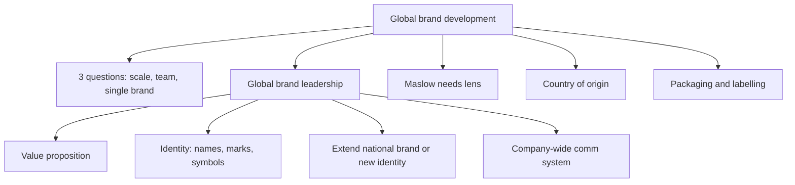

# MM-2: Global Brand Building, Needs, Country of Origin, Packaging and Labelling

Covers: the three questions before building a global brand, global brand leadership, Maslow's hierarchy as a lens on local vs global products, country of origin as a brand element, packaging and labelling rules. **(class)** unless tagged.

## Global brand development: three questions (class)
Management should ask before building a global brand:
1. Will the anticipated **scale economies** materialise?
2. How difficult will it be to develop a **global brand team**?
3. Can a **single brand** be imposed on all markets successfully?

## Global brand leadership (class)
Defined on the slide as using organisational structures, processes and cultures to **allocate brand-building resources globally, create global synergies and develop a global brand strategy** that coordinates and leverages country brand strategies. Four action points:
| Step | Action |
|---|---|
| 1 | Create a compelling **value proposition** |
| 2 | Review all elements of brand identity and select **names, marks and symbols** that can globalise |
| 3 | Research the alternatives: **extend a national brand** or **adopt a new brand identity globally** |
| 4 | Develop a **company-wide communication system** |
Memory hook: Value, Identity, Alternatives, Communication.

## Maslow's hierarchy: local vs global products, a needs-based approach (class)
The slide (titled "Local versus Global Products and Brands: A Needs-Based Approach") shows the pyramid: **physiological, safety, social, external/internal esteem, self-actualisation**. The learning outcome on slide 4 says it helps global marketers understand the **benefits sought by buyers in different parts of the world**.
Slides do not map products to levels. The mapping below is **(general)** and illustrative:
| Need level | Benefit sought | Brand implication **(general)** |
|---|---|---|
| Physiological | Food, water, basics | Local or adapted products fit local diets; price matters most |
| Safety | Health, security, reliability | Quality marks and trusted names reassure |
| Social | Belonging | Global brands that signal membership of a global community (youth brands) |
| Esteem | Status, recognition | Premium global brands, country-of-origin cues |
| Self-actualisation | Fulfilment, experiences | Experiential and lifestyle brands |
How to use it: the same product can answer different levels in different markets. A mobile phone is a safety and social tool in one market and an esteem signal in another, so positioning (communication) may need to change even when the product does not.

## Country of origin as a brand element (class)
- Perceptions of and attitudes toward a country often **extend to products and brands known to come from it**.
- Slide countries: Japan, Germany, France, Italy.
- Typical associations **(general)**: Japan, miniaturised electronics and reliability; Germany, engineering and precision; France, fashion, wine and perfume; Italy, design, food and fashion.
- It is a **brand element**: it can lift a brand (Swiss watches, German cars) or hurt it (a stereotype of poor quality). Consider it when choosing between extending a national brand and creating a new one.
- Tie to ChaiConnect (MM-1): India as origin may help premium tea if the "origin of tea" story is credible, and hurt if buyers associate India with low prices.

## Packaging (class)
Slide points:
- Packaging protects or contains the product during **shipping** (the slide ties it to consumer packaged goods).
- **Eco-packaging**: designers must address environmental issues.
- Packaging offers **communication cues** that give consumers a basis for the purchase decision.
Exam wording: packaging has a protective job (survives long transit, climate), a communication job (colour, language, claims) and an environmental job (recyclable, minimal). Climate and shelf-life **(general)** push exporters to rethink pack strength and size.

## Labelling (class)
Labels give consumers information, and **regulations differ by country**. Slide examples:
| Rule | Where | What it requires |
|---|---|---|
| Health warnings | Tobacco products | Mandatory warning on packs |
| American Automobile Labelling Act | United States | Country of origin and final assembly point on cars (general: also US/Canadian parts content %) |
| Genetically modified ingredient labels | European Union | Labels on all food products that include ingredients from genetically modified crops |
Exam use: labelling is a legal reason to adapt even a standardised product. Give two slide examples.

## Worked example: should a global brand extend the national brand? (exam layout)
Illustrative: a mid-sized Indian packaged-foods firm considers using its domestic brand in the EU and the US. No figures on the slides, so the decision is made by the slide's own questions.
| Step | Question | Likely answer |
|---|---|---|
| 1 | Scale economies? | Yes if one pack and one ad film cover both; weaken if each market needs new packs |
| 2 | Global brand team? | Needs people who can coordinate; cost and skill gap |
| 3 | Single brand on all markets? | Test name, mark and symbol for meaning abroad |
| 4 | Country of origin | Check whether "Made in India" helps for this category |
| 5 | Packaging and labelling | EU labelling of GM ingredients and ingredient lists; eco-packaging expectations |
| 6 | Alternatives | Extend national brand, or a new global identity (slide step 3) |
Decision line: extend the national brand only if the name and image survive the identity check and the label rules can be met cheaply. If not, create a new global identity.

## What to remember
- Three pre-launch questions: scale economies, global brand team, single brand across markets.
- Global brand leadership: value proposition, globalisable identity, extend vs new brand, company-wide communication.
- Maslow's five levels show that buyers in different regions seek different benefits.
- Country of origin transfers national perceptions to the brand: Japan, Germany, France, Italy.
- Packaging protects, communicates and must be eco-aware; labels vary by law (tobacco warnings, US auto act, EU GM food).

## Concept map

## Flashcards
Q: What three questions precede building a global brand?
A: Will scale economies materialise; how hard is it to build a global brand team; can a single brand be imposed on all markets.
Q: Define global brand leadership in one line.
A: Using structures, processes and cultures to allocate brand resources globally, create synergies and coordinate country brand strategies under a global strategy.
Q: List the four global brand leadership steps.
A: Compelling value proposition; globalisable names, marks and symbols; extend a national brand or adopt a new identity; company-wide communication system.
Q: What are the five levels of Maslow's hierarchy on the slide?
A: Physiological, safety, social, external/internal esteem, self-actualisation.
Q: Why does the Maslow lens matter to a global marketer?
A: It shows the benefits buyers seek differ by region, so the same product may need different positioning.
Q: What is country of origin as a brand element?
A: National perceptions that transfer to products from that country; slide countries are Japan, Germany, France and Italy.
Q: Name the three roles of packaging on the slide.
A: Protect or contain in shipping; address environmental issues (eco-packaging); give communication cues for purchase.
Q: Give three slide examples of country-specific labelling rules.
A: Health warnings on tobacco; American Automobile Labelling Act (country of origin and final assembly); EU labels on foods with genetically modified ingredients.
