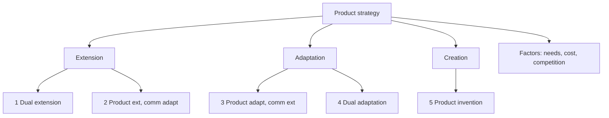

# MM-3: Global Product Planning, Extend, Adapt, Create

Covers: the three strategic alternatives, the five-strategy product by communication grid, the factors that decide the choice, and an exam-format selection. **(class)** unless tagged.

## Extend, Adapt, Create (class)
| Term | Meaning |
|---|---|
| **Extension** | Offer the product virtually unchanged in markets outside the home country |
| **Adaptation** | Change elements of design, function and packaging to suit each country market |
| **Creation** | Develop new products for the world market |
The slide also says firms balance the benefits of adaptation against the efficiency of standardisation, usually using a **mix** of both.

## The grid: product by communication (class)
Two choices, each either **same** or **different**: the product and the communication (promotion).
| | Product same | Product different |
|---|---|---|
| **Communication same** | **Strategy 1:** Dual Extension | **Strategy 3:** Product Adaptation, Communication Extension |
| **Communication different** | **Strategy 2:** Product Extension, Communication Adaptation | **Strategy 4:** Dual Adaptation |
Strategy 5 (Product Invention) sits outside the grid.

## The five strategies (class)
| No. | Strategy | Meaning | Slide example |
|---|---|---|---|
| 1 | **Product-Communication Extension** (dual extension) | Same product and same marketing across all markets | Pepsi |
| 2 | **Product Extension, Communication Adaptation** | Same product, communication adapted to local markets | Coca-Cola |
| 3 | **Product Adaptation, Communication Extension** | Product adapted to local preferences, communication consistent | McDonald's region-specific items such as the McAloo Tikki in India, same brand image |
| 4 | **Dual Adaptation** | Both product and communication changed | **Not described in the slide text.** Gap. **(general)** Different product and different message for each market, for example a local-taste product sold with a locally themed campaign. Choose when markets differ on both use and perception |
| 5 | **Product Invention (Innovation)** | Develop entirely new products to meet local needs | Procter & Gamble products created for emerging markets |
Gap note: the grid on the slide lists Strategy 4 as Dual Adaptation but the follow-up slides jump from 3 to 5. State Dual Adaptation with the **(general)** definition above if asked.

Note: Pepsi and Coca-Cola examples are the class labels. Real campaigns vary, so if challenged say "illustrative of the pattern".

## Factors influencing the strategy choice (class)
1. **Market needs**: the specific needs and preferences of each market.
2. **Cost considerations**: cost of adaptation against the benefit of standardisation.
3. **Competitive landscape**: local competition and market dynamics.
Add from MM-2 **(general link)**: law and labelling, country-of-origin image, climate and usage conditions.

## Product vs communication, a quick decision test
| Question | If yes | Then |
|---|---|---|
| Does the product meet the same need in the same way? | yes | Extend the product |
| Does the market understand the message the same way? | yes | Extend the communication |
| Product fits but message misfires (culture, language, law) | | Strategy 2 |
| Product needs changing but brand image works | | Strategy 3 |
| Neither works | | Strategy 4 or 5 |

## Worked example: ChaiConnect choice across three markets (exam layout)
Illustrative reasoning only; the opener supplies no data. Markets: Japan, Germany, US.
| Step | Content |
|---|---|
| 1. Identify unchanged core | Premium Indian tea, subscription convenience, craft and origin story |
| 2. Score each market on (A) product fit, (B) message fit | Japan: A low (taste standard), B medium. Germany: A medium (herbal and organic expectations), B high. US: A medium (ready-to-drink, sweet), B high. Scores are judgemental **(general)** |
| 3. Match to grid | Japan: Strategy 4 (adapt blend and message). Germany: Strategy 3 (adapt blend and label, keep brand message). US: Strategy 3 or 2 depending on convenience format |
| 4. Check cost and law | Adaptation cost per market; labelling (MM-2); import rules |
| 5. Decide sequence | Start with the market where Strategy 3 is enough, since it keeps scale economies |
Decision line: choose the least adaptive strategy that still fits local buyers, because every extra change costs scale economy and brand consistency. Name the assumption on which this rests.

## 5-mark skeleton: "Explain the strategic alternatives in global product planning"
Extension, adaptation, creation defined (1); the grid with five strategies (2); one example each for two or three strategies (1); factors: needs, cost, competition (1).

## What to remember
- Extend, adapt, create; usually a mix.
- Five strategies: dual extension (Pepsi), product extension and communication adaptation (Coca-Cola), product adaptation and communication extension (McDonald's McAloo Tikki), dual adaptation, product invention (P&G emerging-market products).
- Strategy 4 is missing from the slide text; define it as dual adaptation (general).
- Choice depends on market needs, cost and competition.
- Pick the lowest-adaptation strategy that still fits.

## Concept map

## Flashcards
Q: Define product extension, adaptation and creation.
A: Extension is offering the product virtually unchanged abroad; adaptation changes design, function or packaging by market; creation develops new products for the world market.
Q: What is Strategy 1 and the slide example?
A: Product-communication extension, same product and same marketing everywhere; Pepsi.
Q: What is Strategy 2 and the slide example?
A: Product extension with communication adaptation; same product, locally adapted communication; Coca-Cola.
Q: What is Strategy 3 and the slide example?
A: Product adaptation with communication extension; McDonald's region-specific items such as the McAloo Tikki in India under a consistent brand image.
Q: What is Strategy 4, and is it on the slide text?
A: Dual adaptation, changing both product and communication; the slide grid shows it but the text does not describe it (so define it from general knowledge).
Q: What is Strategy 5 and the slide example?
A: Product invention, developing entirely new products for local markets; P&G products created for emerging markets.
Q: Name the three factors influencing the strategy choice.
A: Market needs, cost considerations (adaptation cost against standardisation benefit) and competitive landscape.
Q: Why do firms usually mix standardisation and adaptation?
A: Pure standardisation ignores local needs and law, pure adaptation loses scale economies, so a mix optimises resources.
